# Depreciação e exportação para contabilidade

!!! info "Informações do procedimento"

    **Status editorial:** Em revisão · **Última revisão:** 14/07/2026 · **Sistemas envolvidos:** SBP

<button type="button" class="md-button checklist-print-button" aria-label="Imprimir ou salvar este procedimento como PDF">Imprimir</button>
<button type="button" class="md-button checklist-clear-button" aria-label="Limpar progresso do checklist deste procedimento">Limpar checklist</button>

Marcações salvas só neste navegador. Elas não constituem registro oficial nem histórico auditável.

## Objetivo

Encerrar a competência corrente no SBP, executar a rotina de depreciação dos bens patrimoniais ativos e exportar os lançamentos contábeis sintéticos para importação pelo departamento contábil.

## Pré-requisitos

Antes de iniciar, verifique se você possui:

- [ ] Acesso ao **SBP** com perfil que permita executar fechamento de mês, depreciação e exportação de lançamentos.
- [ ] Confirmação de que todas as movimentações patrimoniais do mês (entradas, baixas e transferências) foram concluídas.
- [ ] Alinhamento prévio com o departamento contábil sobre a data de exportação e a janela de importação dos lançamentos.

!!! danger "Perigo"

    O fechamento do mês é uma operação de efeito **retroativo e restritivo**. Após confirmado, nenhuma movimentação patrimonial poderá ser lançada em competências iguais ou anteriores à do mês fechado, salvo reabertura formal. Certifique-se de que não há pendências antes de avançar.

## Passos

1. **Acesse a rotina de fechamento de mês**

    No SBP, acesse o menu **Fechamento de Mês** e, em seguida, a opção **Fechamento**.

    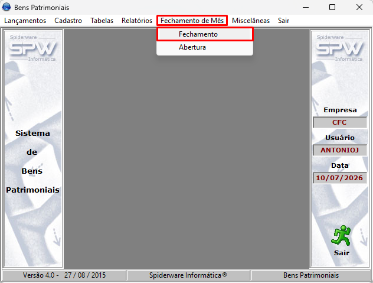

2. **Verifique o mês aberto e o mês fechado**

    O sistema apresenta duas informações de referência: o **mês aberto**, no qual ainda é possível registrar entradas, baixas e demais movimentações; e o **mês fechado**, encerrado para novas movimentações.

    Após conferir as competências, clique em **Fechar Mês**.

    !!! tip "Dica"

        Meses fechados podem, eventualmente, ser reabertos caso o sistema permita a operação e o perfil do usuário autorize a reabertura. Trate a reabertura como exceção, não como rotina.

    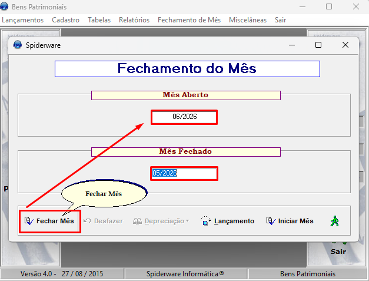

3. **Analise a mensagem de confirmação**

    O sistema apresentará uma mensagem de confirmação do fechamento. Leia atentamente antes de prosseguir.

    !!! danger "Perigo"

        Ao confirmar, **nenhuma competência anterior ou igual ao mês fechado poderá ser atualizada**. A reabertura, quando permitida, é procedimento excepcional e não deve ser tratada como rotina operacional.

    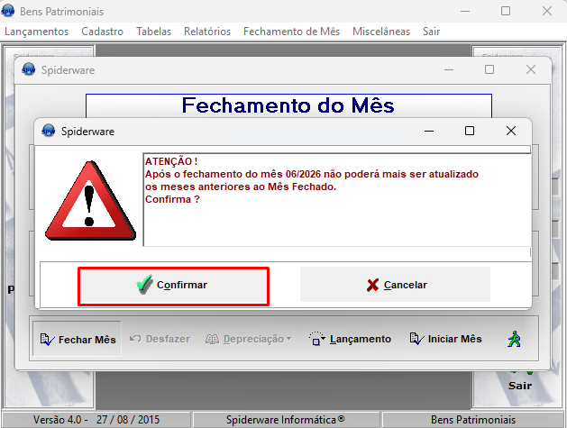

4. **Confirme o fechamento**

    Clique em **OK** para efetivar o fechamento da competência.

    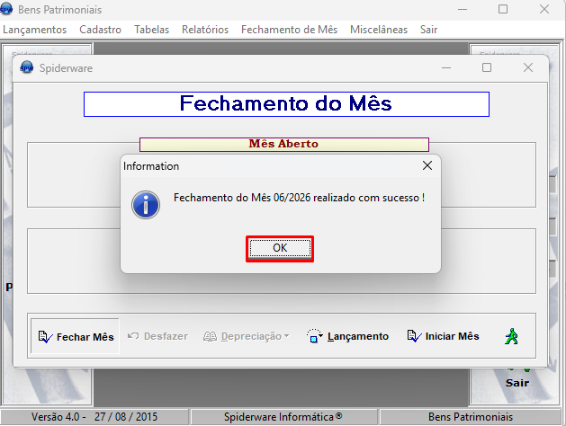

5. **Acione a rotina de depreciação**

    Acesse o menu **Depreciação** e clique em **Executar Depreciação do Mês**.

    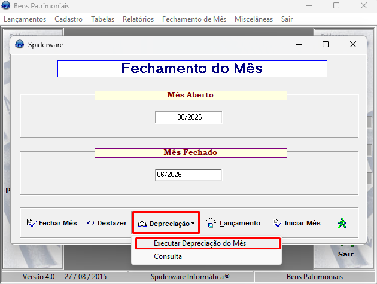

6. **Confirme a execução da depreciação**

    Clique em **Confirmar** para iniciar o processamento.

    !!! warning "Cuidado"

        Esta rotina calcula e aplica a depreciação de todos os bens ativos referente à competência fechada. A operação é irreversível dentro do mês corrente.

    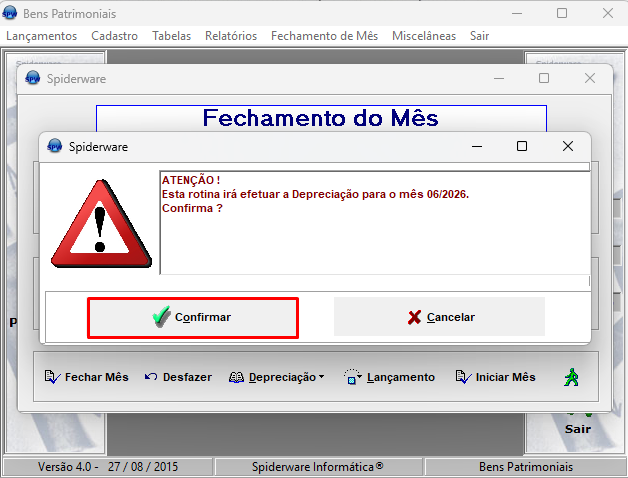

7. **Aguarde a conclusão do processamento**

    Ao término, clique em **OK** na mensagem de confirmação.

    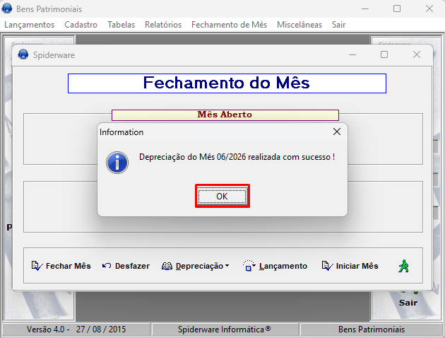

8. **Consulte o valor depreciado por bem**

    O sistema apresentará o **valor da depreciação de cada bem** processado na competência. Após a verificação, clique em **Sair**.

    !!! note "Nota"

        Este relatório tem finalidade exclusivamente **conferencial**. Nenhuma ação adicional é necessária nesta tela.

    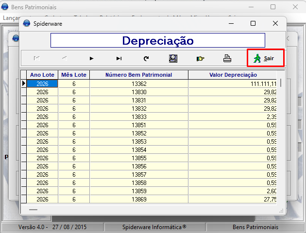

9. **Acesse a exportação de lançamentos**

    Clique em **Exportar Lançamento**.

    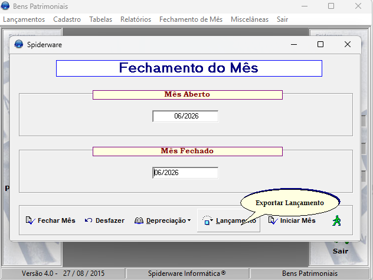

10. **Selecione o lançamento contábil para exportação**

    Acesse **Lançamento Contábil** e clique em **Exportar**.

    !!! note "Nota"

        Os lançamentos gerados pelo SBP são **analíticos** e ainda não estão registrados na contabilidade. Após a exportação, os débitos e créditos das contas patrimoniais ficam disponíveis para importação pelo departamento contábil no sistema contábil corporativo.

    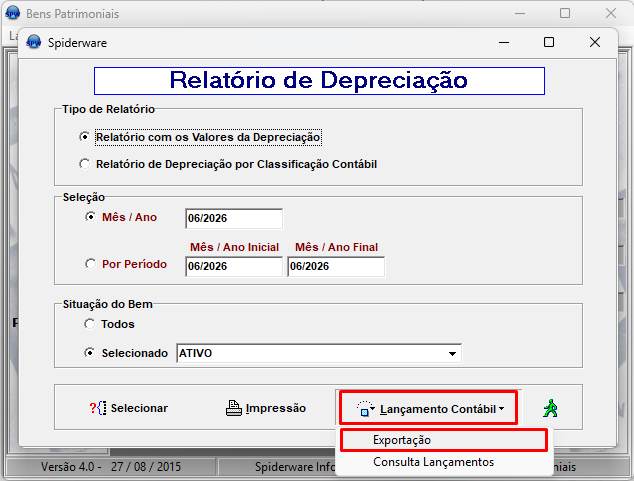

11. **Preencha os parâmetros de exportação**

    O sistema exibirá uma tela para confirmação da exportação e definição dos parâmetros de importação pela contabilidade.

    - No campo **Dt. Lançamento**, informe a data em que a exportação está sendo realizada.
    - Verifique a **identificação do lançamento**.
    - Clique em **Confirmar**.

    !!! warning "Cuidado"

        A data de lançamento e a identificação são os parâmetros usados pelo departamento contábil para conciliar a importação. Erros neste passo geram divergências entre o SBP e o sistema contábil.

    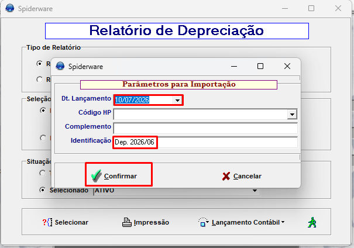

12. **Confirme a mensagem do sistema**

    Clique em **OK** para confirmar a exportação.

    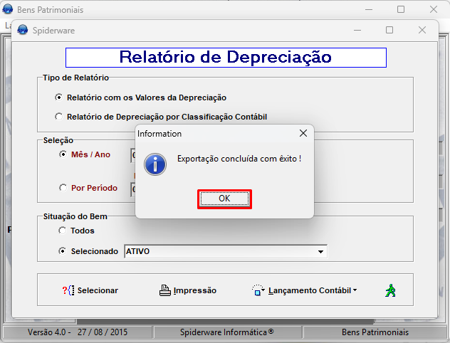

13. **Encerre a rotina e valide o resumo sintético**

    Clique em **Sair**. Nesta tela final será apresentado o **valor sintético do lançamento**, com **partida e contrapartida**, **débito e crédito**.

    !!! tip "Dica"

        Este é o resumo que o departamento contábil registrará ao importar o arquivo no sistema contábil corporativo. Recomenda-se salvar ou imprimir esta tela para conferência posterior.

    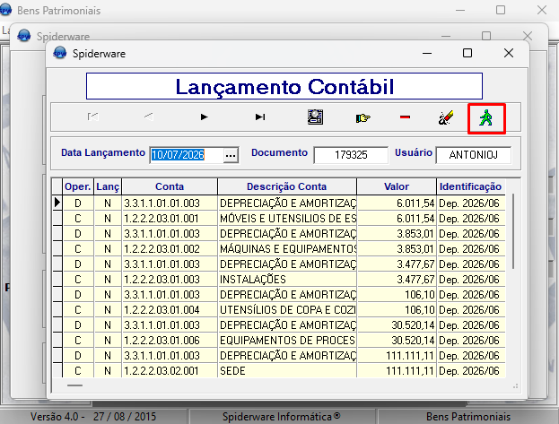

14. **Acesse o módulo de relatórios estatísticos**

    Clique em **Relatórios** e, em seguida, em **Estatístico**.

    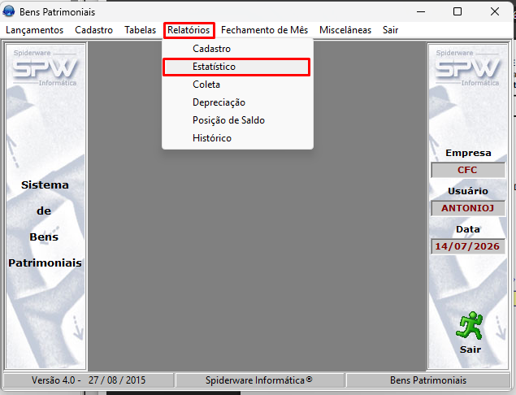

15. **Gere o relatório por classificação contábil**

    No campo estatístico, selecione **Classificação Contábil** e clique em **Impressão**.

    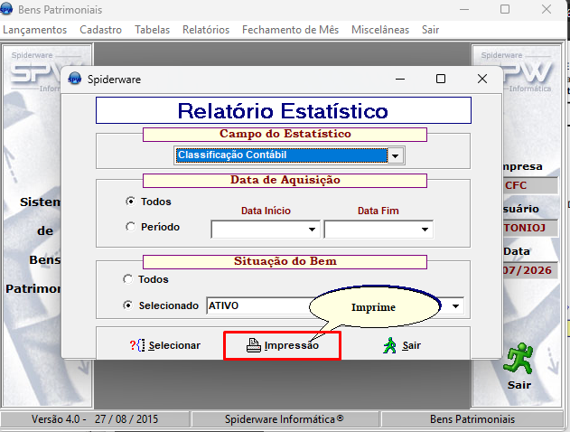

16. **Direcione a impressão para o PDF reDirect v2**

    Na caixa de diálogo de impressão, selecione a impressora virtual **PDF reDirect v2** e clique em **OK**.

    !!! note "Nota"

        O uso do **PDF reDirect v2** é obrigatório neste procedimento porque permite mesclar múltiplos relatórios em um único arquivo PDF, consolidando toda a documentação da competência.

    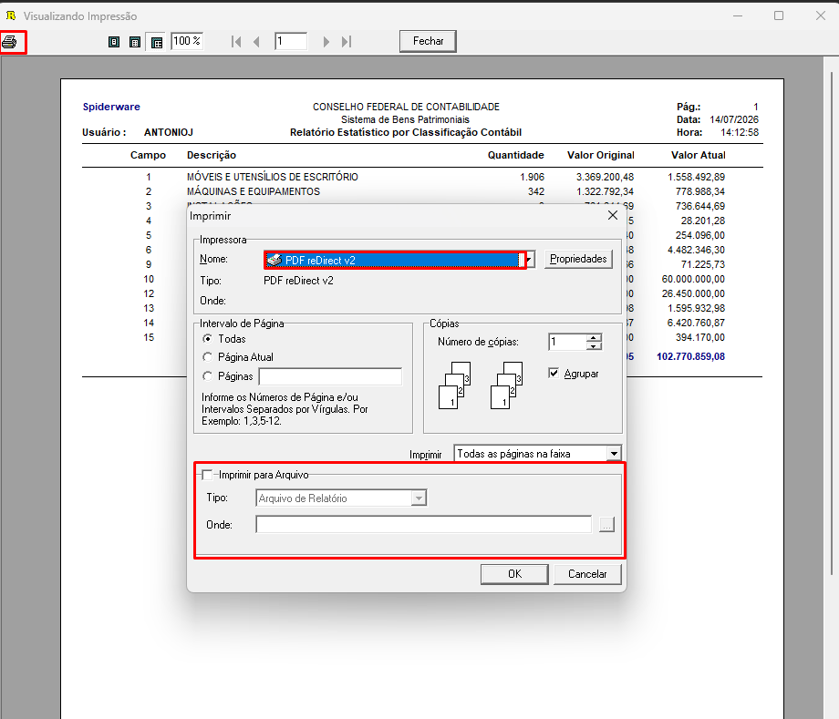

17. **Configure o destino e a nomenclatura do arquivo**

    O aplicativo **PDF reDirect v2** será aberto. No **gerenciador de pastas**, navegue até `j:\colog\sepat\2026\SBP`. Em **Conteúdo da pasta**, observe o padrão de nomenclatura `XX_SBP_MES.pdf` — por exemplo, `01_SBP_JAN.pdf`. Renomeie o arquivo de acordo com o mês que está sendo fechado.

    !!! warning "Cuidado"

        **Não feche o PDF reDirect v2** ao final desta etapa. A janela deve permanecer aberta até a conclusão da impressão dos demais relatórios (passos 18 a 22), para que todos sejam consolidados no mesmo arquivo.

    !!! tip "Dica"

        A nomenclatura `XX_SBP_MES.pdf` segue o padrão do setor: `XX` corresponde ao número sequencial do mês e `MES` à abreviação de três letras (JAN, FEV, MAR, etc.). Respeite o padrão para preservar a ordenação cronológica dos arquivos na pasta.

    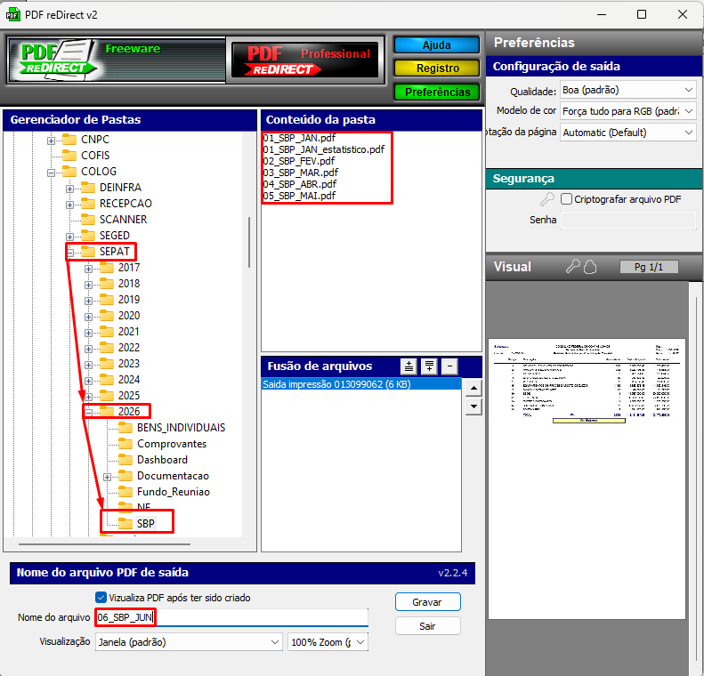

18. **Acesse o relatório de depreciação analítico**

    No SBP, clique em **Relatórios** e depois em **Depreciação**.

    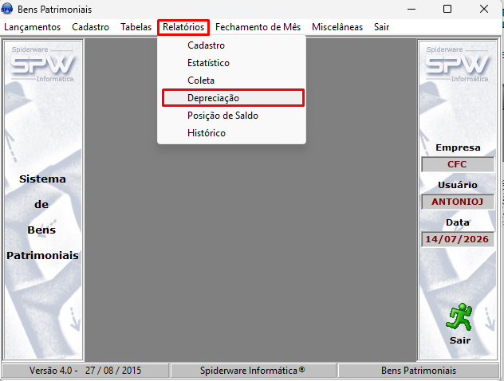

19. **Selecione o relatório com os valores de depreciação**

    No campo **Tipo de Relatório**, selecione **Relatório com os Valores de Depreciação** e clique em **Impressão**.

    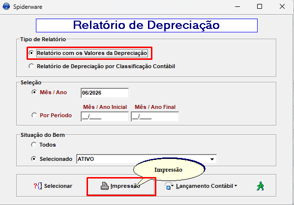

20. **Envie o relatório analítico para o PDF reDirect v2**

    Clique no ícone da **impressora** para enviar o relatório à impressora virtual.

    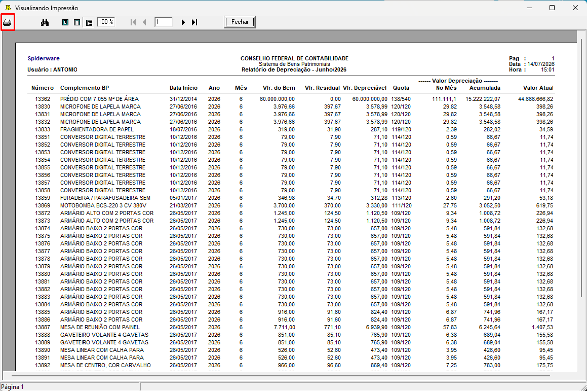

21. **Selecione o relatório por classificação contábil**

    Novamente, clique em **Relatórios**, **Depreciação** e, no campo **Tipo de Relatório**, selecione **Relatório de Depreciação por Classificação Contábil**. Clique em **Impressão**.

    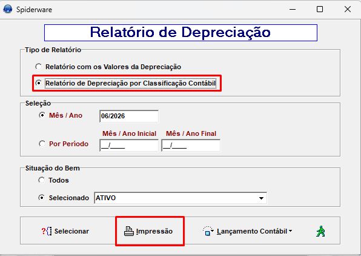

22. **Envie o relatório por classificação contábil para o PDF reDirect v2**

    Clique no ícone da **impressora** para enviar o segundo relatório de depreciação à impressora virtual.

    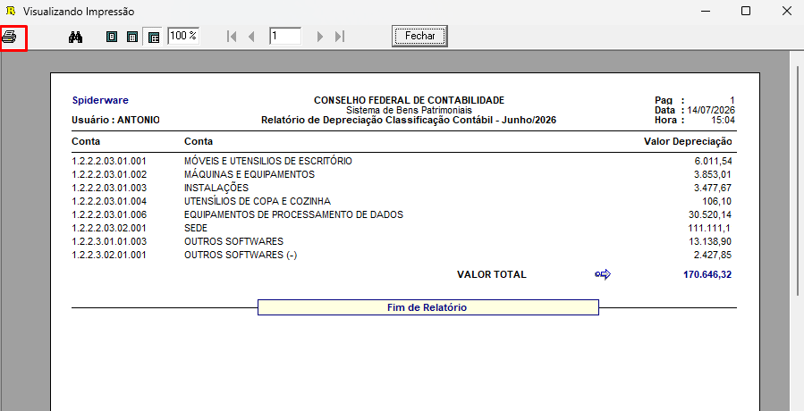

23. **Consolide e grave o PDF final**

    O **PDF reDirect v2** será exibido novamente. Verifique que os **três relatórios** estão listados na área **Fusão de arquivos**.

    !!! warning "Cuidado"

        Antes de gravar, confirme que os **três relatórios** constam na área de fusão:

        - Relatório **estatístico por Classificação Contábil** (passo 15).
        - Relatório de **Depreciação — Valores** (analítico, passo 19).
        - Relatório de **Depreciação por Classificação Contábil** (passo 21).

        A ausência de qualquer um dos relatórios compromete a integridade documental da competência.

    Após a verificação, clique em **Gravar** para consolidar os três relatórios em um único arquivo PDF na pasta `j:\colog\sepat\2026\SBP`.

    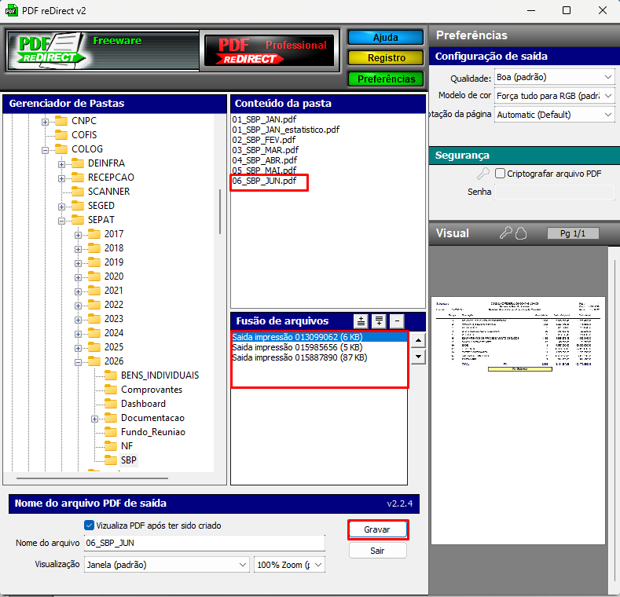

## Resultado esperado

Ao concluir este procedimento você terá:

- Competência mensal encerrada no SBP.
- Depreciação processada e aplicada a todos os bens ativos da competência.
- Arquivo de lançamento contábil exportado e disponível para importação pelo departamento contábil.

**Como confirmar:** No SBP, verifique se o mês anteriormente aberto passou a constar como **mês fechado** e se o relatório de depreciação apresenta valores para os bens ativos. Confirme com o departamento contábil o recebimento e a importação do arquivo exportado.

## Referências

- Manual do SBP — disponível no portal interno do setor.
- Lei n.º 4.320/1964, arts. 94 a 96 — disposições gerais sobre controle patrimonial.
- NBC T 16.9 — Depreciação, Amortização e Exaustão no setor público.
- Manual de Contabilidade Aplicada ao Setor Público (MCASP) — Secretaria do Tesouro Nacional.
