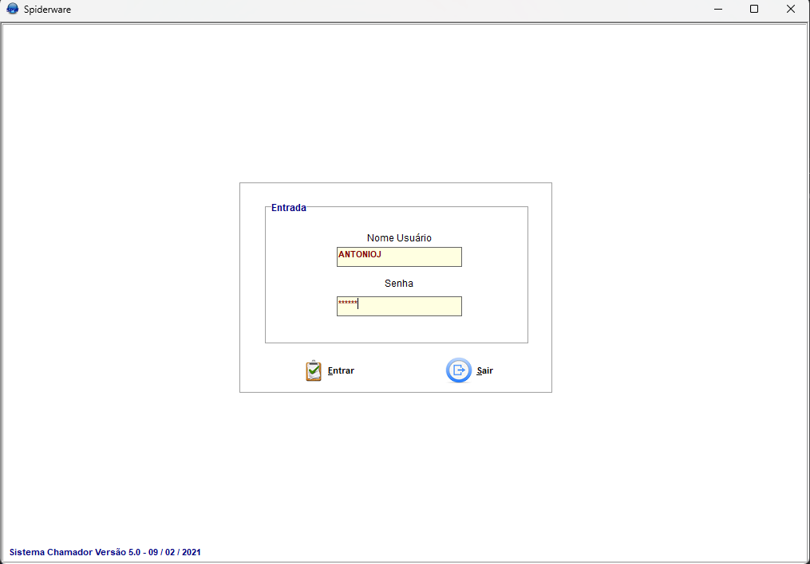
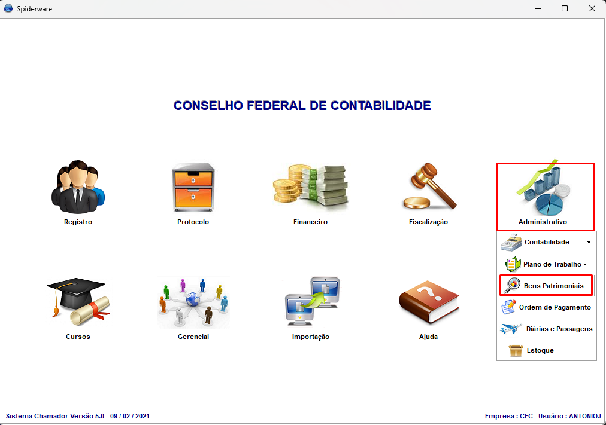
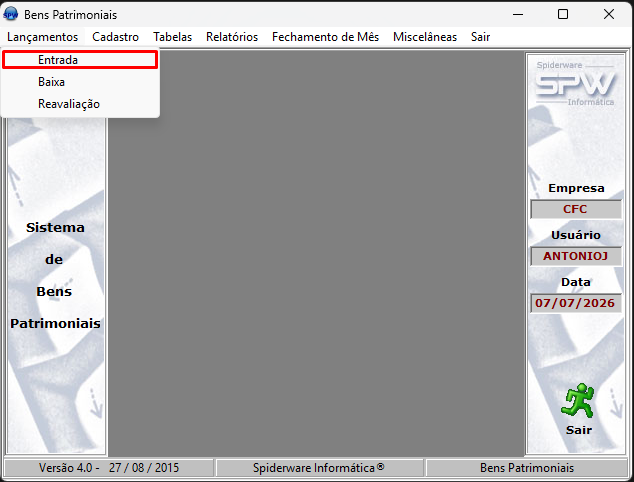
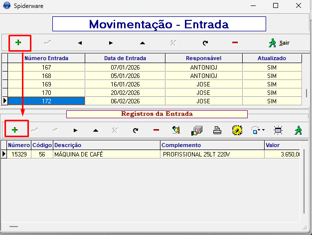
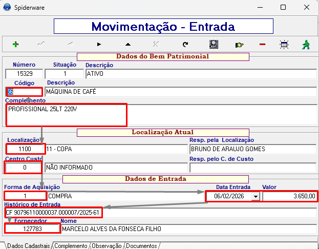
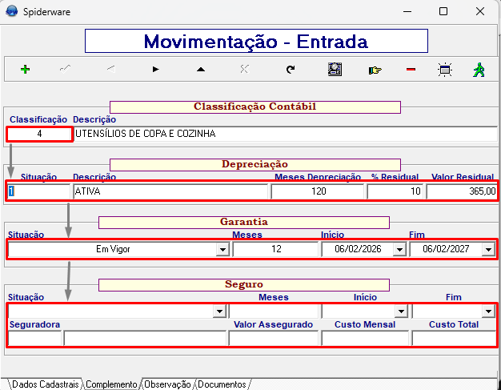
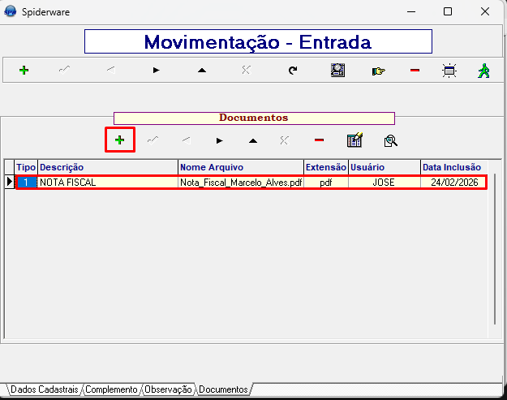
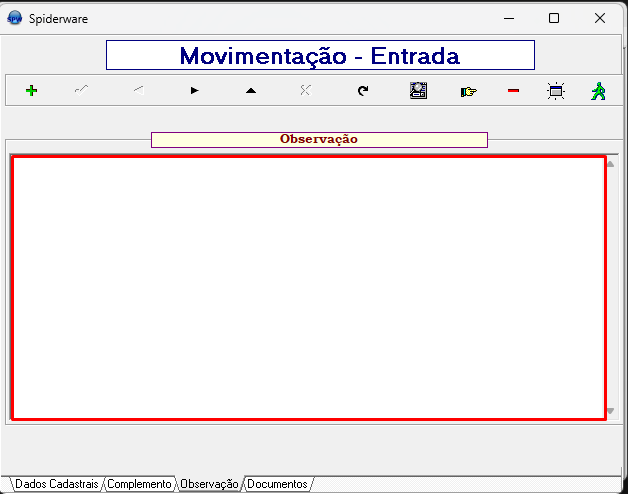
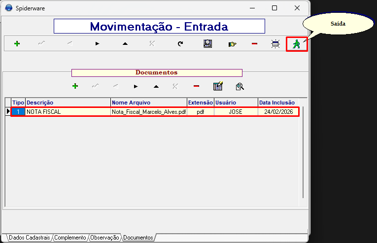
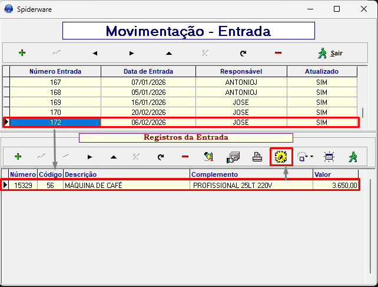

# Incorporar bem ao patrimônio

!!! info "Informações do procedimento"

    **Status editorial:** Em revisão · **Última revisão:** 25/06/2026 · **Sistemas envolvidos:** SBP, SEI

<button type="button" class="md-button checklist-print-button" aria-label="Imprimir ou salvar este procedimento como PDF">Imprimir</button>
<button type="button" class="md-button checklist-clear-button" aria-label="Limpar progresso do checklist deste procedimento">Limpar checklist</button>

Marcações salvas só neste navegador. Elas não constituem registro oficial nem histórico auditável.

## Objetivo

Registrar um bem móvel adquirido por compra no SBP, gerando o número de tombamento e o Termo de Responsabilidade para assinatura do responsável pela unidade.

## Pré-requisitos

Antes de iniciar, verifique se você possui:

- [ ] Acesso ao sistema **SBP** com perfil de **Registrador de Bens**.
- [ ] Nota fiscal ou documento equivalente que comprove a aquisição.
- [ ] Número do processo **SEI** de aquisição (se aplicável).
- [ ] Aprovação do responsável pelo setor para realizar o registro.

!!! warning "Cuidado"

    Se você não tiver o perfil adequado no sistema, não avance. Solicite o acesso ao setor de TI antes de iniciar o procedimento.

## Passos

1. **Acesse o sistema**

    Insira seu nome de usuário e senha na tela de login e clique no botão **Entrar**.

    

2. **Acesse o módulo de bens**

    No menu principal, clique no ícone **Administrativo** e selecione **Bens Patrimoniais**.

    

3. **Inicie o lançamento**

    No menu superior da janela, clique em **Lançamentos** e escolha a opção **Entrada**.

    

4. **Adicione a nova entrada e o item**

    Clique no botão verde **+** na parte superior da tela para criar a entrada. Em seguida, clique no outro botão **+**, localizado na seção **Registros da Entrada**, para adicionar o bem.

    

5. **Preencha os dados cadastrais**

    Na aba principal, informe os dados do bem patrimonial, preenchendo campos como **Código**, **Complemento**, **Localização**, **Histórico** e **Fornecedor**.

    

    !!! note "Nota"

        O campo <strong>Complemento</strong> deve conter informações suficientes para identificação do bem, como marca, modelo, número de série e características relevantes.

6. **Preencha os complementos**

    Clique na aba **Complemento**, localizada na parte inferior da tela, e insira as informações de **Classificação Contábil**, **Depreciação**, **Garantia** e **Seguro**, quando aplicável.

    

7. **Anexe os documentos**

    Vá para a aba **Documentos** e clique no botão **+** para adicionar a Nota Fiscal ou documento equivalente.

    

    !!! tip "Dica"

        Use a aba <strong>Observação</strong> para registrar informações complementares relevantes, como número do processo SEI, justificativas ou detalhes não contemplados nos campos principais.

8. **Edite o campo Observação, se necessário**

    Clique na aba **Observação**, na parte inferior da tela do SBP, para selecionar o campo observação.

    

9. **Volte para a tela principal**

    Clique no botão **Sair**, identificado pelo ícone verde de uma pessoa no canto superior direito, para retornar à tela de movimentação.

    

10. **Confirme a operação**

    Selecione o item incluído na lista inferior e clique no botão amarelo de engrenagem para confirmar e finalizar o lançamento.

    

## Resultado esperado

Ao concluir este procedimento você terá:

- Bem registrado no SBP com número de tombamento único.

**Como confirmar:** Acesse **Lançamentos → Entrada**, ou acesse cadastro e digite F7 informe o número de tombamento recebido e verifique se os dados do bem aparecem corretamente.

## Referências

- Manual do SBP — disponível no portal interno do setor.
- Instrução Normativa SEGES/ME n.º 205/1988 — orientações sobre material permanente.
- Processo SEI de aquisição relacionado (número variável por caso).
