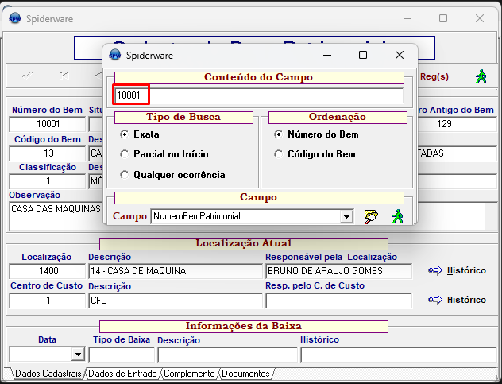
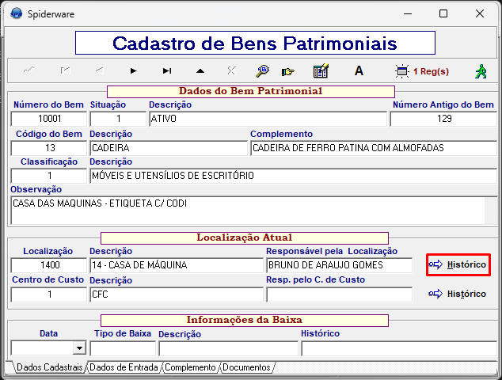
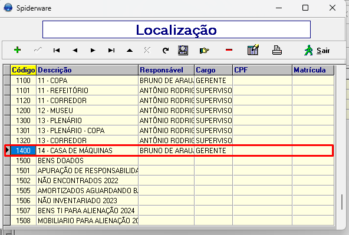
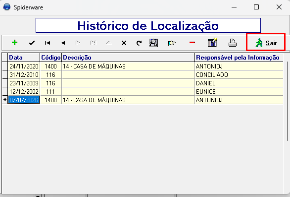

# Movimentação e transferência de bens patrimoniais

!!! info "Informações do procedimento"

    **Status editorial:** Em revisão · **Última revisão:** 07/07/2026 · **Sistemas envolvidos:** SBP, SEI

<button type="button" class="md-button checklist-print-button" aria-label="Imprimir ou salvar este procedimento como PDF">Imprimir</button>
<button type="button" class="md-button checklist-clear-button" aria-label="Limpar progresso do checklist deste procedimento">Limpar checklist</button>

Marcações salvas só neste navegador. Elas não constituem registro oficial nem histórico auditável.

## Objetivo

Registrar no SBP a movimentação e transferência de localização de um bem patrimonial entre unidades, atualizando o histórico de localização do bem para refletir o novo setor de destino.

## Pré-requisitos

Antes de iniciar, verifique se você possui:

- [ ] Acesso ao sistema **SBP** com perfil que permita movimentação de bens.
- [ ] Número de tombamento do bem patrimonial a ser movimentado.
- [ ] Identificação do setor/localidade de destino da transferência (código ou nome).
- [ ] Aprovação do responsável pelo setor de destino, quando aplicável.

!!! warning "Cuidado"

    Se você não tiver o perfil adequado no sistema, não avance. Solicite o acesso ao setor de TI antes de iniciar o procedimento.

## Passos

1. **Acesse o cadastro do bem**

    No chamador SPW, acesse o SBP, clique em **Cadastro**, pressione **F7** e digite o número de tombamento do bem patrimonial a ser movimentado.

    

2. **Abra o histórico de localização**

    Com o bem localizado, clique em **Histórico** para acessar o histórico de localização do bem.

    

3. **Selecione o setor de destino**

    Informe o código da localidade para onde o bem está sendo transferido ou clique duas vezes sobre o campo para abrir a lista de localidades disponíveis e selecione o setor de destino.

    !!! tip "Dica"

        Se já souber o código da localidade, digite-o diretamente. Caso contrário, use a lista para localizar o setor pelo nome.

    

4. **Confirme a nova localização**

    Após selecionar o local de destino, o novo setor aparecerá registrado no histórico de localização do bem e clique em **Sair**.

    

5. **Repita para os demais bens**

    Caso precise alterar a localização de mais de um bem, repita os passos 1 a 4 para cada bem patrimonial.

    !!! danger "Perigo"

        Toda a movimentação de bem deve ser procedida da emissão do Termo de Responsabilidade, para que a nova localização reflita as alterações no SEI!

6. **Acesse o procedimento Termos de Responsabilidade**

    Siga para o procedimento [Termos de Responsabilidade](../../termos-relatorios/termos-responsabilidade/index.md) - fluxo necessário para emissão do termo de responsabilidade.

## Resultado esperado

Ao concluir este procedimento você terá:

- Bem com a localização atualizada no SBP, refletindo o novo setor de destino.

**Como confirmar:** Acesse o cadastro do bem (**F7**, informando o número de tombamento) e verifique se o novo local aparece no histórico de localização.

## Referências

- Manual do SBP — disponível no portal interno do setor.
- Lei n.º 4.320/1964, arts. 94 a 96 — disposições gerais sobre controle patrimonial.
- [Abrir processo SEI patrimonial](../../processos-sei/index.md) — processo SEI necessário para formalizar a movimentação.
