# Administração

!!! info "Informações do procedimento"

    **Status editorial:** Em revisão · **Última revisão:** 22/10/2026 · **Sistemas envolvidos:** Sistema de Patrimônio

<button type="button" class="md-button checklist-print-button" aria-label="Imprimir ou salvar este procedimento como PDF">Imprimir</button>
<button type="button" class="md-button checklist-clear-button" aria-label="Limpar progresso do checklist deste procedimento">Limpar checklist</button>

Marcações salvas só neste navegador. Elas não constituem registro oficial nem histórico auditável.

## Objetivo

- Conduzir os **inventários**: criar o evento com a comissão e as salas, abrir e fechar a leitura, finalizar
  e, se preciso, excluir.
- Manter os **usuários** e as suas funções.

## Quem pode

Só o **Administrador** (menu **Administração**, com as abas Inventários e Usuários).

## Antes de começar

- [ ] Ter a portaria (ou outro ato) que designa a comissão do inventário.
- [ ] Os integrantes da comissão já têm usuário no sistema (crie em [Usuários](#usuarios), se preciso).
- [ ] A base de bens está atualizada (o inventário confere contra ela).

## Inventários

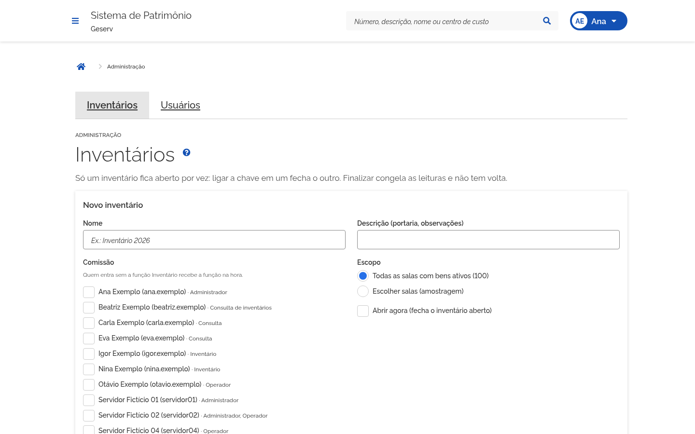

!!! note "Regras do inventário"

    - **Só um inventário fica aberto por vez**: abrir um fecha o outro automaticamente.
    - **Fechado** suspende a leitura (consulta continua liberada) e pode ser reaberto.
    - **Finalizar** congela leituras, números e o retrato dos bens. **Não tem volta.**

### Criar um inventário

1. **Preencha o nome e a descrição (portaria, observações) e marque os integrantes da comissão**

    Pode entrar qualquer usuário ativo; quem não tem a função Inventário a recebe na hora.

    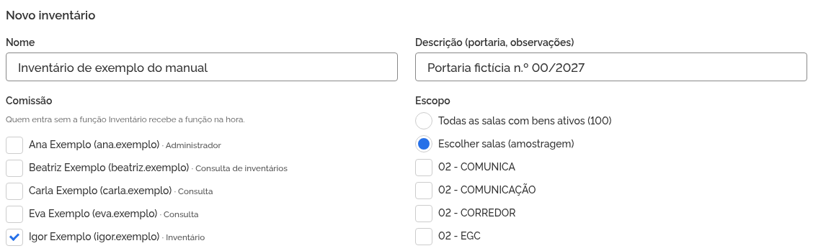

2. **Escolha o escopo**

    - **Todas as salas com bens ativos** (inventário geral), ou
    - **Escolher salas (amostragem)** — e marque as salas.

    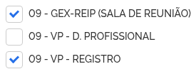

3. **Marque Abrir agora** se a leitura já pode começar (senão, o inventário nasce fechado)

    Se houver outro inventário aberto, ele será fechado.

    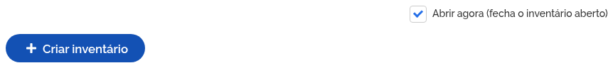

4. **Clique em Criar inventário**

    Aparece *Inventário … aberto.* (ou *criado fechado*). O evento entra na lista, no menu Inventário e no
    Início.

    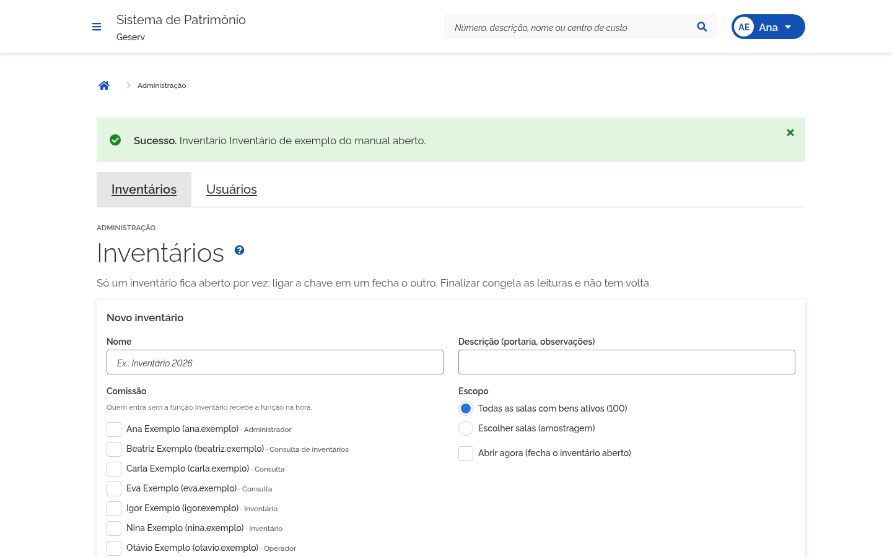

### Ajustar a comissão

1. **Na linha do inventário, clique no ícone de pessoas (Comissão)**

2. **Marque ou desmarque os usuários e clique em Salvar comissão**

    Quem sai deixa de ler; as leituras já feitas ficam. O sistema avisa quem já tem leituras no evento. A
    comissão só pode ser alterada enquanto o inventário não estiver finalizado.

    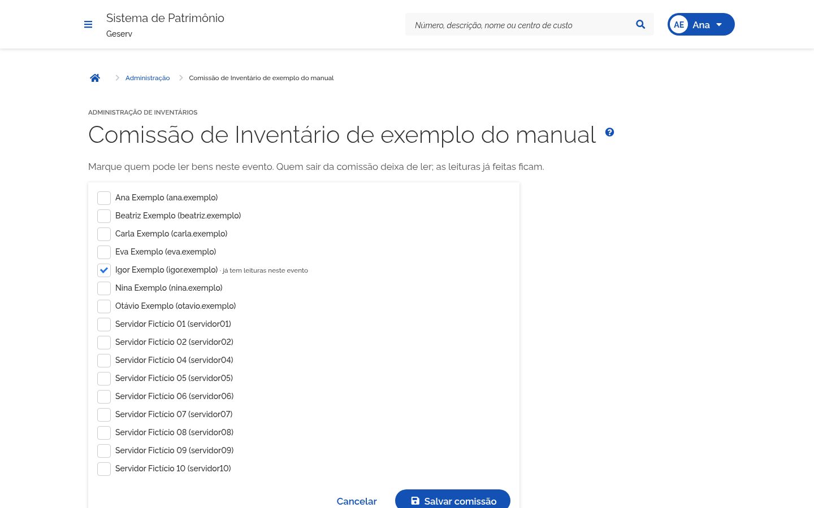

### Fechar, reabrir e finalizar

1. **Para suspender a leitura, clique em Fechar**

    O estado passa a **fechado** e as salas mostram *Inventário fechado*.

    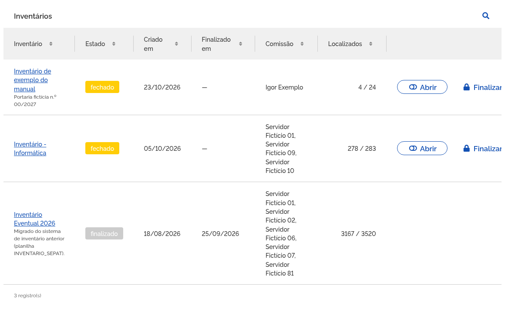

    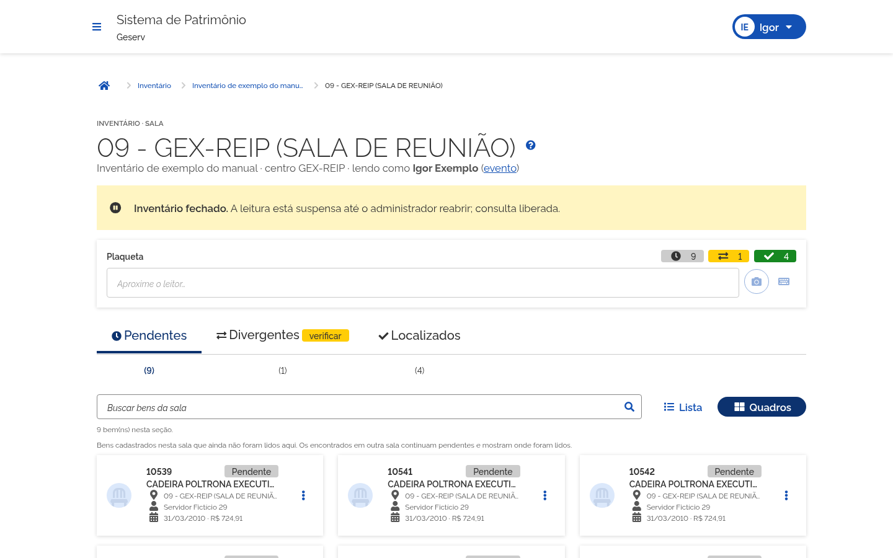

2. **Para retomar, clique em Abrir** (o que estiver aberto é fechado)

    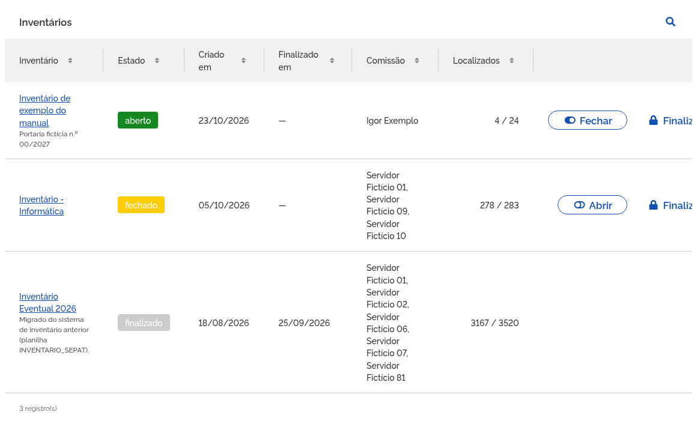

3. **Para encerrar de vez, clique em Finalizar e depois em Confirmar finalização**

    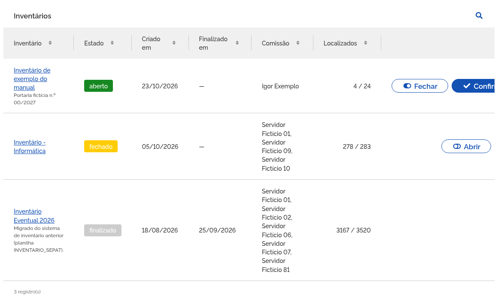

    Aparece *Inventário finalizado. As leituras ficam congeladas; relatório e planilha continuam
    disponíveis.*

    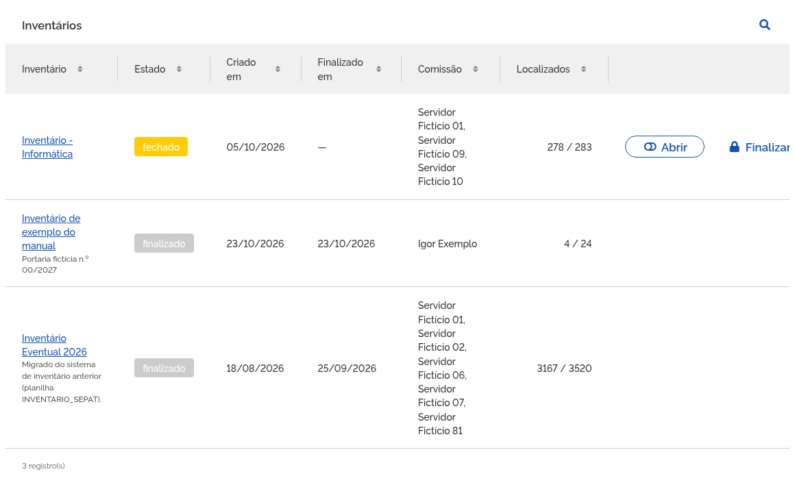

!!! danger "Perigo"

    Finalizar é **definitivo**: não há como reabrir para novas leituras. Confira o Painel e o Relatório
    antes.

### Excluir um inventário

1. **Clique na lixeira vermelha da linha**

    A tela lista tudo o que será apagado (leituras, fotos, sobras, comissão, salas, retrato dos bens).

2. **Digite o nome exato do evento e clique em Excluir definitivamente**

    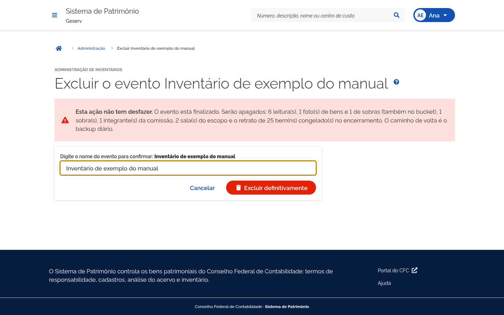

    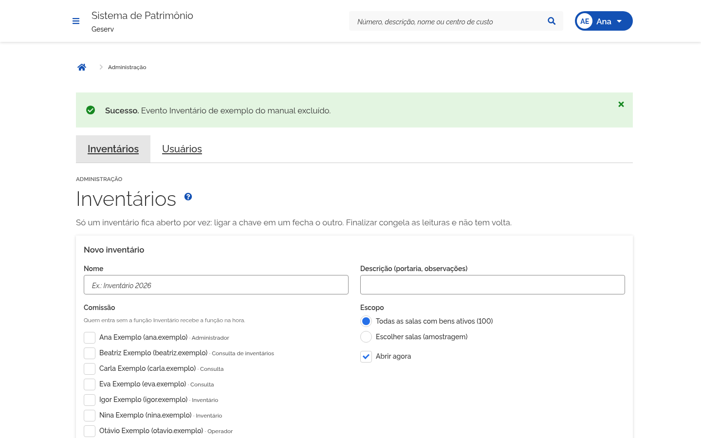

!!! danger "Perigo"

    A exclusão **não tem desfazer**: o caminho de volta é o backup diário. As fotos do evento também são
    apagadas.

## Usuários

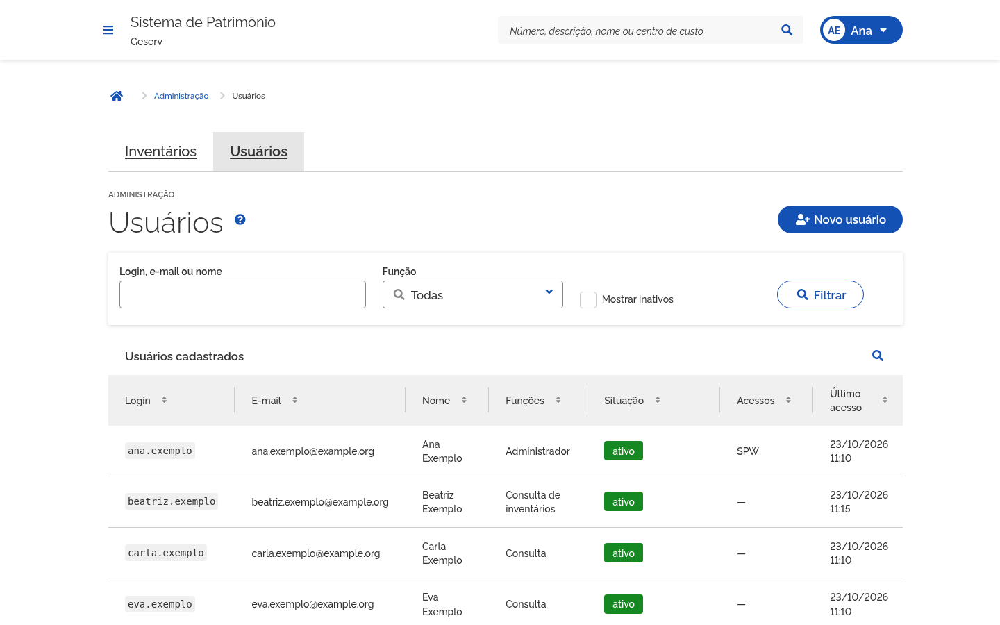

1. **Clique em Novo usuário e preencha**

    - **Login**: minúsculas, números, ponto, hífen ou sublinhado, de 2 a 30 caracteres — **não muda depois**;
    - **E-mail** (opcional, único — também serve para entrar);
    - **Nome** — aparece no cabeçalho e nas leituras do inventário;
    - **Funções** — marque só as necessárias (elas se somam; veja a [tabela](index.md#quem-usa-e-o-que-cada-um-pode-fazer));
    - **Senha inicial** e a repetição, e **Obrigar troca de senha no primeiro acesso**.

    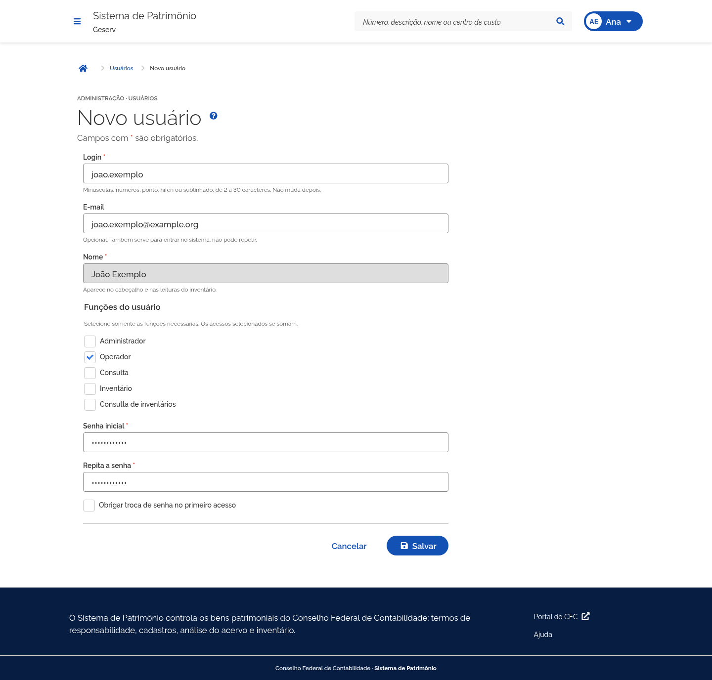

2. **Clique em Salvar**

    Aparece *Usuário … criado.* Informe o login e a senha inicial à pessoa por um canal seguro.

    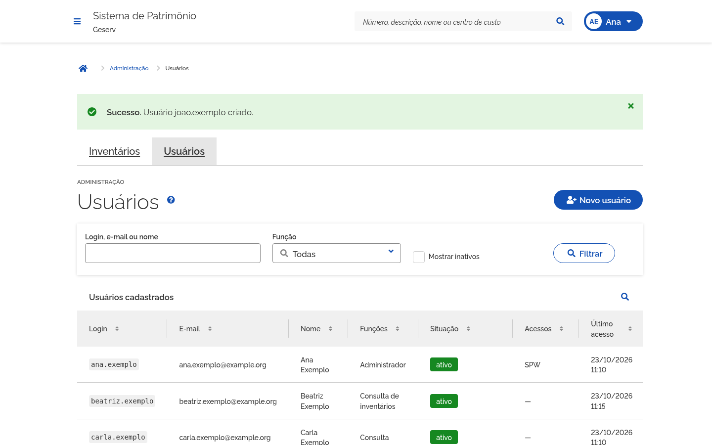

3. **Para alterar, clique no lápis da linha**

    Mude e-mail, nome, funções ou **Ativo**. Usuários **não são excluídos**: desmarque Ativo para inativar.

    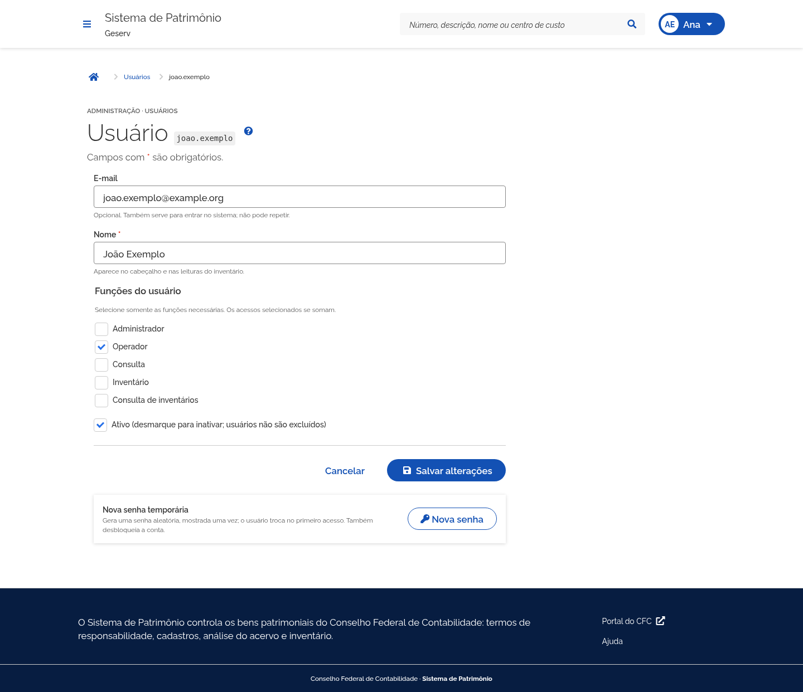

4. **Se a pessoa esqueceu a senha (ou foi bloqueada), clique em Nova senha**

    O sistema gera uma senha temporária e **mostra uma única vez**. Anote e passe à pessoa; ela terá de
    trocar no primeiro acesso. A nova senha também desbloqueia a conta.

    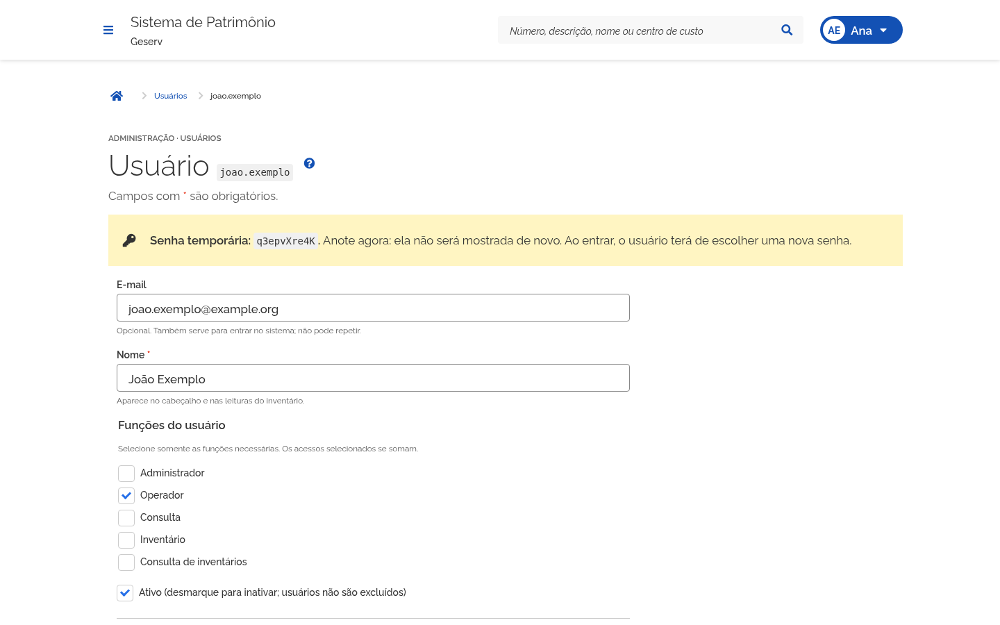

5. **Use os filtros para encontrar usuários**

    Por login, e-mail ou nome, por função e, com **Mostrar inativos**, também os inativos. A coluna
    **Acessos** mostra se o usuário cadastrou acesso ao SEI/SPW; o botão de apagar acessos remove esses
    acessos (a senha nunca é mostrada).

    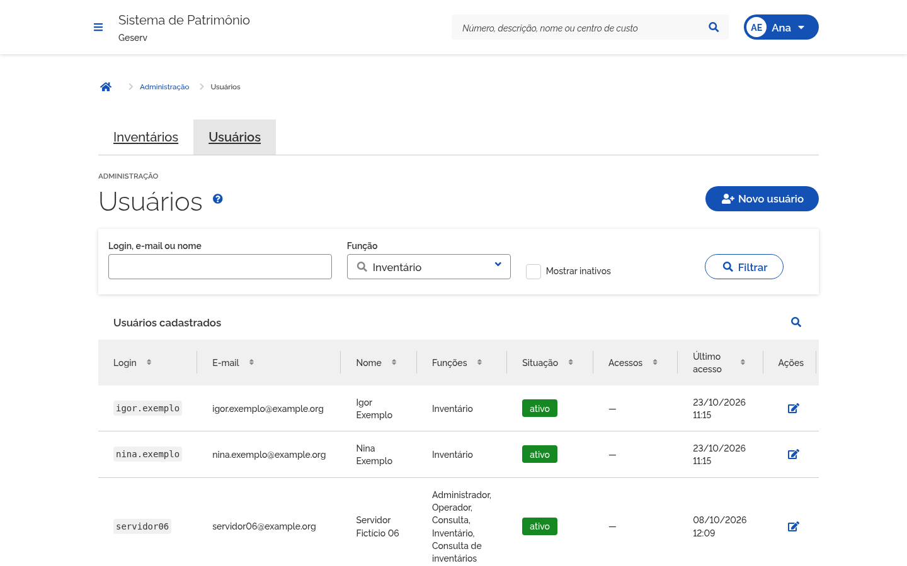

## O que acontece depois / onde confere

- O inventário aparece no Início, no menu Inventário e para os integrantes da comissão.
- O usuário consegue entrar com o login e a senha informados e vê o menu das funções marcadas.

## Erros comuns e mensagens

| Mensagem | O que fazer |
|---|---|
| *Selecione ao menos um usuário ativo.* | Marque pelo menos um integrante na comissão. |
| *O login … já existe.* | Escolha outro login. |
| E-mail já usado | O e-mail é único; use outro ou deixe em branco. |
| O nome digitado para excluir não confere | Digite o nome do evento exatamente como aparece. |
| Não consigo tirar a função Administrador de mim | O sistema não deixa ficar sem nenhum administrador ativo. |
