# Entrar e a sua conta

!!! info "Informações do procedimento"

    **Status editorial:** Em revisão · **Última revisão:** 22/10/2026 · **Sistemas envolvidos:** Sistema de Patrimônio

<button type="button" class="md-button checklist-print-button" aria-label="Imprimir ou salvar este procedimento como PDF">Imprimir</button>
<button type="button" class="md-button checklist-clear-button" aria-label="Limpar progresso do checklist deste procedimento">Limpar checklist</button>

Marcações salvas só neste navegador. Elas não constituem registro oficial nem histórico auditável.

## Objetivo

Entrar no sistema com o seu usuário, definir a sua senha no primeiro acesso, trocá-la quando quiser e
cadastrar os seus acessos ao SEI e ao SPW — necessários para emitir termos no SEI e para pedir a atualização
da base pelo site.

## Quem pode

Todos os usuários. Cada pessoa tem o próprio usuário; não compartilhe a senha.

## Antes de começar

- [ ] Peça ao administrador do sistema o seu **usuário** (login) e a **senha temporária**.
- [ ] Tenha à mão o endereço do sistema, informado pela Geserv.
- [ ] Se for emitir termos no SEI: o seu usuário, a sua senha e a sigla da sua unidade **no SEI**.

## Entrar no sistema

1. **Abra o endereço do sistema no navegador**

    Aparece a tela de entrada.

    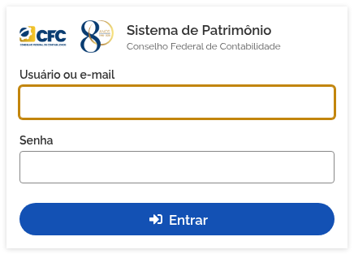

2. **Digite o usuário (ou o e-mail) e a senha e clique em Entrar**

    O e-mail só funciona se estiver cadastrado no seu usuário.

    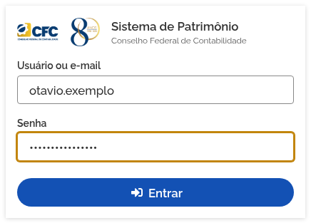

    !!! warning "Cuidado"

        Se aparecer **Usuário ou senha inválidos.**, confira o que digitou. **Cinco senhas erradas
        seguidas bloqueiam a entrada por 15 minutos.** Se esqueceu a senha, peça uma nova ao administrador.

    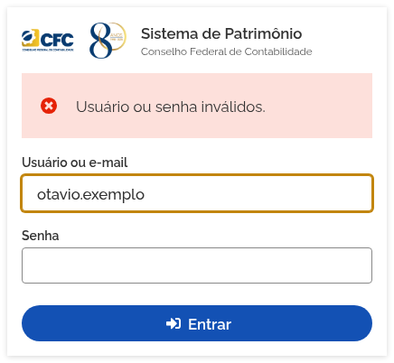

Depois de entrar, quem cuida do acervo (Administrador, Operador ou Consulta) cai no **Início**; quem só
confere inventário cai direto na tela do **Inventário**.

## Primeiro acesso: definir a sua senha

No primeiro acesso (e sempre que o administrador gerar uma senha nova para você), o sistema exige uma senha
nova antes de abrir qualquer outra tela.

1. **Entre com a senha temporária**

    O sistema abre **Trocar senha** com o aviso *Defina uma nova senha para continuar. Sua senha é
    temporária.*

    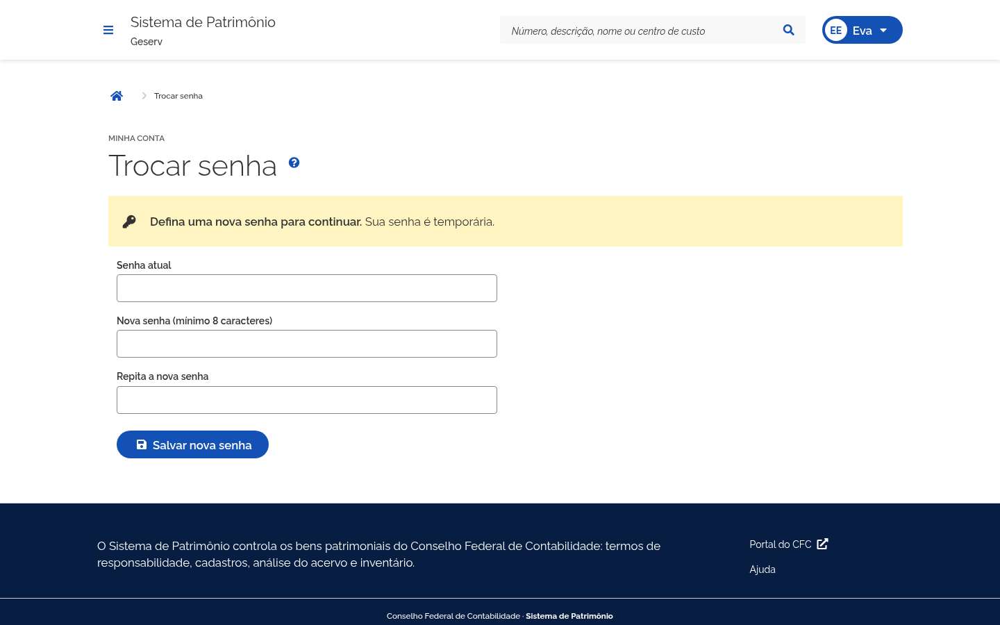

2. **Preencha a senha atual (a temporária), a nova senha e a repetição**

    A senha nova precisa ter **pelo menos 8 caracteres**.

    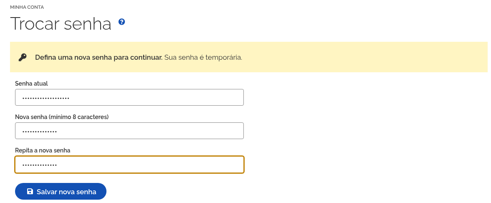

3. **Clique em Salvar nova senha**

    O sistema mostra *Sucesso. Senha alterada.* e abre a sua tela inicial.

    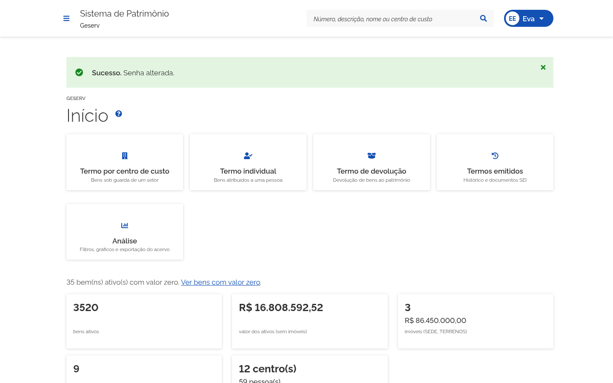

## Trocar a senha, ver quem está conectado e sair

O cabeçalho tem, da esquerda para a direita, o botão do menu (☰) com o nome do sistema, o campo de pesquisa e
o **botão do usuário** — azul, com as suas iniciais e o seu primeiro nome.

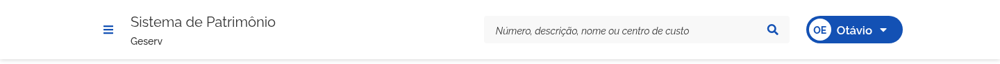

Clique no botão do usuário para ver o seu nome completo e as suas funções, e as opções **Meus acessos**,
**Trocar senha** e **Sair**.

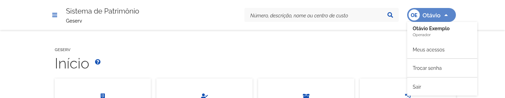

1. **No botão do usuário, clique em Trocar senha**, informe a senha atual, a nova (mínimo de 8 caracteres) e repita a nova

    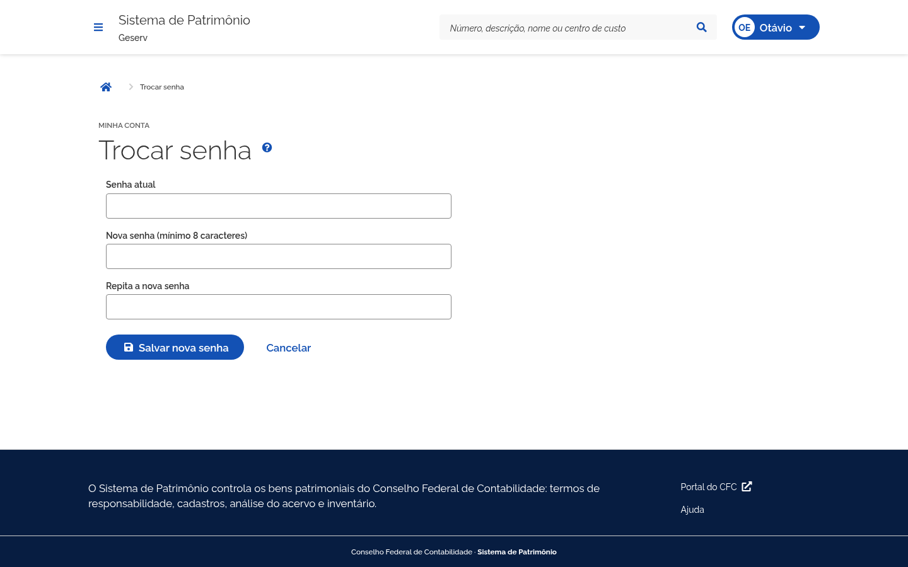

2. **Clique em Salvar nova senha**

    Aparece *Senha alterada.* Em **Cancelar**, nada muda.

3. **Para terminar o trabalho, abra o botão do usuário e clique em Sair**

    A sessão também expira sozinha depois de **12 horas**.

## Meus acessos: SEI e SPW

O sistema emite os termos **no SEI em seu nome**. Para isso, ele precisa do seu usuário, da sua senha e da
sua unidade no SEI. Da mesma forma, **Atualizar com SPW** (só administrador) usa o seu usuário do SPW.

1. **Clique no botão do usuário, no cabeçalho, e depois em Meus acessos**

    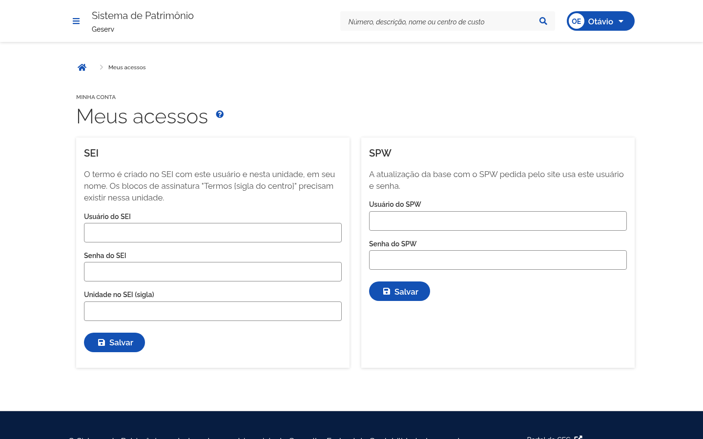

2. **No quadro SEI, preencha o usuário, a senha e a sigla da unidade no SEI e clique em Salvar**

    A unidade é aquela em que os termos vão nascer. Nela precisam existir os blocos de assinatura com o
    nome **Termos {sigla do centro}** (por exemplo, *Termos GECONT*) — os blocos são criados à mão no SEI.

    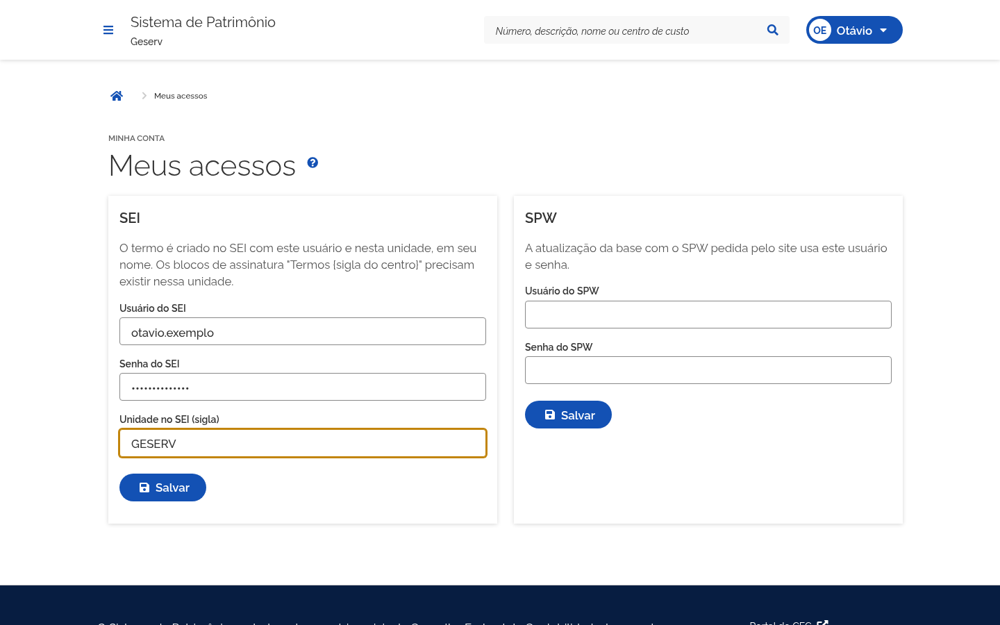

3. **Se for administrador, preencha também o quadro SPW e clique em Salvar**

    Cada quadro tem o próprio **Salvar** e mostra *Acesso ao SEI salvo.* / *Acesso ao SPW salvo.*

    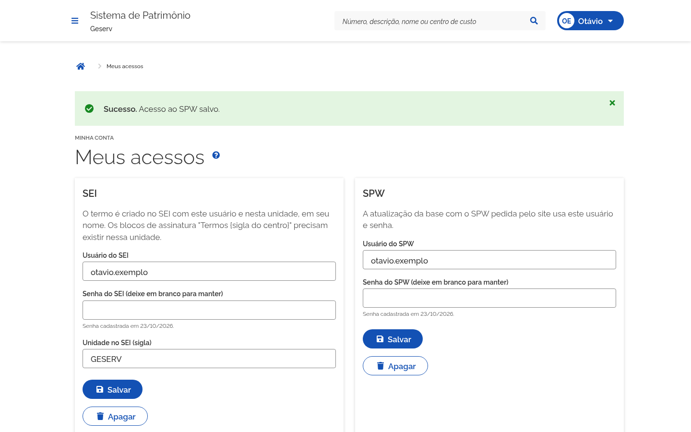

!!! note "Nota"

    As senhas ficam guardadas cifradas e **nunca são mostradas** de novo — nem para o administrador. Para
    trocar só o usuário ou a unidade, deixe a senha em branco: a atual é mantida. Quando mudar a sua senha
    no SEI ou no SPW, atualize aqui também. **Apagar** remove o acesso; sem ele você não consegue emitir no
    SEI.

## O que acontece depois / onde confere

- O seu primeiro nome aparece no botão do usuário, no cabeçalho de todas as telas; o nome completo e as
  suas funções, ao abrir esse botão.
- Em **Meus acessos**, a linha *Senha cadastrada em DD/MM/AAAA* confirma que o acesso está salvo.

## Erros comuns e mensagens

| Mensagem | O que significa | O que fazer |
|---|---|---|
| *Usuário ou senha inválidos.* | Usuário, e-mail ou senha errados (ou usuário inativo). | Confira; depois de 5 erros, aguarde 15 minutos ou peça nova senha. |
| *Muitas tentativas. Aguarde 15 minutos.* | Cinco senhas erradas seguidas. | Aguarde ou peça ao administrador uma senha nova (ela também desbloqueia). |
| *Defina uma nova senha para continuar.* | A senha é temporária. | Troque a senha; não há como pular esta tela. |
| *A senha atual não confere.* / *A confirmação não confere com a nova senha.* / *A nova senha precisa ser diferente da atual.* | Erro ao trocar a senha. | Confira os três campos e tente de novo. |
| *Sessão expirada ou formulário inválido.* | A página ficou aberta tempo demais. | Recarregue a página e repita. |
| *Seu usuário não tem permissão para esta ação.* | A tela não faz parte das suas funções. | Peça ao administrador a função necessária. |
| *Cadastre seu acesso ao SEI em Meus acessos para emitir.* | Você tentou emitir no SEI sem acesso cadastrado. | Preencha o quadro SEI em Meus acessos. |
