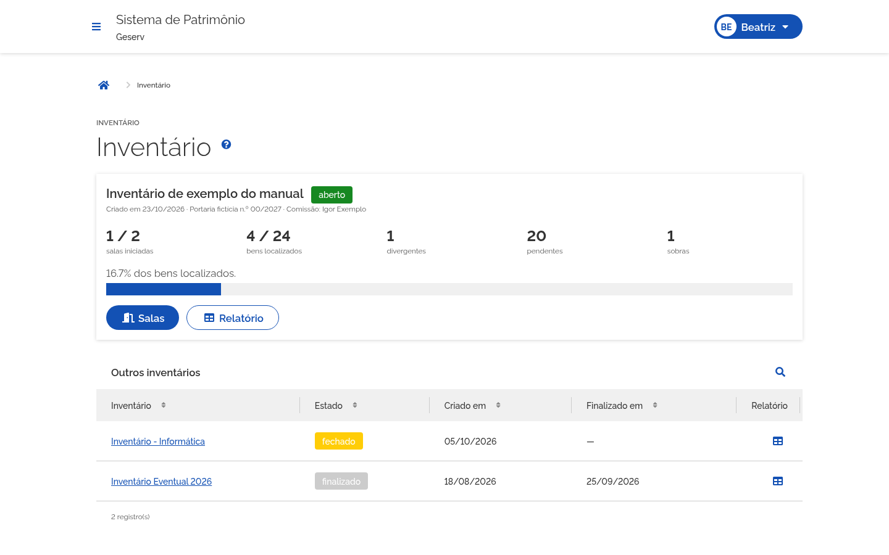
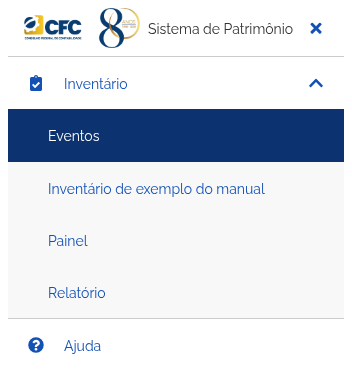
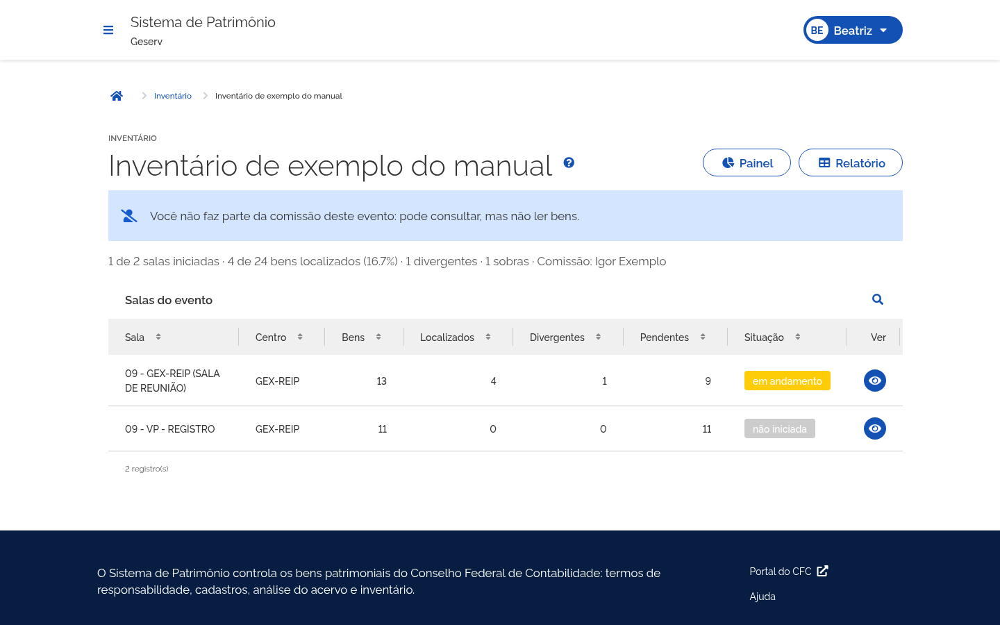
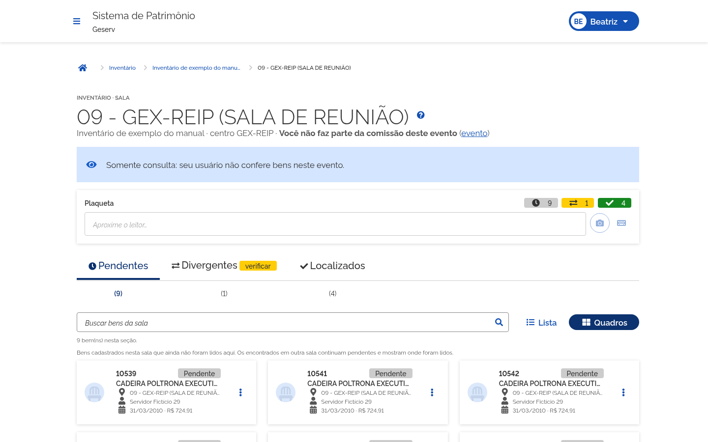
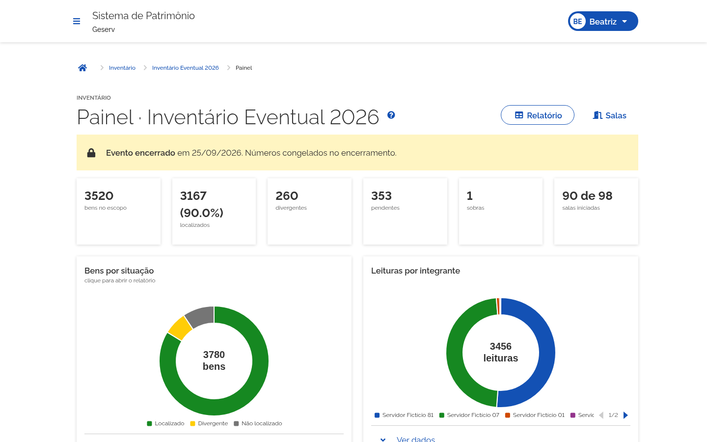
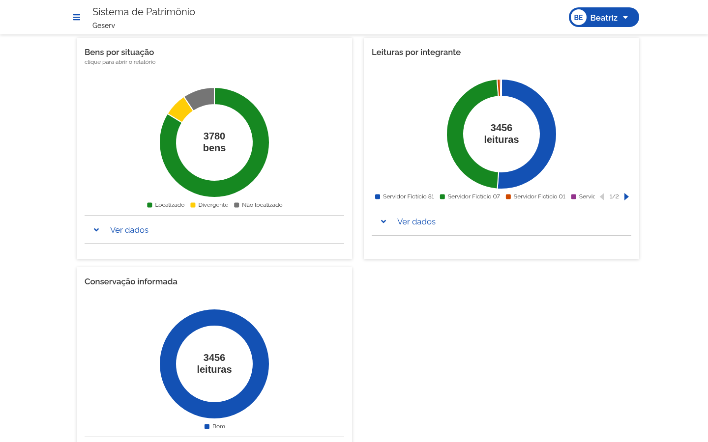
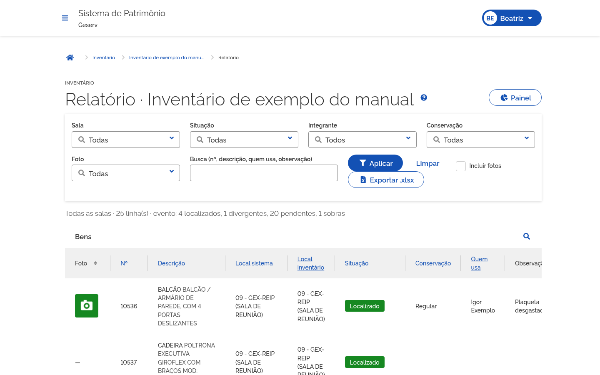
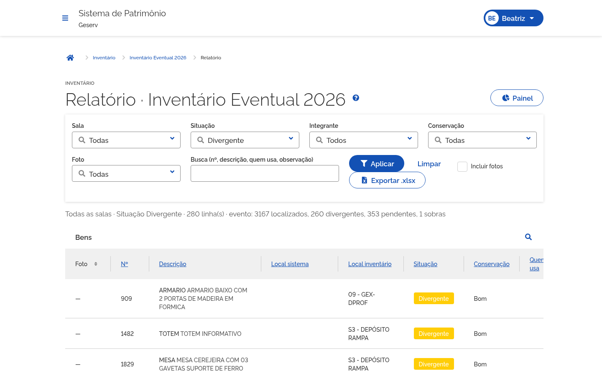

# Inventário: acompanhamento

!!! info "Informações do procedimento"

    **Status editorial:** Em revisão · **Última revisão:** 23/10/2026 · **Sistemas envolvidos:** Sistema de Patrimônio

<button type="button" class="md-button checklist-print-button" aria-label="Imprimir ou salvar este procedimento como PDF">Imprimir</button>
<button type="button" class="md-button checklist-clear-button" aria-label="Limpar progresso do checklist deste procedimento">Limpar checklist</button>

Marcações salvas só neste navegador. Elas não constituem registro oficial nem histórico auditável.

## Objetivo

Acompanhar o andamento de um inventário (aberto, fechado ou finalizado) e extrair os resultados: quantos bens
foram localizados, quais estão divergentes ou não localizados, quem leu o quê, conservação e fotos.

## Quem pode

**Consulta de inventários** e **Administrador** — em todos os eventos. A função Consulta de inventários não
lê bens; quem tem também a função Inventário lê só nos eventos da própria comissão.

## Antes de começar

- [ ] Ter a função Consulta de inventários (ou Administrador).

## Acompanhar

1. **Abra Inventário › Eventos**

    No alto, o inventário corrente com os números do andamento e os botões **Salas** e **Relatório**; abaixo,
    os **outros inventários** (fechados e finalizados), cada um com o botão do relatório.

    

    

2. **Para ver as salas, clique em Salas**

    A tabela mostra o andamento por sala. O aviso azul lembra que você pode consultar, mas não ler bens; o
    olho de cada linha abre a sala em modo consulta: as abas Pendentes, Divergentes e Localizados, a busca e
    a ficha de cada bem (menu ⋮ › Detalhes, com o cadastro, a leitura e as fotos) ficam disponíveis; leitura,
    lote e fotos ficam desligados.

    

    

3. **Abra o Painel**

    Cartões com bens no escopo, localizados (com o percentual), divergentes, pendentes, sobras e salas
    iniciadas, e gráficos por situação, por integrante, por conservação, por andar e por sala. Clicar num
    gráfico abre o relatório já filtrado. Em evento finalizado, os números ficam **congelados** no
    encerramento.

    

    

4. **Abra o Relatório e aplique os filtros**

    Filtre por sala, situação (localizado, divergente, não localizado), integrante, conservação, com ou sem
    foto e por texto (número, descrição, quem usa, observação). Clique nos títulos das colunas para ordenar.
    A miniatura da foto abre a foto ampliada.

    

    

5. **Para levar ao Excel, clique em Exportar .xlsx**

    A planilha segue os filtros aplicados. Marque **Incluir fotos** para trazer as fotos dentro da planilha
    (exige o Excel do Microsoft 365; no Excel antigo aparece `#NOME?`).

## O que acontece depois / onde confere

- Os números do Painel, do Relatório e da lista de salas são os mesmos.
- Evento finalizado não muda mais, mesmo quando a base de bens é atualizada.

## Erros comuns e mensagens

| Situação | Explicação |
|---|---|
| *Relatório pesado. N fotos no filtro* | O `.xlsx` com fotos pode demorar a abrir; filtre mais ou exporte sem fotos. |
| `#NOME?` nas fotos da planilha | O Excel não é o Microsoft 365; exporte sem fotos. |
| Não vejo Painel nem Relatório | A sua função é só Inventário; peça a Consulta de inventários. |
