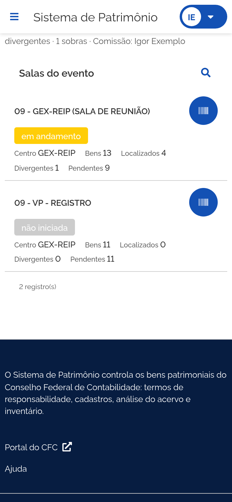
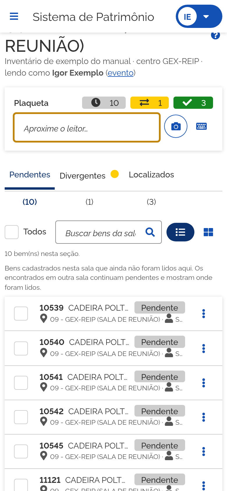
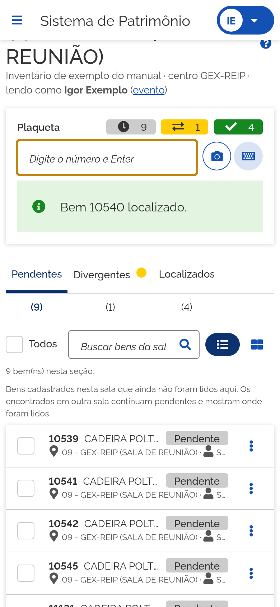

# Inventário: guia rápido da comissão

!!! info "Informações do procedimento"

    **Status editorial:** Em revisão · **Última revisão:** 11/11/2026 · **Sistemas envolvidos:** Sistema de Patrimônio

<button type="button" class="md-button checklist-print-button" aria-label="Imprimir ou salvar este procedimento como PDF">Imprimir</button>
<button type="button" class="md-button checklist-clear-button" aria-label="Limpar progresso do checklist deste procedimento">Limpar checklist</button>

Marcações salvas só neste navegador. Elas não constituem registro oficial nem histórico auditável.

## Objetivo

Guia de bolso para os integrantes da **comissão de inventário**: o que levar, como ligar o leitor ao celular
e o que fazer em cada situação dentro da sala. O passo a passo completo, tela por tela, está em
[Inventário: conferência nas salas](inventario-conferencia.md).

## Antes de sair para as salas

- [ ] Celular carregado, com internet (Wi-Fi do CFC ou 4G).
- [ ] **Leitor de código de barras sem fio** carregado, com o **receptor USB** dele.
- [ ] **Adaptador OTG** (liga o receptor USB na entrada de carga do celular).
- [ ] Seu **usuário e senha** do Sistema de Patrimônio — cada integrante usa o próprio; a leitura fica
  gravada com o seu nome.
- [ ] Saber quais salas são suas (combinado no grupo de WhatsApp da comissão).

## Ligar o leitor ao celular

1. **Encaixe o receptor USB do leitor no adaptador OTG e o adaptador no celular**

    O celular passa a tratar o leitor como um **teclado**: tudo o que o leitor lê é "digitado" na tela,
    seguido de Enter. Não é preciso instalar nada.

2. **Ligue o leitor e faça um teste**

    Com a sala aberta no sistema (veja abaixo), aponte para uma plaqueta e aperte o gatilho. O leitor apita e
    a mensagem do bem aparece no alto da tela.

!!! tip "Sem leitor, o inventário continua"

    Se o leitor descarregar ou falhar, use o botão **Câmera** (lê o código pela câmera do celular) ou o botão
    **Digitar** (abre o teclado para escrever o número). As três formas valem igual.

## Conferir uma sala

1. **Entre no sistema pelo navegador do celular e toque em Salas e leitura**

    Cada sala aparece num bloco, com a situação e os números.

    

2. **Toque em Conferir na sala em que você está**

    Confira o nome da sala no alto antes de começar: ler na sala errada gera divergência.

    

3. **Leia todas as plaquetas da sala**

    Aponte, dispare e espere a mensagem. O campo *Plaqueta* volta a ficar pronto sozinho depois de cada
    leitura; o teclado do celular **não** abre, de propósito, para não cobrir a tela.

    

4. **Olhe a aba Pendentes antes de sair**

    O que sobrou ali é bem cadastrado na sala que você ainda não leu. Procure-o; se não achar, deixe
    pendente — ele sai no relatório como **não localizado**.

## O que cada mensagem pede

| Cor e mensagem | O que significa | O que fazer |
|---|---|---|
| Verde — *Bem N localizado.* | Está na sala certa. | Siga para o próximo. |
| Amarelo — *cadastrado em …; registrado aqui como divergente.* | O bem é de outra sala. | Confirme que **você** está na sala certa. Se estiver, siga: a divergência é o registro correto. |
| Azul — *está BAIXADO; leitura registrada.* | Bem baixado no cadastro, mas presente. | Siga; a leitura fica como evidência. |
| Vermelho — *Bem N não está na base.* | Número sem cadastro. | Leia de novo. Se repetir, toque em **Registrar sobra**. |
| *Já lido em … por … Atualizado.* | Alguém já leu esse bem. | Vale a leitura mais recente; nada a fazer. |
| Vermelho — *Sem conexão; tente de novo.* | A internet caiu. | Espere o sinal voltar e leia de novo; a leitura **não** foi gravada. |

## Situações da sala

- **Bem sem plaqueta ou com número que não existe (sobra):** toque em **Registrar sobra**, descreva o bem,
  escreva a observação e tire a **foto** (obrigatória). Detalhes em
  [Registrar uma sobra](inventario-conferencia.md#registrar-uma-sobra-bem-sem-cadastro).
- **Plaqueta ilegível ou em lugar que o leitor não alcança:** ache o bem na aba Pendentes, marque a caixa
  dele (um ou vários) e toque em **Localizados**, na barra que aparece embaixo. Só marque o que você viu.
  Detalhes em [Marcar em lote](inventario-conferencia.md#plaqueta-ilegivel-marcar-em-lote).
- **Conservação e foto:** toque no bem já lido para abrir a ficha, escolha a **conservação** (Bom, Regular,
  Ruim ou Inservível), informe quem usa, se souber, e toque em **Adicionar foto**. Tudo é salvo sozinho; as
  etiquetas laranja *sem conservação* e *sem foto* mostram o que falta.
- **Leu por engano:** menu **⋮** do bem › **Desfazer leitura**. As fotos daquele bem neste inventário são
  apagadas junto.
- **Leu na sala errada:** leia o bem de novo na sala certa; vale a última leitura.

## Trabalhando em equipe

- Cada sala fica com **uma pessoa ou dupla** por vez; avise no grupo de WhatsApp qual sala você pegou e
  quando terminou.
- As leituras dos colegas na mesma sala aparecem quando você **recarrega a página** (arraste a tela para
  baixo).
- Dúvida, bem estranho, sala trancada ou problema com o leitor: mande no **grupo de WhatsApp da comissão**,
  com foto quando ajudar. Não mande ali senha nem dados pessoais.

## Se algo não funcionar

| Situação | O que fazer |
|---|---|
| O leitor apita, mas nada aparece na tela | Toque no campo *Plaqueta* e leia de novo. Confira se o receptor e o adaptador OTG estão bem encaixados. |
| O leitor não apita nem acende | Está descarregado ou desligado; carregue-o e use a **Câmera** enquanto isso. |
| O celular não reconhece o receptor | Tire e recoloque o adaptador OTG. Em alguns aparelhos é preciso ligar a opção **OTG** nas configurações. |
| Preciso digitar e o teclado não abre | Toque no botão **Digitar** (ícone de teclado) ao lado do campo. |
| *Inventário fechado. A leitura está suspensa…* | O administrador fechou o evento; avise no grupo e aguarde. |
| *Somente consulta: seu usuário não confere bens neste evento.* | Você não está na comissão do evento; peça ao administrador. |
| *Nenhum inventário atribuído a você* | Mesma causa: peça a inclusão na comissão. |

## Onde confere

Os contadores no alto da sala (pendentes, divergentes, localizados) e a situação da sala na lista de salas
(*em andamento*, *completa*). O andamento geral fica com quem acompanha o
[Painel](inventario-acompanhamento.md).
