# Inventário: conferência nas salas

!!! info "Informações do procedimento"

    **Status editorial:** Em revisão · **Última revisão:** 23/10/2026 · **Sistemas envolvidos:** Sistema de Patrimônio

<button type="button" class="md-button checklist-print-button" aria-label="Imprimir ou salvar este procedimento como PDF">Imprimir</button>
<button type="button" class="md-button checklist-clear-button" aria-label="Limpar progresso do checklist deste procedimento">Limpar checklist</button>

Marcações salvas só neste navegador. Elas não constituem registro oficial nem histórico auditável.

## Objetivo

Registrar, sala por sala, os bens encontrados fisicamente durante um **inventário** (evento), para comparar
com o cadastro: o que está no lugar, o que está em outra sala, o que não foi encontrado e o que apareceu sem
cadastro.

| Situação | Significado |
|---|---|
| **Localizado** | Bem lido na sala em que está cadastrado. |
| **Divergente** | Bem lido numa sala diferente da do cadastro. O cadastro do SPW **não** muda. |
| **Pendente** / **Não localizado** | Bem cadastrado na sala que ainda não foi lido. |
| **Sobra** | Bem encontrado sem número no cadastro (sem plaqueta ou com número inexistente). |

## Quem pode

Quem tem a função **Inventário** (ou Administrador) **e faz parte da comissão do evento**. Quem não está na
comissão só consulta.

## Antes de começar

- [ ] O administrador criou o inventário, colocou você na **comissão** e deixou o evento **aberto** (veja
  [Administração](administracao.md#inventarios)).
- [ ] Celular ou computador com internet; de preferência, um leitor de código de barras ou a câmera do
  celular.
- [ ] Saber quais salas vai conferir.

## Conferir uma sala

1. **Entre no sistema**

    Quem só tem a função Inventário cai direto na tela **Inventário**, com o evento aberto: salas iniciadas,
    bens localizados, divergentes, pendentes e sobras, e uma barra com o percentual de bens localizados.

    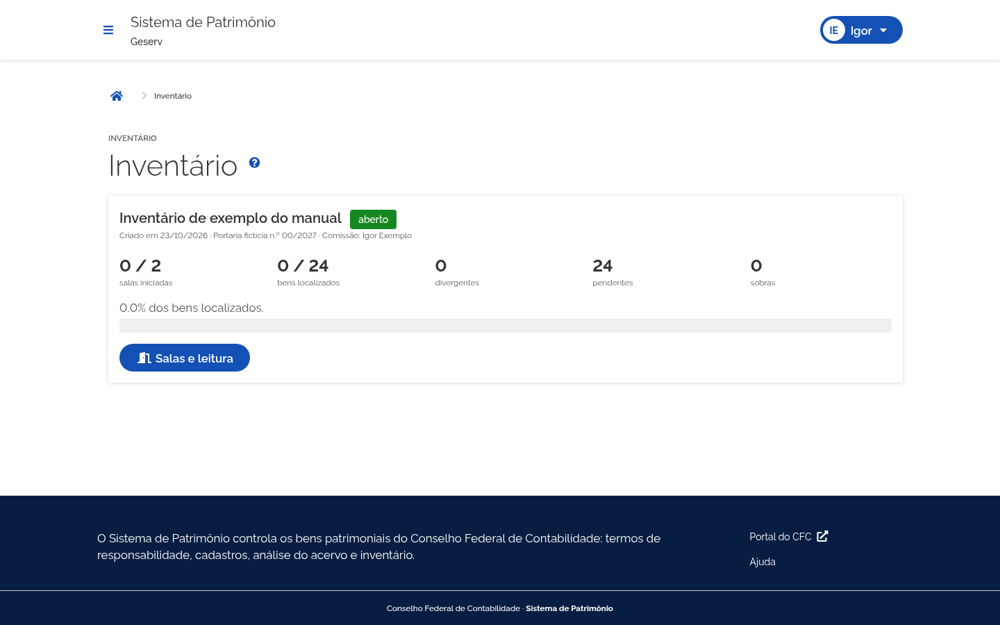

    O menu dessa função tem só o Inventário e a Ajuda:

    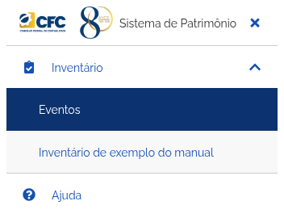

2. **Clique em Salas e leitura**

    A tabela mostra cada sala do evento com bens, localizados, divergentes, pendentes e a situação (*não
    iniciada*, *em andamento*, *completa*).

    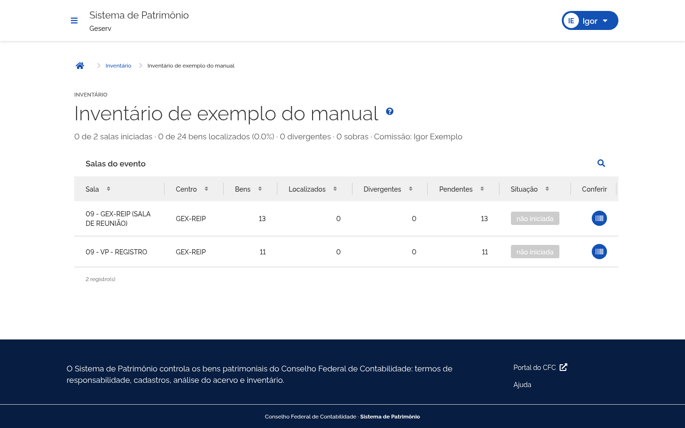

3. **Clique no botão Conferir da sala em que você está**

    No alto: o nome da sala, o centro de custo e **lendo como** (o seu nome, que fica gravado em cada
    leitura). Logo abaixo, a **faixa de leitura**: o campo *Plaqueta*, os botões Câmera e Digitar e os
    contadores cinza (pendentes), amarelo (divergentes) e verde (localizados). A faixa fica presa no alto da
    tela enquanto você rola a lista, para ler sem subir a página.

    Os bens ficam em três abas, cada uma com o número entre parênteses:

    - **Pendentes** (a que abre primeiro): bens cadastrados na sala que ainda não foram lidos aqui. Um bem
      lido em outra sala continua aqui, com a etiqueta amarela *Encontrado em …*;
    - **Divergentes**: bens lidos aqui mas cadastrados em outra sala (ou baixados). Quando há algum, a aba
      mostra a etiqueta **verificar** (no celular, uma bolinha amarela);
    - **Localizados**: bens cadastrados na sala e lidos aqui.

    Cada bem mostra o número, a descrição, a situação, onde está cadastrado, quem responde por ele e, depois
    de lido, quem leu e quando. Etiquetas laranja lembram o que falta: **sem conservação** e **sem foto**.

    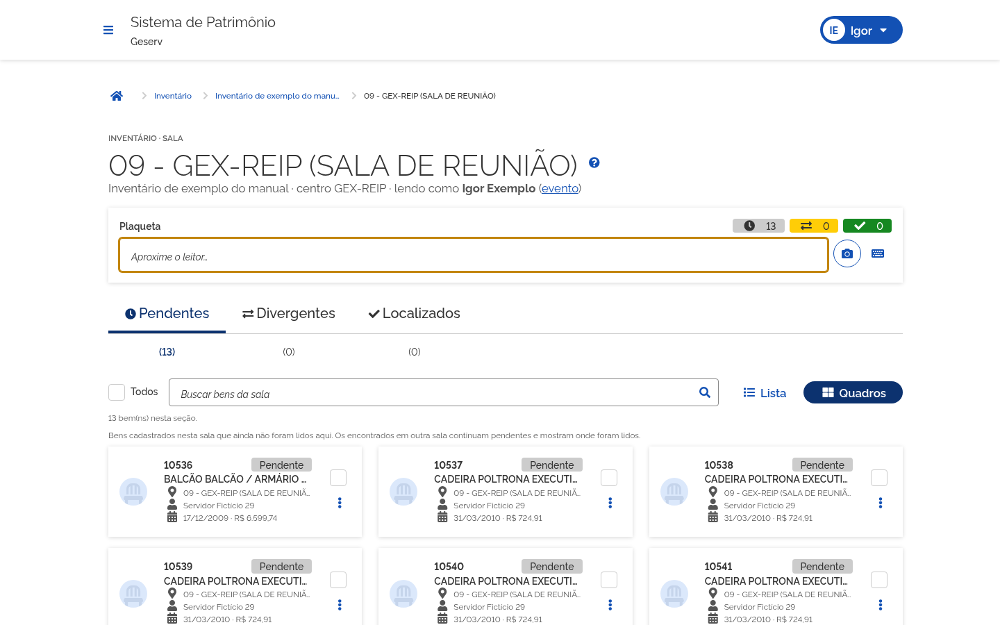

4. **Leia cada plaqueta**

    - **Leitor de código de barras**: com o cursor no campo *Plaqueta*, aponte e dispare — o leitor
      digita o número e o Enter;
    - **Câmera**: toque em **Câmera** e aponte para o código; a câmera fica aberta para leituras seguidas até
      **Fechar câmera**;
    - **Digitar**: toque em **Digitar**, escreva o número e tecle Enter.

    A mensagem verde confirma *Bem N localizado.*, o bem sai de Pendentes, entra no topo de **Localizados**
    e os contadores mudam.

    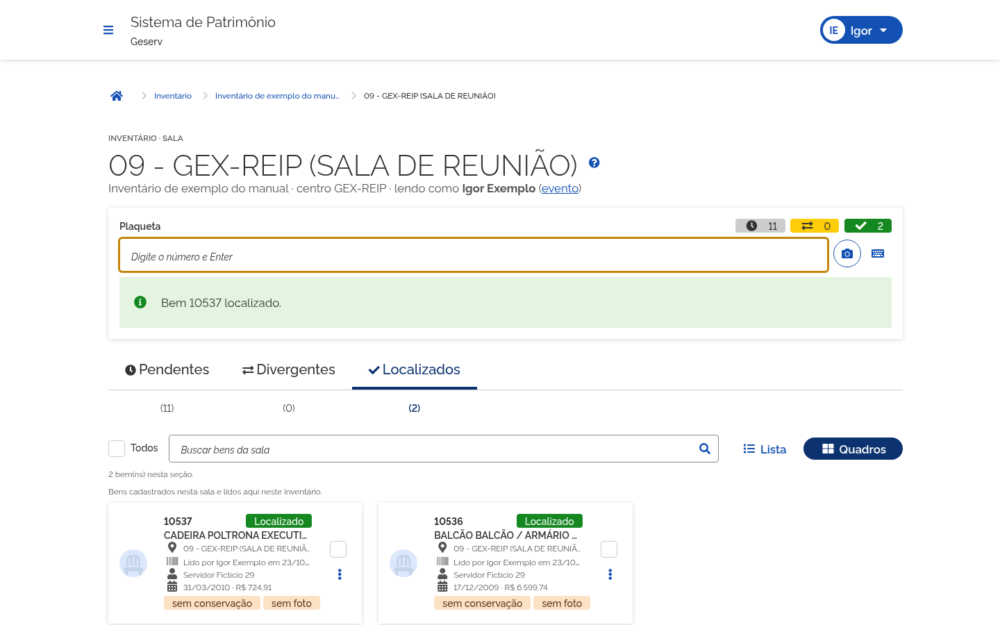

5. **Se o bem é de outra sala, ele fica divergente**

    A mensagem amarela diz onde ele está cadastrado. Ele entra na aba **Divergentes**, com *Cadastrado em …*,
    e a aba ganha a etiqueta **verificar**. Se você leu na sala errada, leia de novo na sala certa: vale a
    leitura mais recente.

    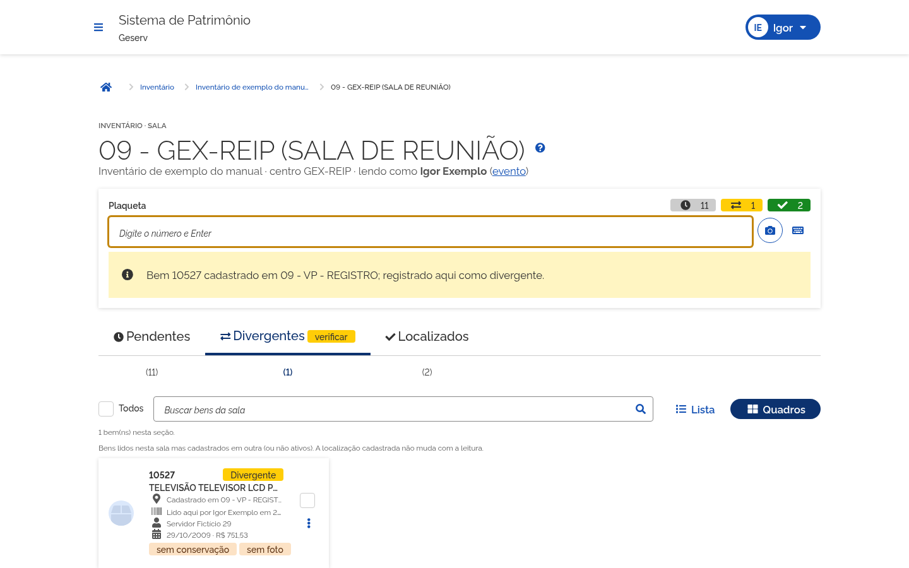

6. **Se o bem está baixado no cadastro, a leitura fica registrada assim mesmo**

    O bem continua baixado no SPW; a leitura serve de evidência de que ele ainda está fisicamente no órgão.
    Ele aparece em Divergentes com a etiqueta vermelha **Não ativo** e não entra no contador de divergentes.

    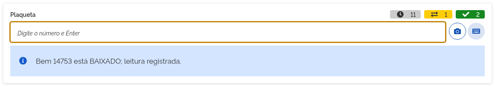

## Registrar uma sobra (bem sem cadastro)

1. **Leia ou digite o número encontrado**

    Se ele não existe na base, aparece *Bem N não está na base.* com o botão **Registrar sobra**.

    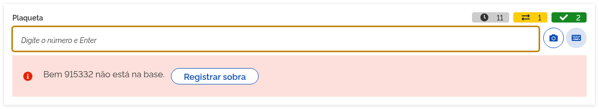

2. **Clique em Registrar sobra e preencha descrição, complemento, observação e a foto**

    Observação e foto são obrigatórias (a foto, quando o recurso de fotos está ligado). No celular, a foto
    pode ser tirada na hora.

    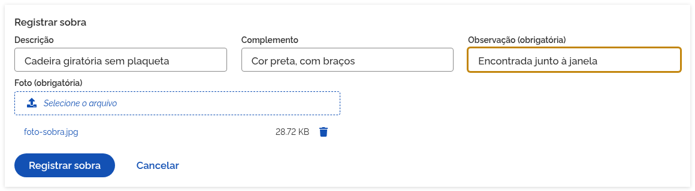

3. **Clique em Registrar sobra**

    Aparece *Sobra registrada.* A sobra fica listada em **Sobras (bens sem cadastro)**, no fim da página da
    sala, com a foto e o seu nome. A lixeira da linha exclui a sobra registrada por engano.

    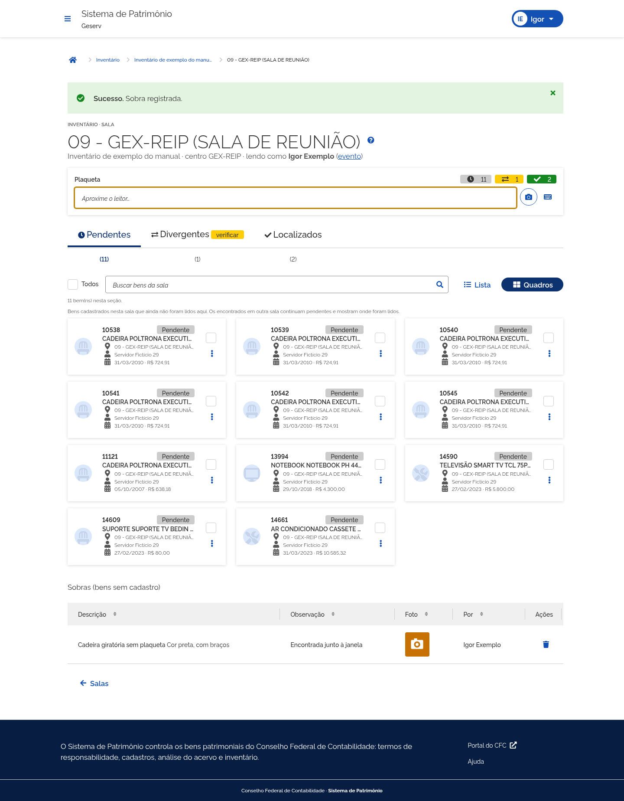

## O menu do bem e a ficha

Cada bem tem o botão **⋮** (três pontinhos), com:

- **Detalhes**: abre a ficha do bem (o mesmo que tocar no bem);
- **Registrar leitura nesta sala**: para quando a plaqueta não lê — vale como uma leitura;
- **Desfazer leitura**: apaga a leitura (o sistema pede confirmação; as fotos daquele bem nesse inventário
  também são apagadas) e o bem volta a pendente;
- **Nova foto**: abre a câmera do celular (ou a escolha de arquivo) e envia a foto na hora. Só funciona
  depois de o bem ser lido.

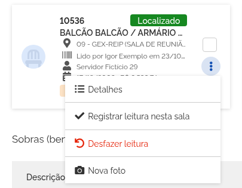

A **ficha do bem** mostra o cadastro (descrição, classificação, localização, valores, centro de custo e
responsável), a leitura neste inventário (sala, quem leu, data e hora) e as fotos. Depois de lido, o bem
libera os campos — **tudo é salvo sozinho** ao mudar de campo, não há botão salvar.

1. **Escolha a conservação** (Bom, Regular, Ruim ou Inservível)

2. **Preencha quem usa e a observação, se houver**

3. **Para fotografar, toque em Adicionar foto**

    A foto aparece na hora na galeria da ficha e no quadro do bem; o bem aceita várias fotos. A lixeira
    embaixo de cada foto apaga aquela foto (o sistema pede confirmação).

    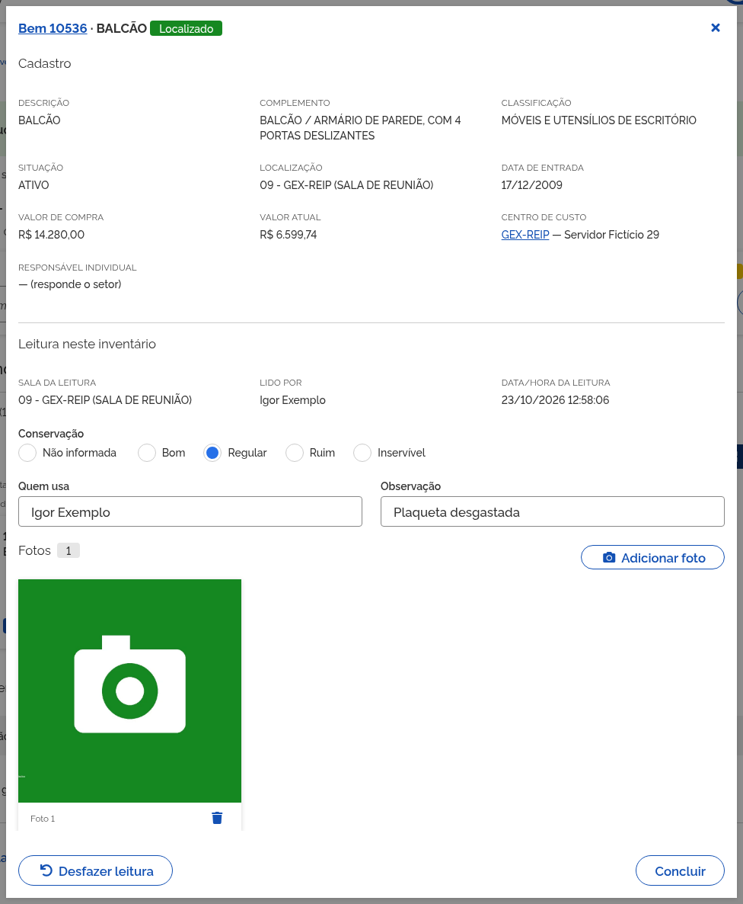

4. **Toque em Concluir** (ou fora da janela) para voltar à leitura

## Plaqueta ilegível: marcar em lote

1. **Confira o bem fisicamente e marque a caixa dele** (uma ou várias)

    Ao marcar o primeiro bem, aparece embaixo da tela a barra do lote, com quantos estão marcados e os
    botões **Localizados** e **Desmarcar**. A caixa **Todos**, ao lado da busca, marca todos os bens da aba
    aberta que a busca deixou à vista.

    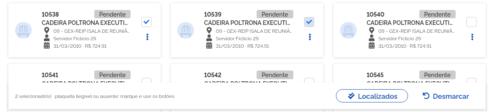

2. **Clique em Localizados**

    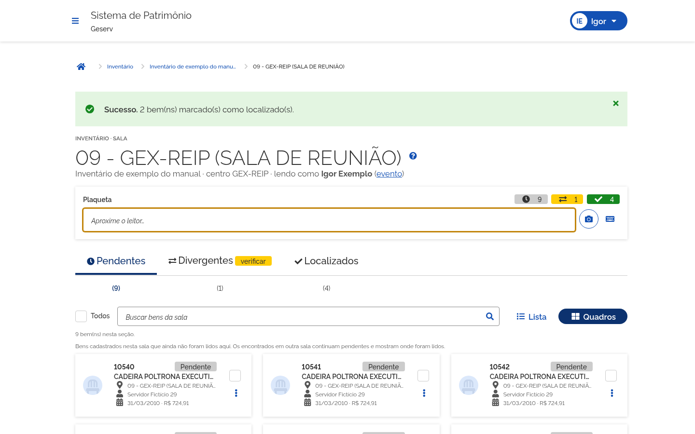

3. **Para desfazer, marque o bem (na aba Localizados) e clique em Desmarcar** — confirme a pergunta

    A leitura é apagada e o bem volta a **pendente**. As fotos daquele bem nesse inventário também são
    apagadas.

    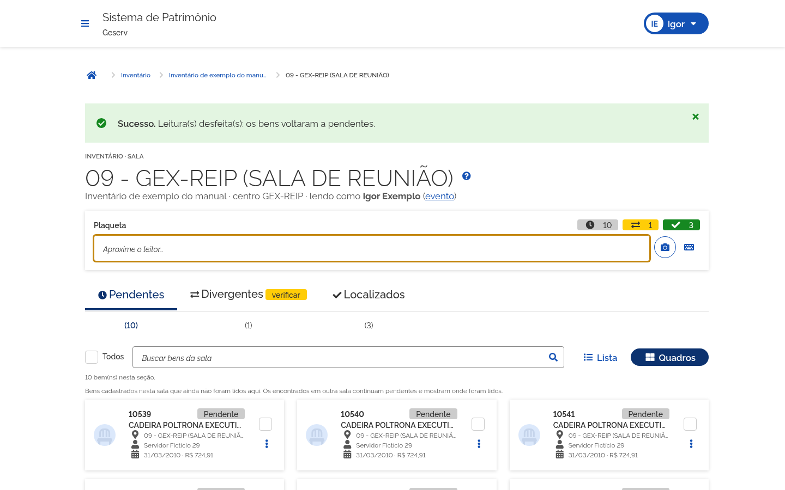

## Buscar e trocar a visão

- **Buscar bens da sala**: escreva parte do número, da descrição ou de quem responde; a aba aberta mostra só
  o que combina e conta *N de M bem(ns) desta seção correspondem à busca*. A contagem acompanha as leituras
  feitas com a busca preenchida.
- **Lista** ou **Quadros**: a lista é compacta (uma linha por bem, sem foto); os quadros mostram a foto (ou
  um ícone da categoria) e mais dados. O sistema lembra a escolha neste aparelho. Sem escolha, o celular abre
  em Lista e o computador em Quadros.

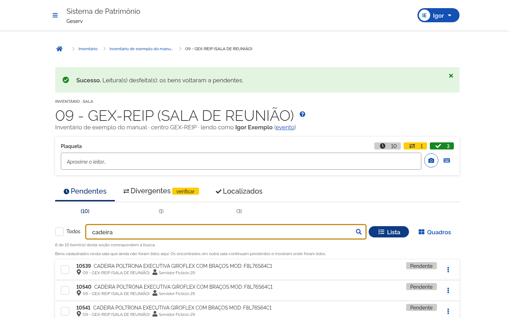

## No celular

Na lista de salas, cada sala vira um bloco: o nome e o botão de conferir na primeira linha, a situação na
segunda e os números (bens, localizados, divergentes, pendentes) na terceira — sem precisar arrastar a tela
para o lado.

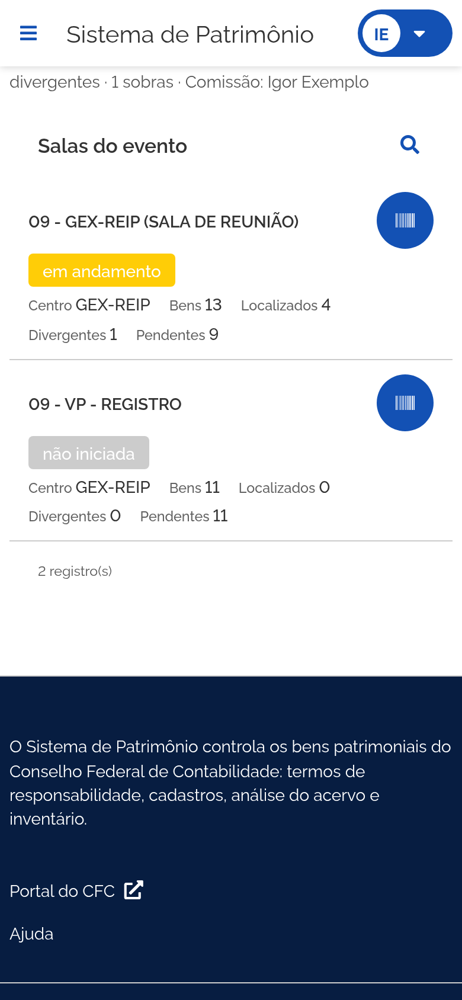

A tela da sala se reorganiza em uma coluna e abre em Lista; a faixa de leitura (campo, Câmera e Digitar)
fica presa no alto enquanto você rola os bens.

| Sala no celular | Depois de uma leitura |
|---|---|
| 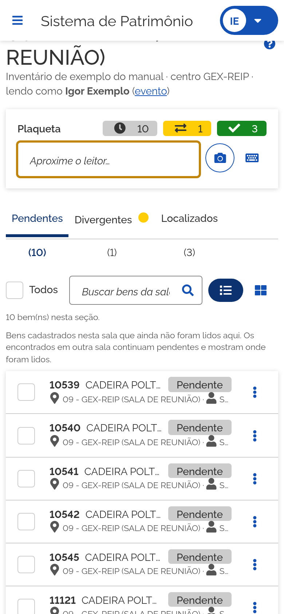 | 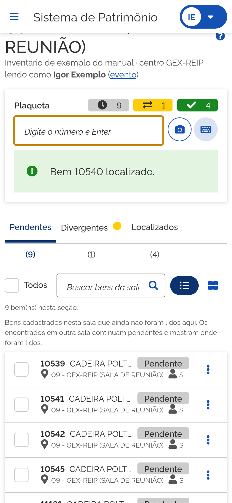 |

## Sem comissão

Quem tem a função Inventário mas ainda não está em nenhuma comissão vê *Nenhum inventário atribuído a você*.
Peça ao administrador para incluí-lo na comissão.

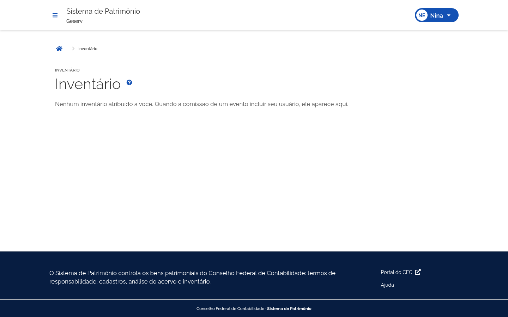

## O que acontece depois / onde confere

- Os contadores da sala e a situação da sala na lista de salas (*em andamento*, *completa*).
- O andamento geral no Início (*Inventário em andamento · N divergentes*) e no
  [Painel](inventario-acompanhamento.md).
- Cada leitura guarda data, hora, sala, o seu nome, conservação, quem usa, observação e fotos.

## Erros comuns e mensagens

| Mensagem | O que fazer |
|---|---|
| *Inventário fechado. A leitura está suspensa até o administrador reabrir* | Aguarde a reabertura; a consulta continua liberada. |
| *Evento encerrado: somente consulta.* | O inventário foi finalizado; não aceita leituras. |
| *Somente consulta: seu usuário não confere bens neste evento.* | Você não está na comissão; peça ao administrador. |
| *Selecione ao menos um bem na lista.* | Marque as caixas antes de usar os botões de lote. |
| *Registre a leitura do bem N antes de fotografar.* | Leia o bem (ou use Registrar leitura nesta sala) e tente a foto de novo. |
| *Nenhum bem desta seção corresponde à busca.* | Apague ou mude o texto da busca, ou troque de aba. |
| *Sem conexão; tente de novo.* | A internet caiu; leia de novo quando voltar. |
| A foto não foi enviada | Confira a conexão e tente de novo; a foto é enviada no momento do registro. |
