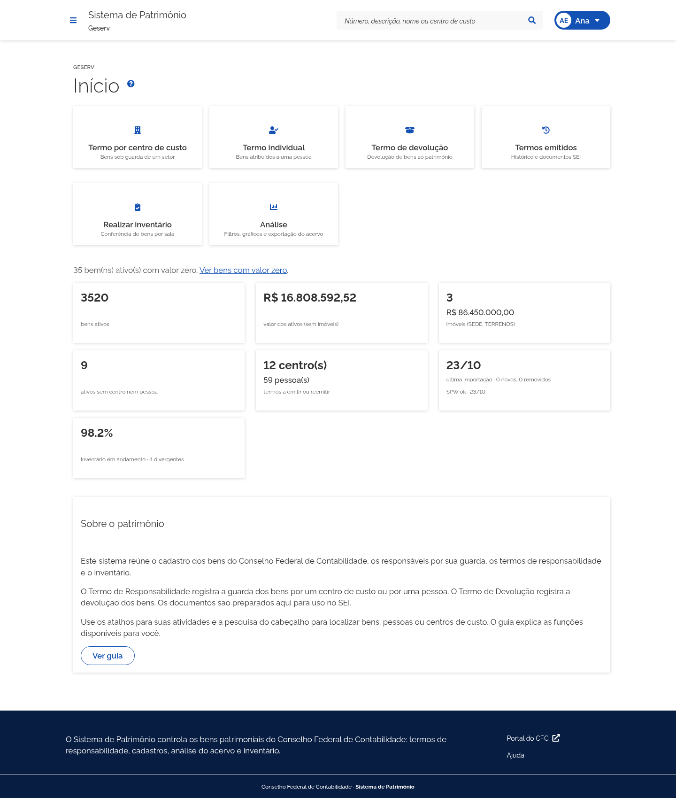
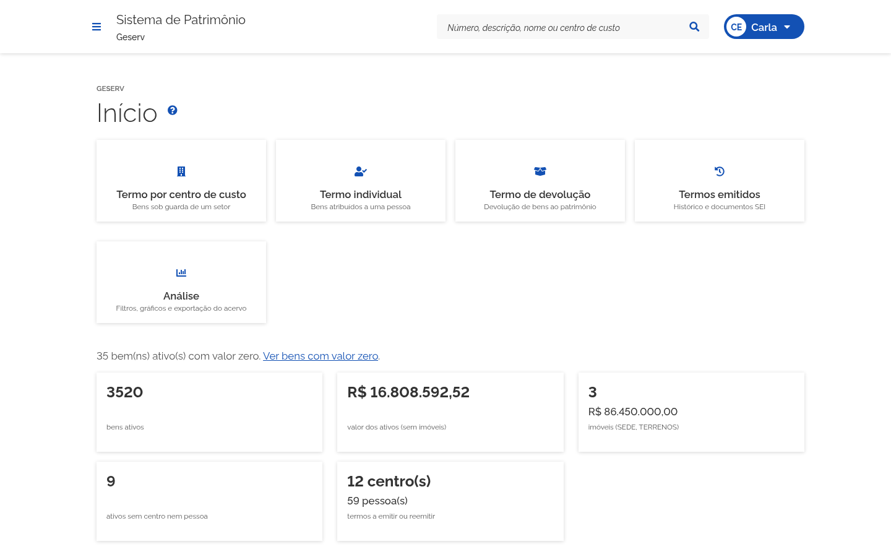
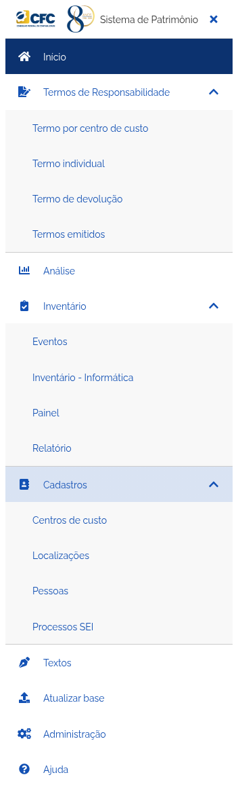
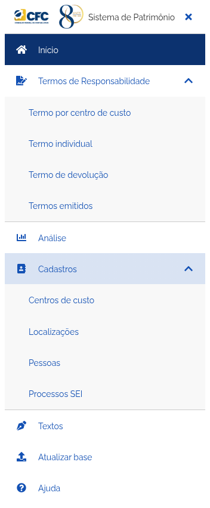
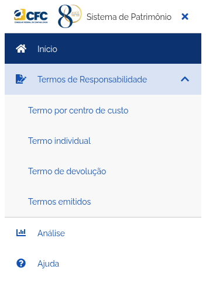
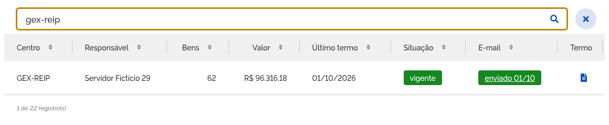
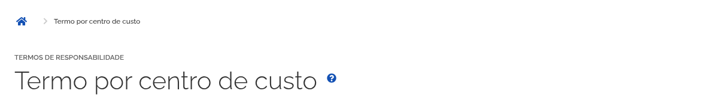
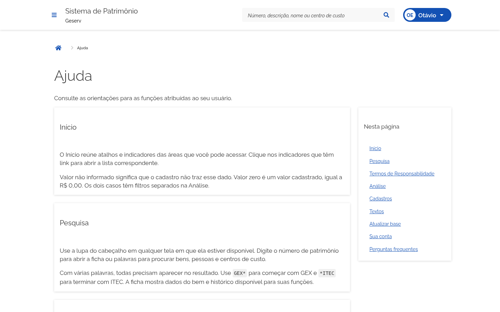
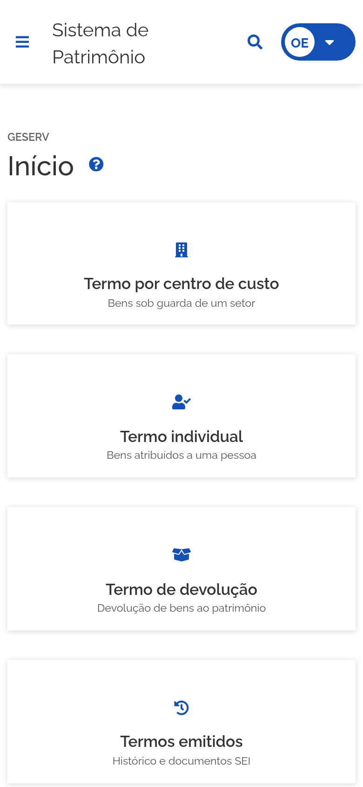
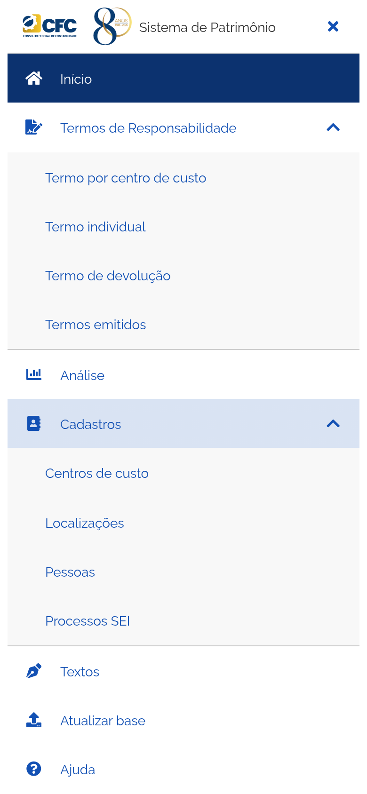

# Navegação, pesquisa e ajuda

!!! info "Informações do procedimento"

    **Status editorial:** Em revisão · **Última revisão:** 22/10/2026 · **Sistemas envolvidos:** Sistema de Patrimônio

<button type="button" class="md-button checklist-print-button" aria-label="Imprimir ou salvar este procedimento como PDF">Imprimir</button>
<button type="button" class="md-button checklist-clear-button" aria-label="Limpar progresso do checklist deste procedimento">Limpar checklist</button>

Marcações salvas só neste navegador. Elas não constituem registro oficial nem histórico auditável.

## Objetivo

Conhecer as partes fixas de todas as telas — Início, menu, pesquisa, trilha de navegação e ajuda — para
chegar rápido a qualquer rotina.

## Quem pode

Todos. O que aparece em cada parte depende das suas [funções](index.md#quem-usa-e-o-que-cada-um-pode-fazer).

## Antes de começar

- [ ] Ter entrado no sistema (veja [Entrar e a sua conta](entrar.md)).

## A página inicial (Início)

O **Início** traz atalhos para as rotinas mais usadas e indicadores do acervo. Cada usuário vê só os atalhos
e indicadores das telas que pode abrir. Os indicadores com link abrem a lista correspondente (na Análise).

Os indicadores mais úteis:

- **bens ativos** e **valor dos ativos (sem imóveis)**;
- **ativos sem centro nem pessoa** — bens que não entram em termo nenhum (resolva em
  [Cadastros](cadastros.md));
- **termos a emitir ou reemitir** — centros e pessoas cujo termo ainda não foi emitido ou ficou
  desatualizado;
- **última importação** — data da última atualização da base com o SPW; fica em destaque quando a base está
  desatualizada ou quando o robô do SPW falhou;
- **andamento do inventário** — percentual de bens localizados no inventário aberto.

O perfil **Consulta** vê os mesmos atalhos de consulta, sem as rotinas de emissão e de inventário:

## O menu

1. **Clique no botão ☰ (três tracinhos), à esquerda do nome do sistema**

    O menu abre do lado esquerdo, com o logo do CFC e o nome do sistema no alto e o nome do órgão no fim.
    Os grupos (Termos de Responsabilidade, Inventário, Cadastros) só abrem e fecham com um clique — eles não
    levam a nenhuma tela. O grupo da tela em que você está já vem aberto.

    

2. **Clique no item desejado**

    O menu fecha e a tela abre. Para fechar sem escolher, clique no **×** ou fora do menu.

O menu é recortado pelas funções. Compare:

| Operador | Consulta |
|---|---|
|  |  |

Os menus das funções de inventário estão em [Conferência](inventario-conferencia.md) e
[Acompanhamento](inventario-acompanhamento.md).

## A pesquisa (lupa do cabeçalho)

O campo **Número, descrição, nome ou centro de custo**, no cabeçalho, pesquisa em qualquer tela (para quem
tem acesso ao acervo).

1. **Clique no campo de pesquisa e digite**

    - um **número de patrimônio** abre direto a ficha do bem;
    - **palavras** procuram nos bens (descrição, complemento, localização, centro de custo, pessoa), nas
      pessoas e nos centros de custo. Com várias palavras, **todas** precisam aparecer: `cadeira GEX-REIP`
      traz as cadeiras do GEX-REIP;
    - texto simples procura o que **contém** a palavra (`GEX` acha GEX-ITEC e AGEX). Com `*` a busca é
      exata nas pontas: `GEX*` só o que começa com GEX, `*ITEC` só o que termina com ITEC.

    

2. **Tecle Enter (ou clique na lupa)**

    O resultado está explicado em [Consultar bens e Análise](pesquisa-analise.md).

## Buscar dentro de uma tabela

As tabelas com título (por exemplo, a lista de centros em **Termo por centro de custo**) têm uma **lupa
própria**, à direita do título da tabela. Ela procura **só nas linhas daquela tabela**, sem sair da tela:

1. **Clique na lupa da tabela e digite**

    A tabela mostra só as linhas que contêm o que foi digitado; maiúsculas e acentos não importam
    (`fictício`, `FICTICIO` e `Fictício` dão o mesmo resultado). Abaixo da tabela, a contagem passa de
    *22 registro(s)* para *1 de 22 registro(s)*. Se nada servir, aparece *Nenhum registro corresponde à busca.*

    

2. **Clique no X (ou tecle Esc) para fechar a busca**

    Todas as linhas voltam.

Quando a lista foi cortada pelo sistema (por exemplo, só os primeiros resultados de uma pesquisa grande), a
lupa da tabela procura só nas linhas mostradas: refine a pesquisa ou o filtro da tela.

## Trilha de navegação e ajuda de cada tela

Acima do título de cada tela há a **trilha** (a casinha volta ao início; os nomes anteriores são links) e, em
letras pequenas, a área do sistema em que você está (por exemplo, *TERMOS DE RESPONSABILIDADE*). Ao
lado do título, o botão **?** abre a **Ajuda** direto no assunto daquela tela.

A **Ajuda** (último item do menu, também no rodapé de todas as telas) é o guia resumido do sistema, com
perguntas frequentes. Ela mostra só as seções das suas funções. No computador, o sumário **Nesta página**
fica à direita e acompanha a rolagem; no celular, ele fica no alto.

## No celular

O sistema funciona no navegador do celular; as telas se reorganizam em uma coluna e o menu ocupa a tela. No
cabeçalho, a pesquisa vira uma lupa (toque nela para abrir o campo) e o botão do usuário mostra só as iniciais.
Na tela **Pesquisa**, o campo também fica no corpo da tela, logo abaixo do título. A trilha mostra só a tela
atual; toque no ícone de pasta, à esquerda, para ver as telas anteriores.

| Início no celular | Menu no celular |
|---|---|
|  |  |

A conferência do inventário pelo celular está em [Conferência nas salas](inventario-conferencia.md#no-celular).

## O que acontece depois / onde confere

- O item da tela aberta fica destacado no menu.
- As mensagens de resultado (verde = sucesso, amarelo = atenção, vermelho = erro) aparecem no topo da tela;
  o **×** fecha a mensagem.

## Erros comuns e mensagens

| Situação | O que fazer |
|---|---|
| Não acho um item no menu | Ele não faz parte das suas funções. Veja a [tabela de funções](index.md#quem-usa-e-o-que-cada-um-pode-fazer). |
| *Seu usuário não tem permissão para esta ação.* | Abriu um endereço de outra função (por exemplo, um link recebido). Peça a função ao administrador. |
| *Nada encontrado.* na pesquisa | Tente parte da palavra ou menos palavras. |
| *Muitos resultados.* | Só os primeiros aparecem; acrescente palavras para refinar. |
| *Bem N não encontrado.* | O número não existe na base. Confira o número da plaqueta. |
