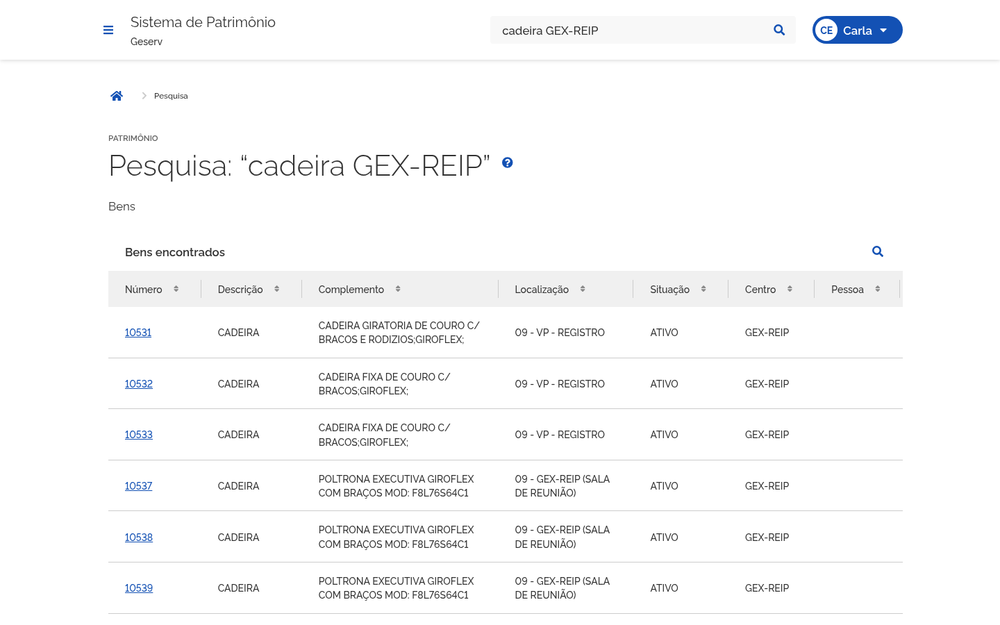
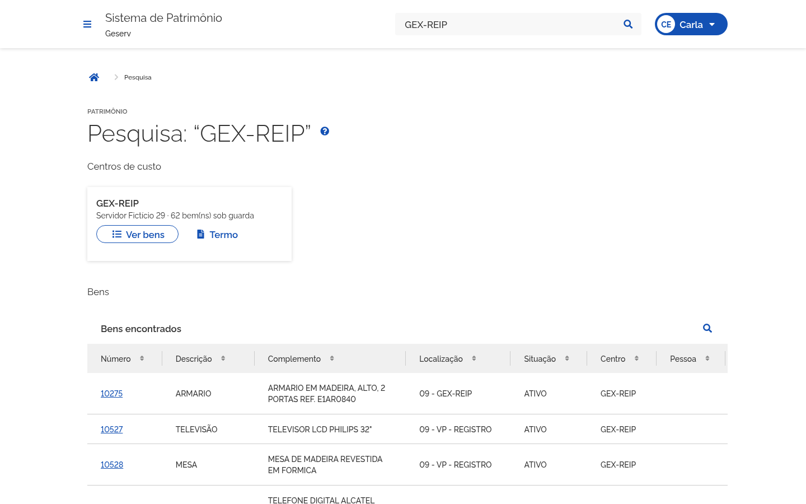
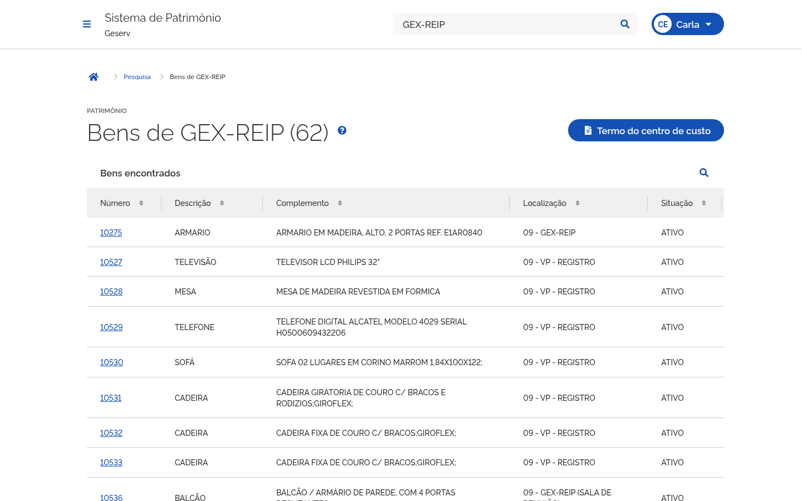
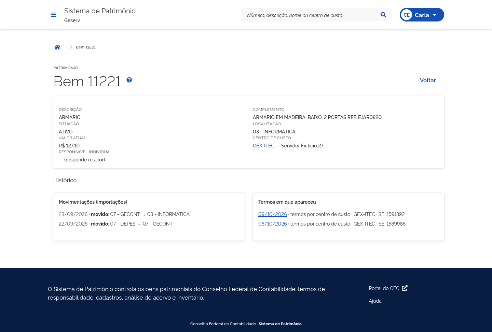
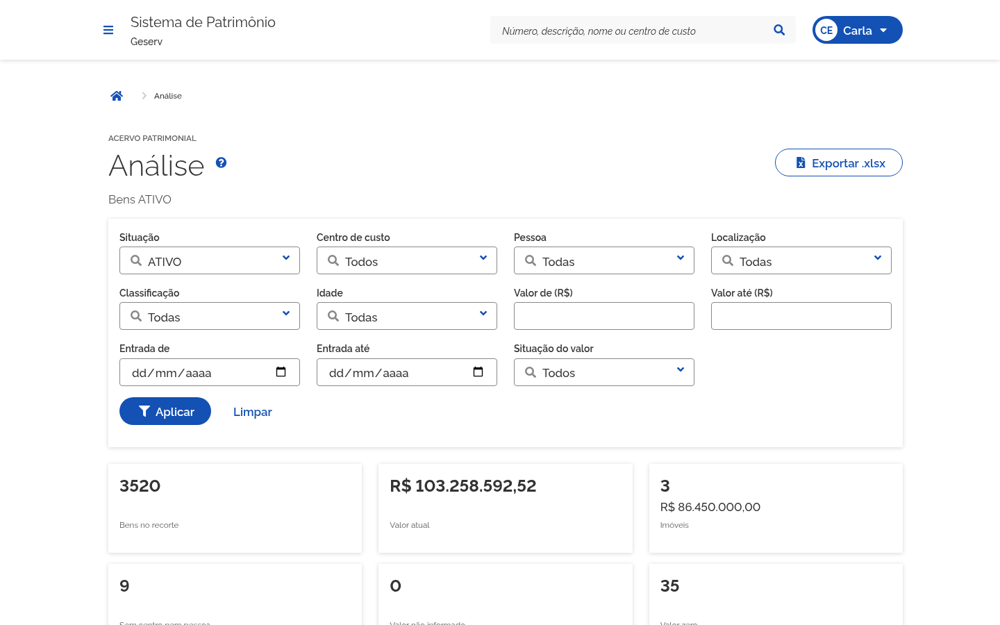
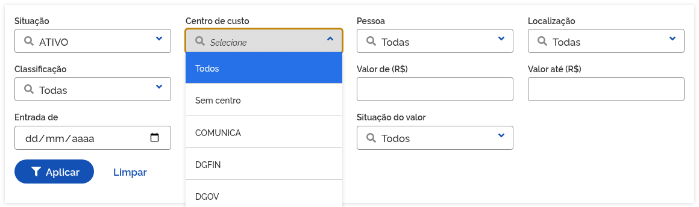
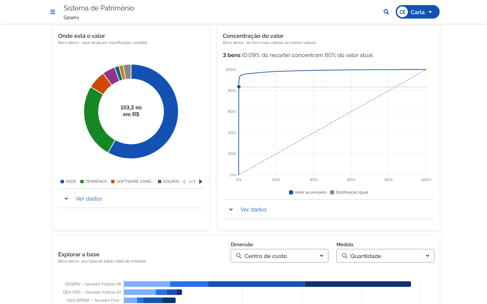
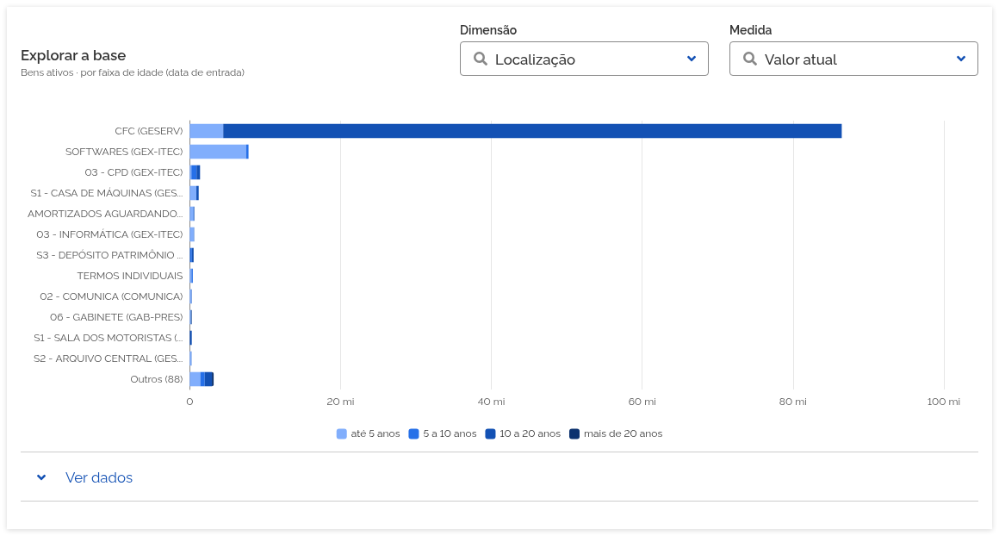
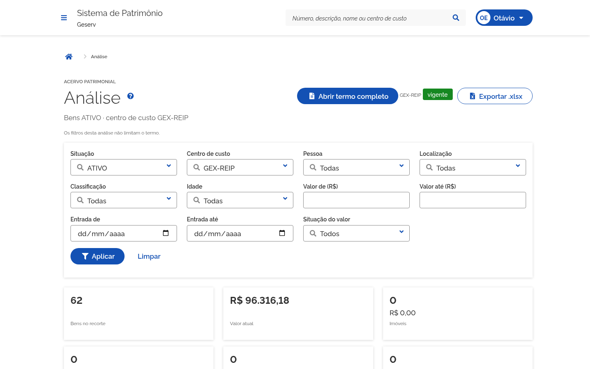

# Consultar bens e Análise

!!! info "Informações do procedimento"

    **Status editorial:** Em revisão · **Última revisão:** 22/10/2026 · **Sistemas envolvidos:** Sistema de Patrimônio

<button type="button" class="md-button checklist-print-button" aria-label="Imprimir ou salvar este procedimento como PDF">Imprimir</button>
<button type="button" class="md-button checklist-clear-button" aria-label="Limpar progresso do checklist deste procedimento">Limpar checklist</button>

Marcações salvas só neste navegador. Elas não constituem registro oficial nem histórico auditável.

## Objetivo

Encontrar um bem, ver tudo o que o sistema sabe sobre ele (localização, responsável, histórico, termos e
fotos do inventário) e montar recortes do acervo com filtros, gráficos e planilha.

## Quem pode

Administrador, Operador e Consulta.

## Antes de começar

- [ ] Ter entrado no sistema.
- [ ] Saber o número do patrimônio, parte da descrição, o nome da pessoa ou a sigla do centro de custo.

## Pesquisar e abrir a ficha do bem

1. **Digite a pesquisa na lupa do cabeçalho e tecle Enter**

    Veja as regras da pesquisa em [Navegação](navegacao.md#a-pesquisa-lupa-do-cabecalho). O resultado
    traz, quando houver, os **Centros de custo**, as **Pessoas** e os **Bens** encontrados.

    

2. **Para ver o acervo de um centro (ou de uma pessoa), pesquise a sigla (ou o nome)**

    O cartão do centro mostra o responsável, quantos bens estão sob guarda e os botões **Ver bens** e
    **Termo**.

    

3. **Clique em Ver bens**

    Abre a lista dos bens sob guarda do centro (os bens atribuídos individualmente a pessoas não entram),
    com o botão para o termo do centro.

    

4. **Clique no número de um bem**

    A **ficha do bem** mostra descrição, complemento, situação, localização, valor atual, o centro de custo
    (com o responsável) e o responsável individual, se houver. Em **Histórico**: as movimentações vindas
    das atualizações da base e os termos em que o bem apareceu. Se o bem foi fotografado num inventário, as
    fotos aparecem no fim, agrupadas por evento.

    

## Análise: filtros, gráficos e planilha

1. **Abra Análise no menu (ou no atalho do Início)**

    No alto ficam os filtros; abaixo, os indicadores, os gráficos e a lista de bens do recorte. Sem filtro,
    a Análise mostra os bens **ativos**.

    

2. **Escolha os filtros e clique em Aplicar**

    Filtre por situação, centro de custo, pessoa, localização, classificação, idade, faixa de valor, data
    de entrada e situação do valor. Nas listas, comece a digitar para achar a opção. **Limpar** volta ao
    padrão.

    

    !!! note "Nota"

        **Valor não informado** (o cadastro não traz o valor) e **valor zero** (R$ 0,00 cadastrado) são
        filtros diferentes. Bens sem valor informado não entram nas somas.

3. **Leia os gráficos**

    São seis cartões, sempre do recorte filtrado:

    - **Onde está o valor**: o valor atual por classificação contábil, com o total no meio do anel.
      Desligar uma classificação na legenda tira o valor dela do total.
    - **Concentração do valor**: quantos bens, dos mais valiosos para os menos, somam 80% do valor
      (a frase em destaque diz, por exemplo, "3 bens (0,09% do recorte) concentram 80% do valor atual").
    - **Explorar a base**: os bens por faixa de idade, na dimensão e na medida que você escolher.
    - **Entradas por ano**: quantos bens (ou quanto em valor de compra) entraram a cada ano, por classificação.
    - **Comprado × vale hoje**: o valor de compra ao lado do valor atual, por classificação.
    - **Cobertura de termos**: quanto dos bens ativos está com termo em dia, desatualizado ou sem termo, por
      centro de custo, termos individuais e bens sem responsável.

    

    Passe o mouse (ou toque) numa barra para ver o número exato, em reais quando o gráfico é de valor.
    Clicar numa barra ou fatia refina o filtro; **Ver dados** abre a tabela do gráfico.

4. **Troque a visão nos seletores do cartão**

    **Explorar a base** tem dois seletores no alto do cartão: **Dimensão** (centro de custo, localização,
    classificação, pessoa ou situação) e **Medida** (quantidade ou valor atual). **Entradas por ano** e
    **Cobertura de termos** têm o seletor **Medida**. O gráfico e a tabela de **Ver dados** mudam na hora,
    sem recarregar a página. Uma dimensão já fixada no filtro (por exemplo, um centro de custo) some do
    seletor.

    

5. **Para levar para o Excel, clique em Exportar .xlsx**

    O arquivo `analise.xlsx` traz **todos** os bens do filtro — mesmo quando a tela limita a lista a 1.000.

6. **Para ver o documento do centro ou da pessoa filtrada, clique em Abrir termo completo**

    Aparece quando o filtro é um centro de custo ou uma pessoa. Ao lado, a situação do termo (vigente,
    desatualizado ou sem termo).

    

    !!! warning "Cuidado"

        **Os filtros desta análise não limitam o termo**: o documento sai sempre inteiro, com todos os bens
        do centro ou da pessoa.

## O que acontece depois / onde confere

- A Análise não grava nada; pode filtrar à vontade.
- O endereço da página guarda os filtros: copie-o para mandar o mesmo recorte a um colega.

## Erros comuns e mensagens

| Situação | Explicação |
|---|---|
| *Muitos bens.* | A tabela mostra os 1.000 primeiros; use Exportar .xlsx para o recorte completo. |
| Valor não informado + faixa de valor não traz nada | É o esperado: bem sem valor não cabe em faixa nenhuma. |
| Bem de uso pessoal aparece no centro de custo | Falta atribuí-lo à pessoa em [Cadastros › Pessoas](cadastros.md#pessoas). |
| *Bem N não encontrado.* | O número não está na base (confira a plaqueta; bens novos só aparecem depois da [atualização da base](textos-atualizar-base.md#atualizar-a-base-de-bens)). |
