# Termos de Responsabilidade e Devolução

!!! info "Informações do procedimento"

    **Status editorial:** Em revisão · **Última revisão:** 22/10/2026 · **Sistemas envolvidos:** Sistema de Patrimônio, SEI

<button type="button" class="md-button checklist-print-button" aria-label="Imprimir ou salvar este procedimento como PDF">Imprimir</button>
<button type="button" class="md-button checklist-clear-button" aria-label="Limpar progresso do checklist deste procedimento">Limpar checklist</button>

Marcações salvas só neste navegador. Elas não constituem registro oficial nem histórico auditável.

## Objetivo

Preparar e emitir os documentos que formalizam a guarda dos bens:

- **Termo de Responsabilidade por centro de custo** — os bens ativos nas localizações do centro, menos os
  atribuídos a pessoas; assina o responsável pelo centro;
- **Termo de Responsabilidade individual** — os bens atribuídos a uma pessoa (notebooks, celulares...);
- **Termo de Devolução** — os bens que uma pessoa devolve à Geserv.

O sistema monta o documento a partir dos cadastros, cria-o no **SEI** (ou deixa copiar/baixar para fazer à
mão), guarda um **retrato** dos bens daquele momento e acompanha o pedido de assinatura.

!!! note "Relação com o procedimento antigo"

    O procedimento [Emissão de termo de responsabilidade](../termos-relatorios/termos-responsabilidade/index.md)
    descreve a emissão pelo programa antigo, a partir da planilha `acervo.xlsx`. No Sistema de Patrimônio a
    base de bens é atualizada sozinha a partir do SPW (veja [Atualizar base](textos-atualizar-base.md)) e
    os termos saem prontos para o SEI.

## Quem pode

- **Ver** termos, prévias e termos emitidos: Administrador, Operador e Consulta.
- **Emitir** (Emitir Termo no SEI, Copiar para o SEI, Baixar .docx, Baixar planilha), anotar documento e
  bloco e enviar o e-mail: Administrador e Operador.

## Antes de começar

- [ ] Existe um **processo SEI vigente** para o tipo de termo (veja [Cadastros › Processos SEI](cadastros.md#processos-sei)).
- [ ] O centro de custo tem **responsável**, **função** e **matrícula** cadastrados; a pessoa tem
  **unidade no SEI** (termo individual e de devolução). Veja [Cadastros](cadastros.md).
- [ ] Para **Emitir Termo no SEI**: o seu acesso ao SEI está cadastrado em [Meus acessos](entrar.md#meus-acessos-sei-e-spw)
  e o bloco de assinatura **Termos {sigla}** existe na sua unidade do SEI.
- [ ] A base de bens está atualizada (Início › última importação).

## Termo por centro de custo

1. **Abra Termos de Responsabilidade › Termo por centro de custo**

    A tabela mostra a situação de cada centro: responsável, quantidade e valor dos bens, data do último
    termo, **Situação** (*vigente*, *desatualizado +N −N* ou *sem termo*) e se o e-mail de assinatura foi
    enviado.

    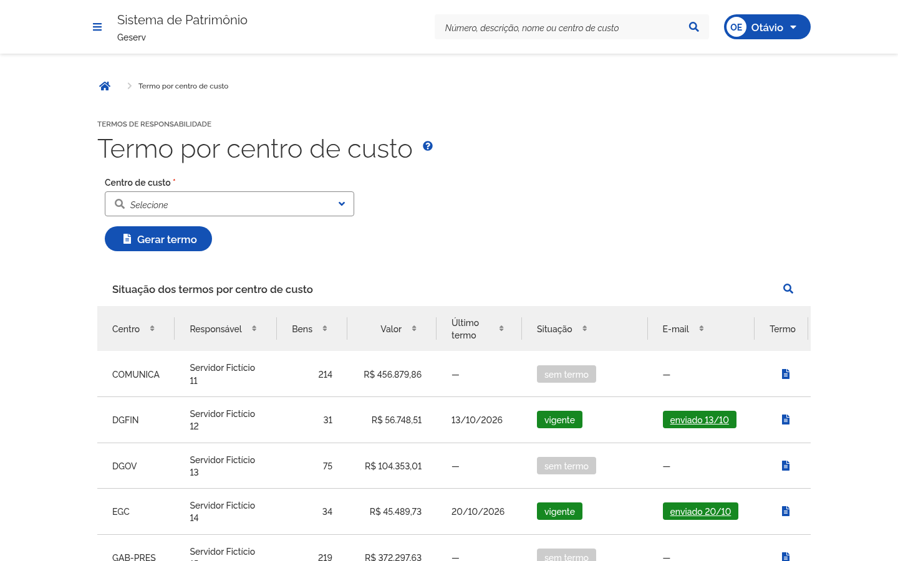

2. **Escolha o centro de custo na lista**

    Comece a digitar a sigla para encontrá-la mais rápido. Também é possível clicar no ícone de documento
    na linha do centro, na tabela.

    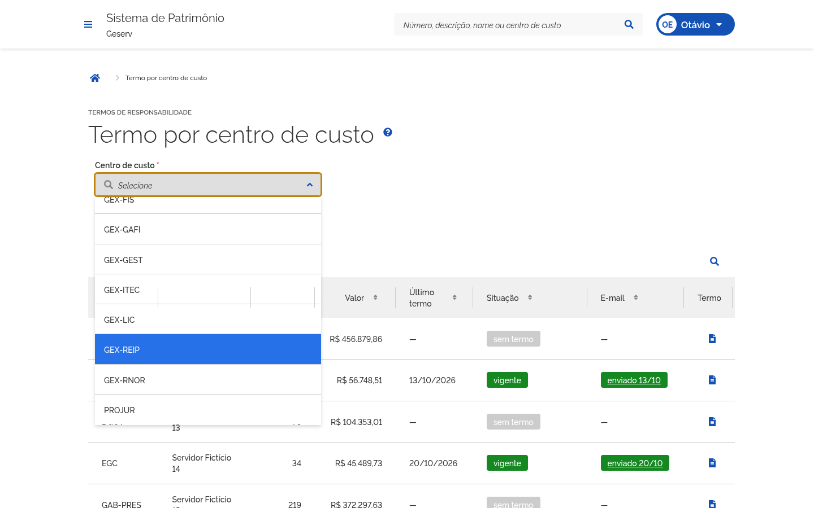

3. **Clique em Gerar termo**

    Abre a **prévia** do documento, com o processo SEI vigente e o último termo registrado. Confira o
    responsável, a matrícula, a função e a lista de bens.

    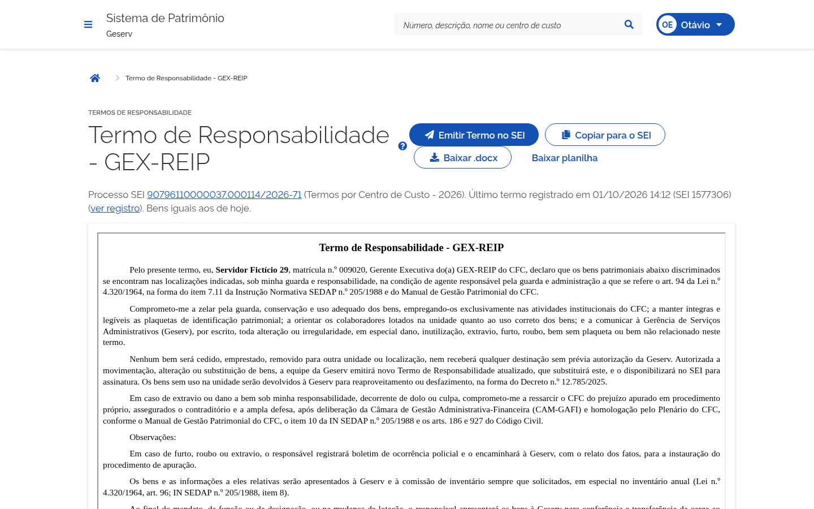

    !!! tip "Dica"

        Abrir a prévia **não registra** emissão nenhuma. Só os botões Emitir Termo no SEI, Copiar para o SEI
        e Baixar .docx registram.

4. **Escolha como emitir**

    - **Emitir Termo no SEI** (recomendado) — o sistema registra a emissão, numera o termo e coloca o pedido
      na fila do robô, que cria o documento no processo e o inclui no bloco de assinatura (passo 5);
    - **Copiar para o SEI** — copia o documento formatado; cole no editor do SEI com `Ctrl+V`. A mensagem
      verde confirma a cópia e a hora da emissão registrada;
    - **Baixar .docx** — baixa o documento em Word;
    - **Baixar planilha** — a lista de bens do centro em Excel (não registra emissão).

    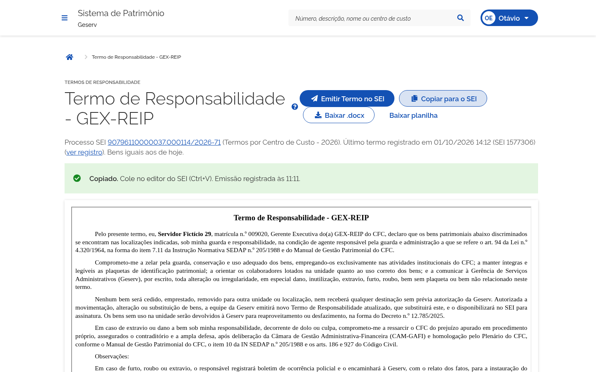

5. **Se usou Emitir Termo no SEI, acompanhe a emissão**

    Abre o **registro** da emissão com *Emitindo no SEI: aguardando a vez…*. A tela se atualiza sozinha a
    cada poucos segundos. Quando o robô termina, aparecem o número do documento e o bloco de assinatura.

    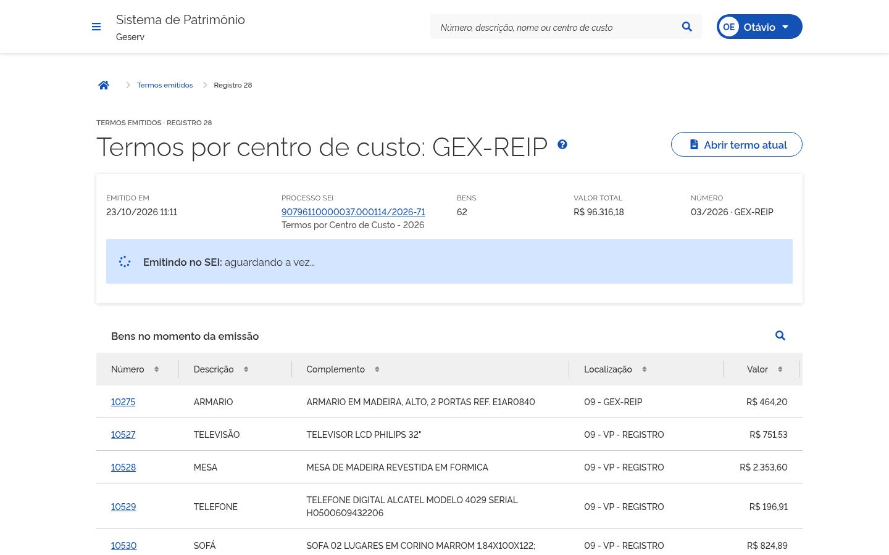

    !!! warning "Cuidado"

        Se depois de alguns minutos aparecer *A emissão ainda não começou; avise o administrador.*, o robô
        não está atendendo a fila. Se aparecer *Não foi possível emitir no SEI*, leia o motivo (por exemplo,
        bloco inexistente) e use **Emitir Termo no SEI** de novo ou **Incluir no bloco** depois de corrigir.

## Anotar o documento à mão e enviar o pedido de assinatura

Quando o termo foi **copiado** ou **baixado**, você mesmo cria o documento no SEI. Depois, anote o número no
sistema para fechar o registro.

1. **Na prévia do termo, clique em ver registro** (ou abra o registro em Termos emitidos)

    O registro mostra a data, o processo, a quantidade e o valor dos bens e os campos **Número do termo**,
    **Documento no SEI** e **Bloco de assinatura**.

    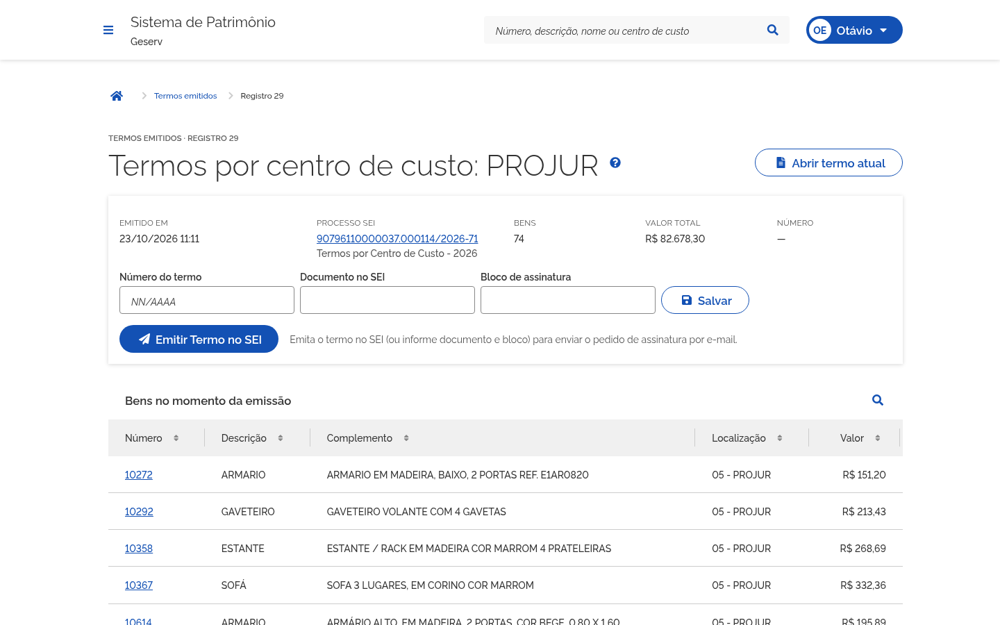

2. **Preencha o documento e o bloco do SEI e clique em Salvar**

    Aparece *Documento e bloco SEI salvos.* e o botão **Enviar email**.

    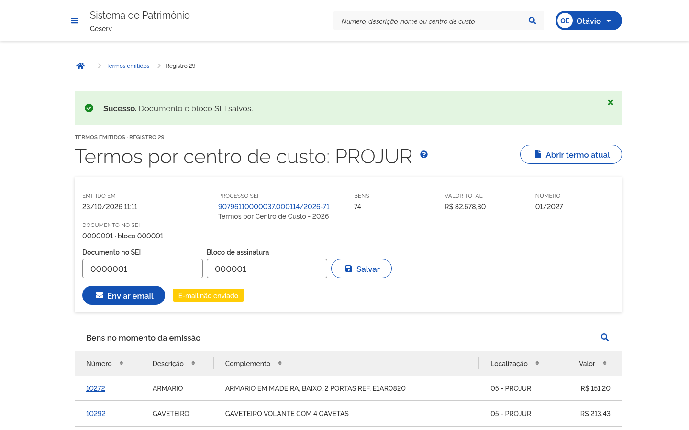

3. **Clique em Enviar email**

    O seu programa de e-mail abre com o destinatário (o responsável pelo centro ou a pessoa), o assunto e o
    texto do pedido de assinatura prontos. Envie a mensagem. O sistema registra a data do envio e a etiqueta
    passa a *E-mail enviado em…*.

    !!! note "Nota"

        O botão só aparece quando há e-mail cadastrado para o responsável ou a pessoa e quando o registro tem
        documento e bloco. O texto do e-mail é editável em [Textos](textos-atualizar-base.md#textos-dos-termos).

## Termo individual

1. **Abra Termos de Responsabilidade › Termo individual**

    A tabela lista as pessoas com bens atribuídos e a situação de cada termo.

    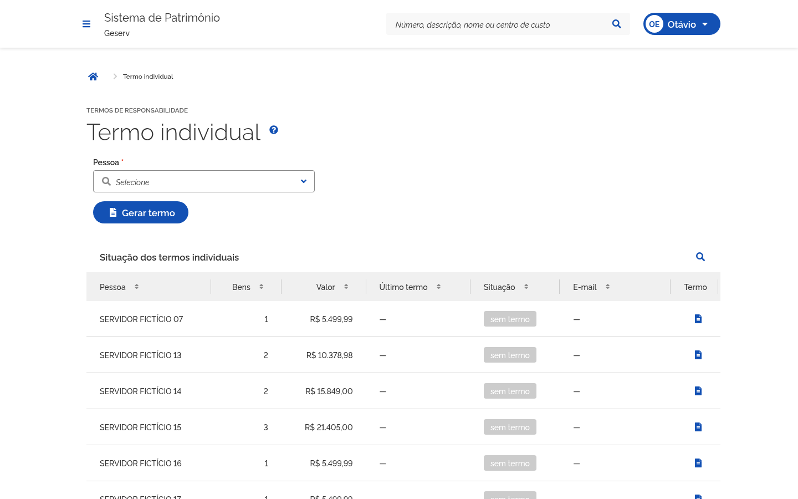

2. **Escolha a pessoa e clique em Gerar termo**

    Confira a prévia: os bens atribuídos à pessoa e o total.

    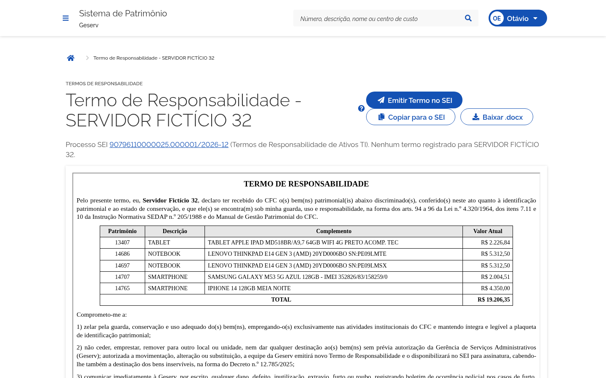

3. **Emita como no termo por centro de custo** (Emitir Termo no SEI, Copiar para o SEI ou Baixar .docx)

    Para emitir no SEI, a pessoa precisa ter **unidade no SEI** cadastrada em [Pessoas](cadastros.md#pessoas).

## Termo de devolução

1. **Abra Termos de Responsabilidade › Termo de devolução**

    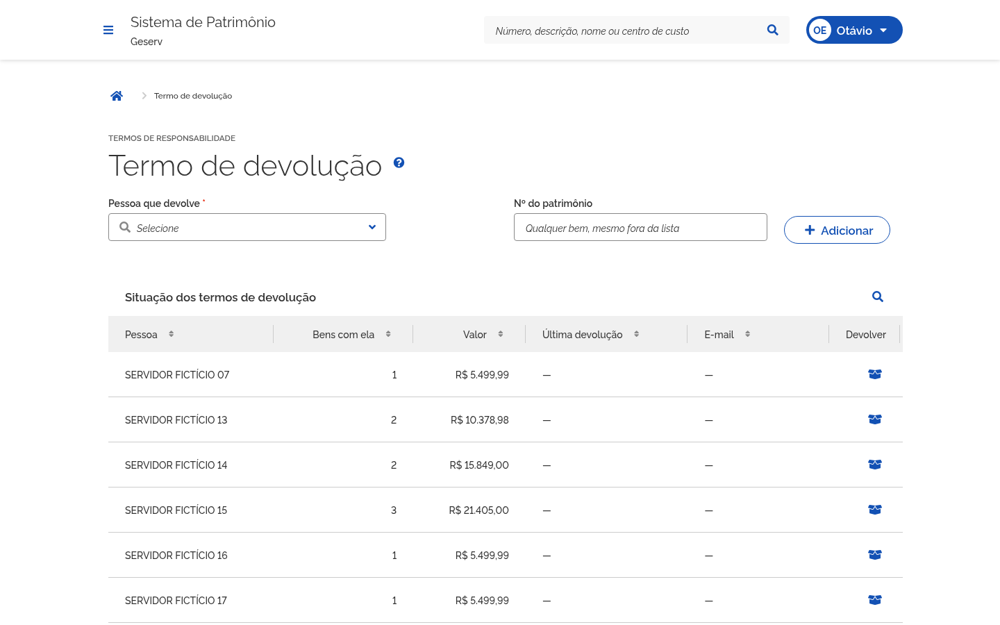

2. **Escolha a pessoa que devolve**

    O sistema mostra os bens que estão com ela, como **sugestão**.

    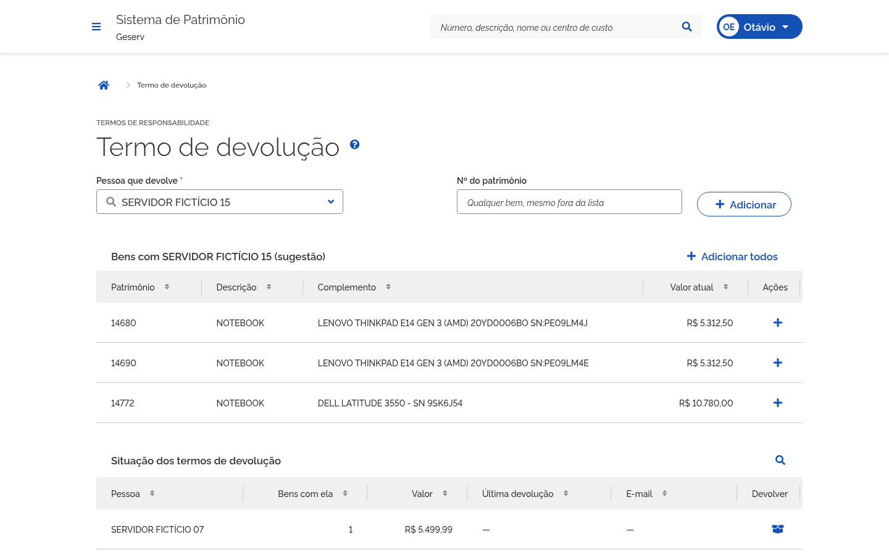

3. **Monte a lista de bens a devolver**

    Use **Adicionar todos**, o **+** de cada linha, ou digite qualquer número em **Nº do patrimônio** e clique
    em **Adicionar** (serve para bens que não estão atribuídos a ela). A lixeira tira um bem da lista;
    **Limpar lista** recomeça.

    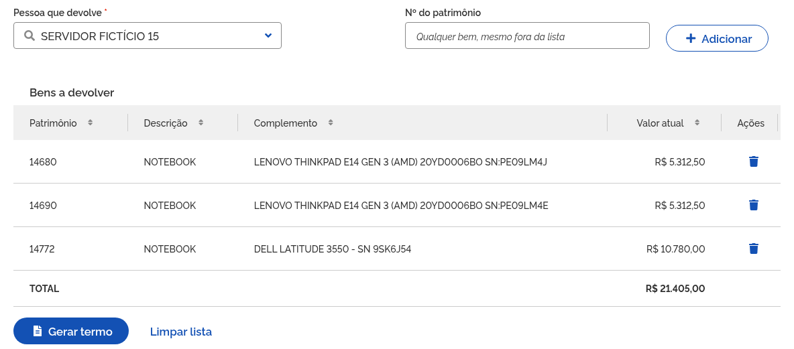

4. **Clique em Gerar termo e emita**

    A prévia traz a declaração da pessoa, a lista, a data e o atesto de recebimento por quem recebe a
    devolução na Geserv (nome e cargo vêm de [Textos](textos-atualizar-base.md#textos-dos-termos)).

    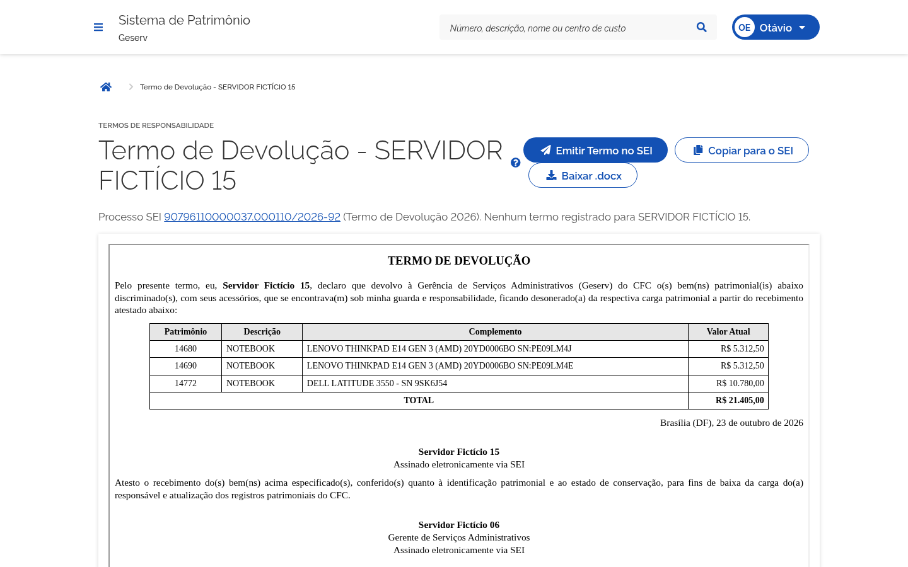

!!! warning "Cuidado"

    O termo de devolução **não muda** as atribuições nem o SPW. Depois de assinado, registre a devolução no
    SPW e retire o vínculo do bem com a pessoa em [Cadastros › Pessoas](cadastros.md#pessoas).

## Termos emitidos

1. **Abra Termos de Responsabilidade › Termos emitidos**

    Cada linha é uma emissão: data, tipo, centro ou pessoa, bens, valor, número do termo, processo,
    documento e bloco no SEI (*enviando…* enquanto o robô trabalha) e, numa etiqueta verde, a data em que o
    e-mail de assinatura foi enviado.

    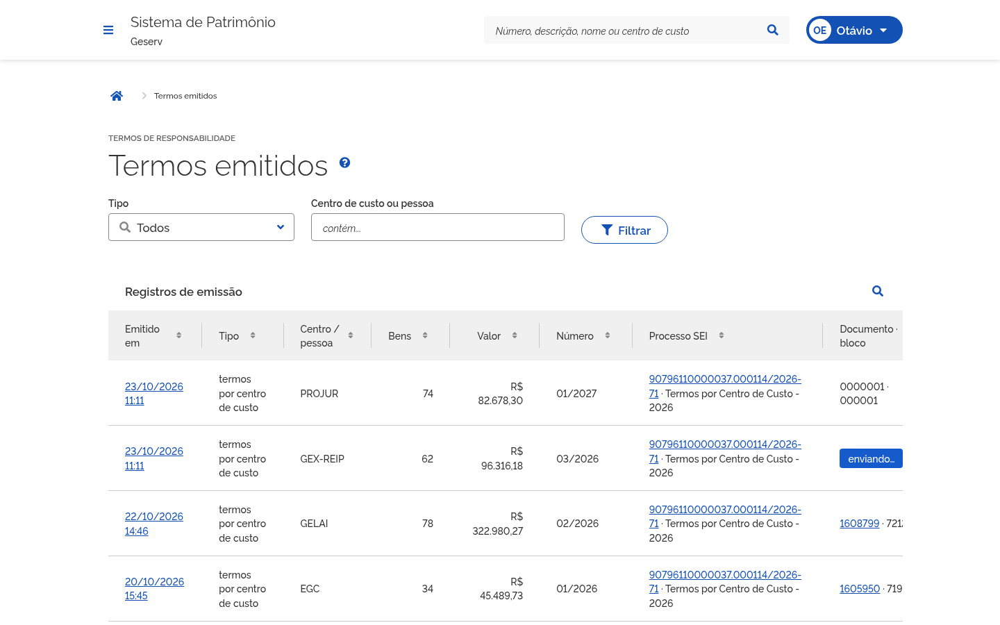

2. **Filtre por tipo e por centro ou pessoa e clique em Filtrar**

    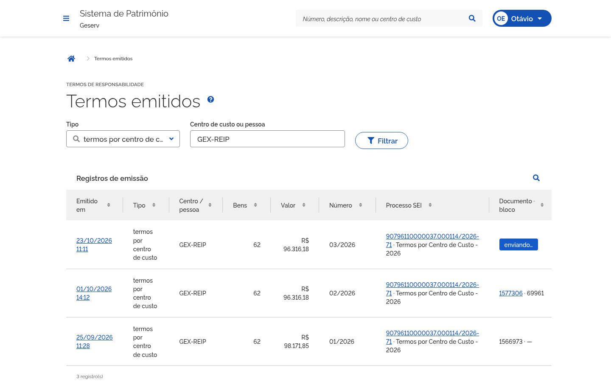

3. **Clique na data para abrir o registro**

    O registro guarda os **bens no momento da emissão** — mesmo que a base mude depois.

## O que acontece depois / onde confere

- Na tela do termo, a frase *Último termo registrado em…* e a situação *Bens iguais aos de hoje* ou
  *Desde então entraram N e saíram N bem(ns): emita de novo*.
- Nas listas de termos, a situação **vigente** (verde), **desatualizado** (amarelo) ou **sem termo** (cinza).
- Na ficha de cada bem, a lista *Termos em que apareceu*.
- No SEI: o documento no processo vigente e no bloco **Termos {sigla}**, à espera da assinatura.

## Erros comuns e mensagens

| Mensagem | O que fazer |
|---|---|
| *Sem processo SEI. Cadastre um processo SEI vigente…* | Cadastre ou torne vigente um processo do tipo em [Cadastros › Processos SEI](cadastros.md#processos-sei). |
| *Atenção. Nenhum bem neste termo.* | O centro não tem bens ativos nas suas localizações (ou todos estão atribuídos a pessoas). Confira as [localizações](cadastros.md#localizacoes). |
| *Cadastre seu acesso ao SEI em Meus acessos para emitir.* | Cadastre o acesso em [Meus acessos](entrar.md#meus-acessos-sei-e-spw). |
| *Cadastre a unidade SEI de … em Cadastros → Pessoas.* | Preencha **Unidade no SEI** na pessoa (no centro de custo, só se a sigla no SEI for diferente da sigla do centro). |
| *Não copiado.* | O navegador bloqueou a cópia: selecione o texto do documento e copie com `Ctrl+C`. |
| *Não foi possível emitir no SEI: Bloco 'Termos X' não existe…* | Crie o bloco no SEI e clique em **Incluir no bloco** no registro. |
| *O SEI recusou seu usuário ou senha; atualize em Meus acessos.* | Atualize a senha do SEI em Meus acessos e emita de novo. |
| Termo **desatualizado** | Entraram ou saíram bens desde a última emissão. Emita de novo; o anterior fica no histórico. |
