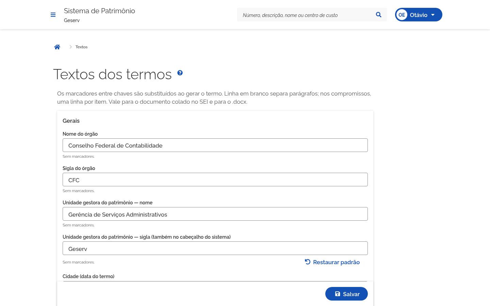
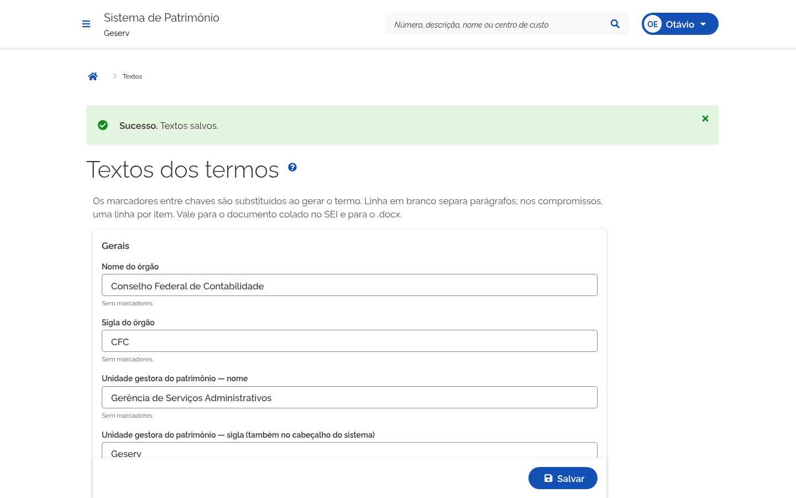
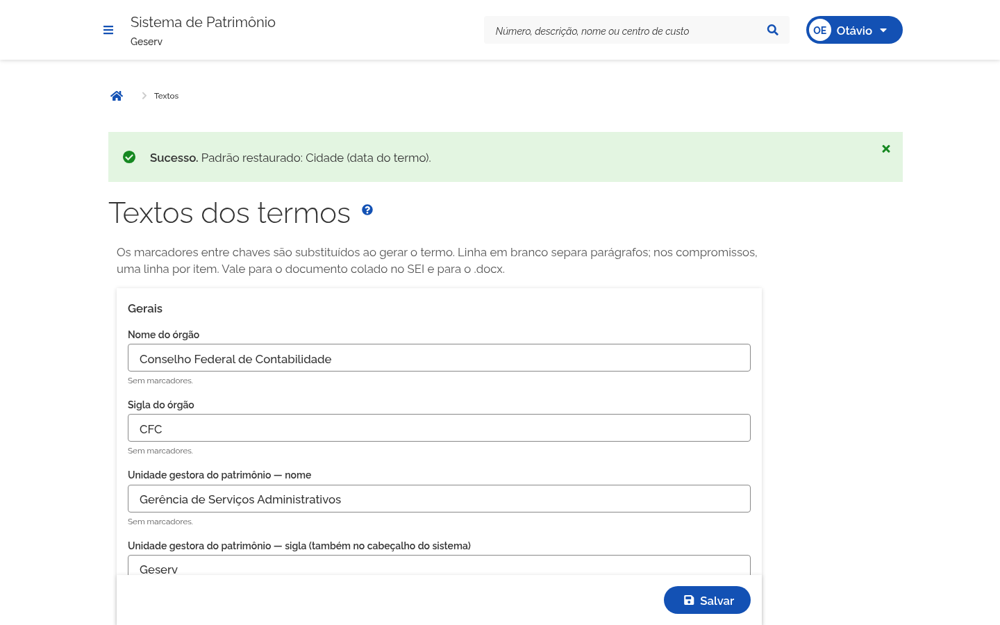
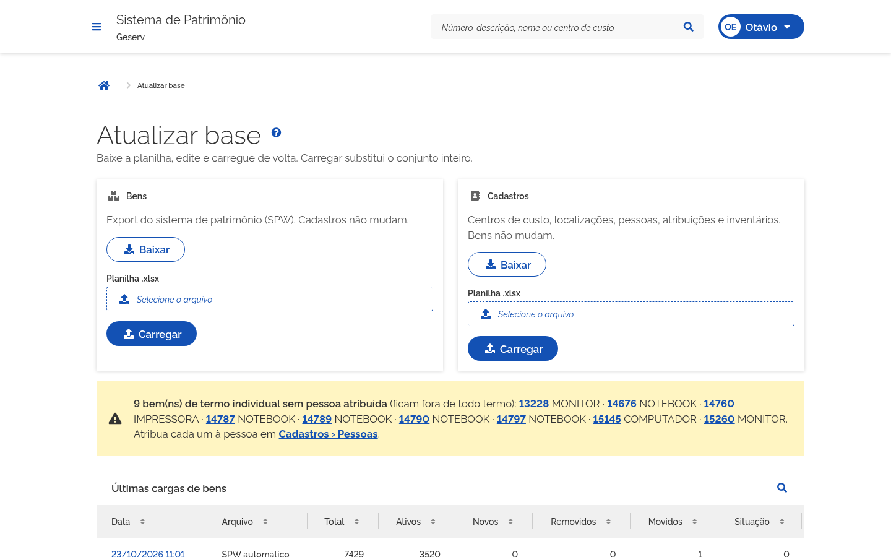
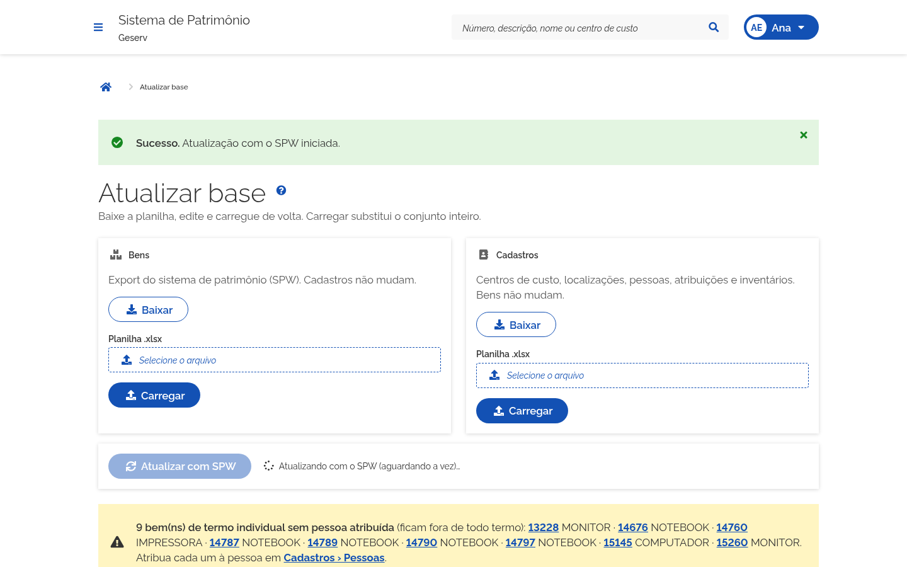
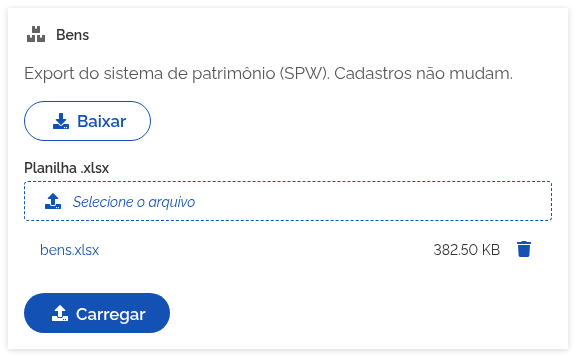
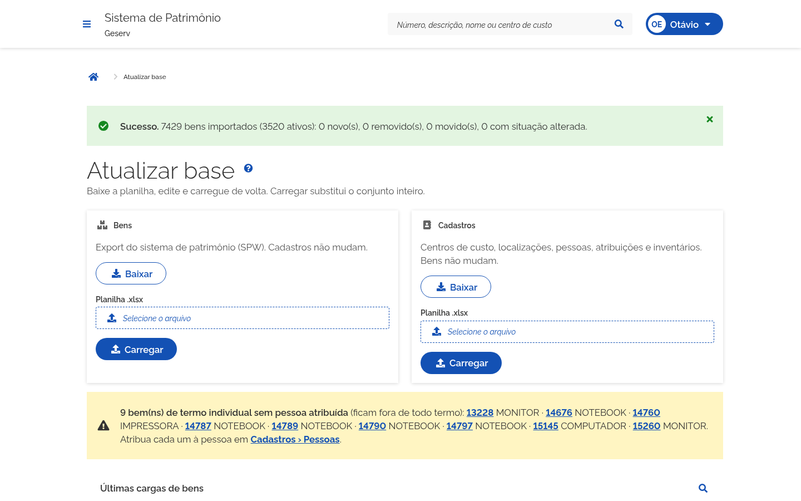
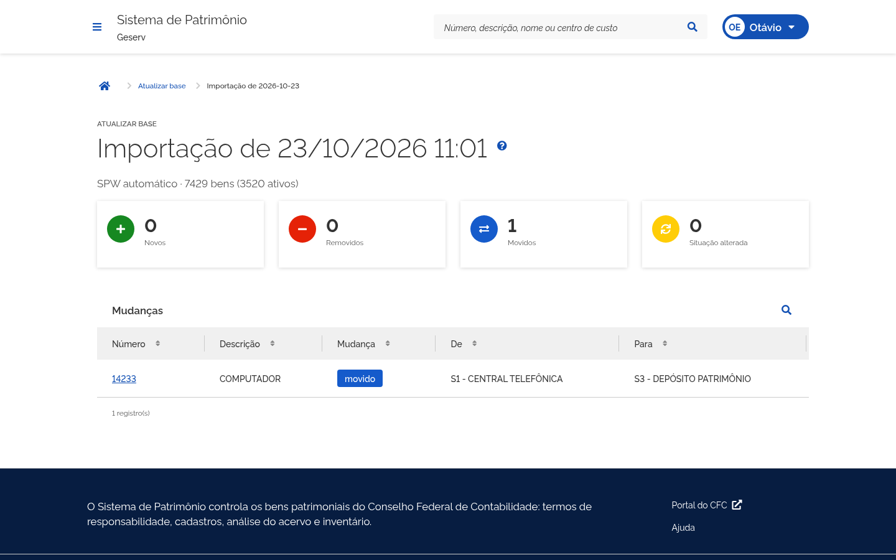

# Textos e Atualizar base

!!! info "Informações do procedimento"

    **Status editorial:** Em revisão · **Última revisão:** 22/10/2026 · **Sistemas envolvidos:** Sistema de Patrimônio, SPW

<button type="button" class="md-button checklist-print-button" aria-label="Imprimir ou salvar este procedimento como PDF">Imprimir</button>
<button type="button" class="md-button checklist-clear-button" aria-label="Limpar progresso do checklist deste procedimento">Limpar checklist</button>

Marcações salvas só neste navegador. Elas não constituem registro oficial nem histórico auditável.

## Objetivo

- Ajustar os **textos** que aparecem nos termos (abertura, compromissos, assinatura, quem recebe a
  devolução, cidade, e-mail de assinatura e tipo de documento do SEI).
- Manter a **base de bens** igual à do SPW, de onde vêm número, descrição, situação, localização e valor de
  cada bem.

## Quem pode

- Textos e carga da planilha de bens: Administrador e Operador.
- **Atualizar com SPW** e carga da **planilha de cadastros**: só o Administrador.

## Antes de começar

- [ ] Para Atualizar com SPW: o seu acesso ao SPW cadastrado em [Meus acessos](entrar.md#meus-acessos-sei-e-spw).
- [ ] Para carregar bens à mão: o export do SPW em `.xlsx` (veja o passo a passo do export nos passos 1 a 3
  de [Emissão de termo de responsabilidade](../termos-relatorios/termos-responsabilidade/index.md)).

## Textos dos termos

1. **Abra Textos no menu**

    Os campos estão agrupados: Gerais, Termo individual, Termo por centro de custo, Termo de devolução,
    E-mail de assinatura no SEI e Emissão no SEI. Abaixo de cada campo aparecem os **marcadores** que ele
    aceita, como `{nome}` e `{ccustos}`, que o sistema troca pelos dados de cada termo.

    

2. **Altere o texto e clique em Salvar** (a barra com o Salvar fica sempre no pé da tela)

    Aparece *Textos salvos.* Vale para o documento copiado para o SEI, para o emitido pelo robô e para o
    `.docx`.

    

3. **Para desfazer, clique em Restaurar padrão** ao lado do campo alterado

    O botão só aparece nos campos diferentes do texto original.

    

!!! warning "Cuidado"

    Não apague nem renomeie os marcadores entre chaves. Linha em branco separa parágrafos; nos compromissos,
    é uma linha por item. O **tipo de documento** (grupo Emissão no SEI) tem de ser igual ao nome do tipo na
    lista *Gerar Documento* do SEI, senão o robô não consegue criar o documento.

## Atualizar a base de bens

A base é atualizada **sozinha**: todo dia útil, de manhã, um robô entra no SPW, exporta a relação de bens e
importa o que mudou. O quadro *última importação* do Início mostra a data e se o robô deu certo, e a tela
Atualizar base lista as últimas cargas e as últimas execuções do robô. Use os procedimentos abaixo só quando
precisar da base atualizada **agora** ou quando o robô falhar.

### Pedir a atualização ao robô (só administrador)

1. **Em Atualizar base, clique em Atualizar com SPW**

    O pedido entra na fila; a tela mostra *Atualizando com o SPW (aguardando a vez)…* e se atualiza sozinha.

    

2. **Aguarde o fim** — a nova linha aparece em *Últimas cargas de bens* e em *Atualizações com o SPW*

!!! note "Quando o robô não entra no SPW"

    O login do SPW tem a caixa "Não sou um robô". Às vezes ela pede o desafio de imagens e o robô para; o
    Início mostra que o reCAPTCHA do SPW não liberou. Nesse caso, carregue a planilha à mão (abaixo). O robô
    também se recusa a importar um export com menos de 90% dos bens da base — proteção contra arquivo vazio
    ou cortado.

### Carregar a planilha de bens à mão

1. **Exporte a relação de bens do SPW**

    Siga os passos 1 a 3 de [Emissão de termo de responsabilidade](../termos-relatorios/termos-responsabilidade/index.md)
    (Sistema Gerencial › Bens patrimoniais › Exportar). Abra o arquivo baixado no Excel, **apague as linhas
    acima do cabeçalho "Número Bem"** e salve como `.xlsx`.

2. **No quadro Bens, clique em Selecione o arquivo e escolha a planilha**

    O nome e o tamanho do arquivo aparecem abaixo. **Baixar** (no mesmo quadro) guarda uma cópia da base
    atual, no mesmo formato — use-a como cópia de segurança.

    

3. **Clique em Carregar e confirme a pergunta do navegador**

    O sistema mostra o resumo: total de bens, ativos, novos, removidos, movidos e com situação alterada.

    

4. **Para ver o que mudou, clique na data da carga em Últimas cargas de bens**

    A tela da importação lista bem a bem o que entrou, saiu, mudou de lugar ou de situação. Cada mudança
    também fica na ficha do bem.

    

!!! warning "Cuidado"

    Carregar **substitui a tabela de bens inteira** pela planilha. Os cadastros (centros, localizações,
    pessoas, atribuições), os termos e os inventários **não mudam**. Inventários já finalizados guardam o
    retrato dos bens de quando foram finalizados.

Depois de carregar, confira os avisos amarelos da tela: **localizações ativas sem centro de custo** e
**bens de termo individual sem pessoa** precisam ser resolvidos em [Cadastros](cadastros.md).

### Carregar a planilha de cadastros (só administrador)

Serve para carga em massa ou migração. Baixe a planilha no quadro **Cadastros** (ou em Cadastros › Baixar
todos os cadastros), edite no Excel, escolha o arquivo e clique em **Carregar**.

!!! danger "Perigo"

    A planilha de cadastros **substitui as quatro tabelas inteiras** (centros de custo, localizações, pessoas
    e atribuições). As abas de inventário (`inv_*`) só são aceitas **todas juntas** — e então substituem
    **todos os inventários** — ou nenhuma (os inventários ficam como estão). Baixe uma cópia antes de
    carregar.

## O que acontece depois / onde confere

- Início › **última importação** com a data de hoje.
- Atualizar base › **Últimas cargas de bens** e **Atualizações com o SPW**.
- Termos que ficaram **desatualizados** nas listas de termos.

## Erros comuns e mensagens

| Mensagem | O que fazer |
|---|---|
| *Carregue o export do sistema de patrimônio em .xlsx.* | Escolha um arquivo `.xlsx` (o `.xls` do SPW precisa ser salvo como `.xlsx`). |
| *Arquivo muito grande: o limite é 20 MB.* | Confira se é o arquivo certo. |
| *Cadastre seu acesso ao SPW em Meus acessos para atualizar.* | Cadastre o acesso ao SPW. |
| *Última atualização falhou: …* | Leia o motivo; tente de novo mais tarde ou carregue a planilha à mão. |
| *base desatualizada* / *SPW falhou* no Início | O robô não atualizou; avise o administrador ou carregue a planilha. |
