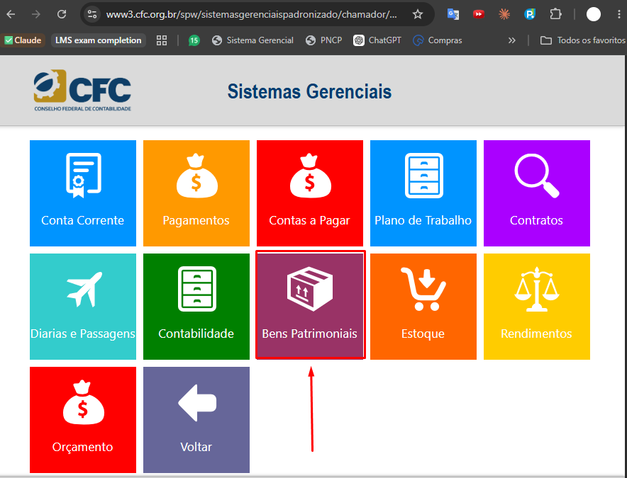
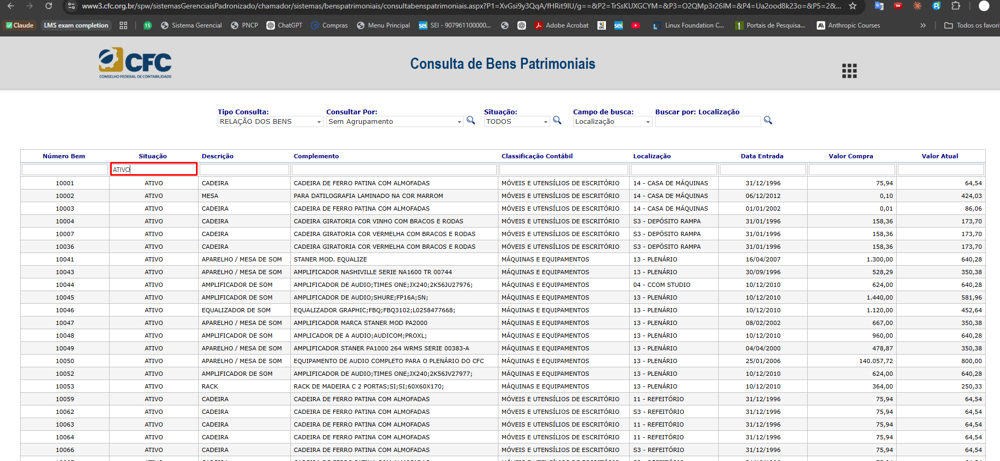
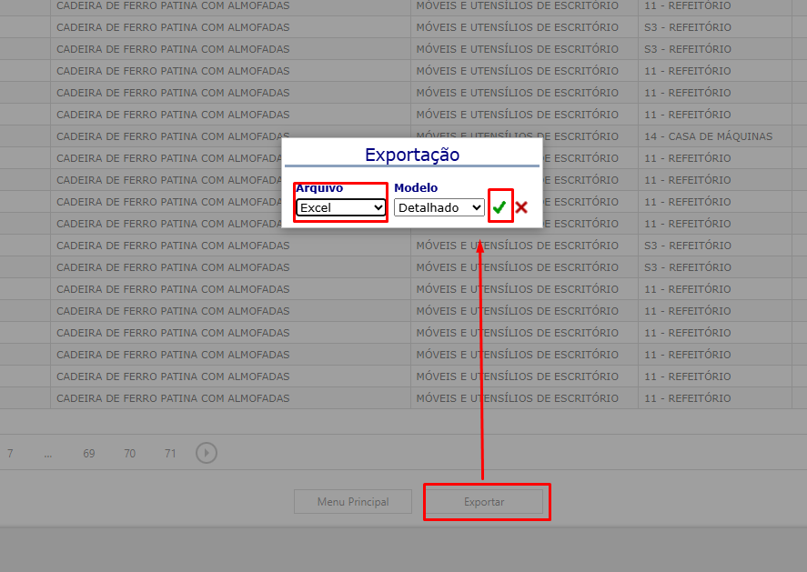
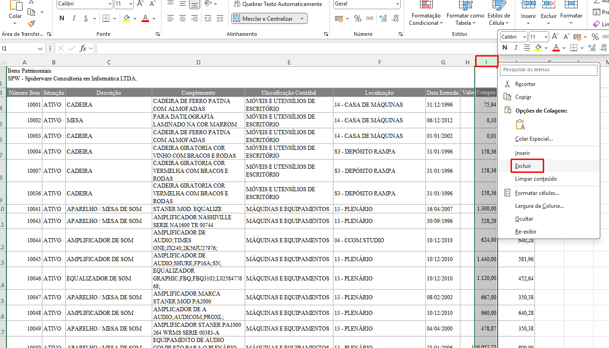
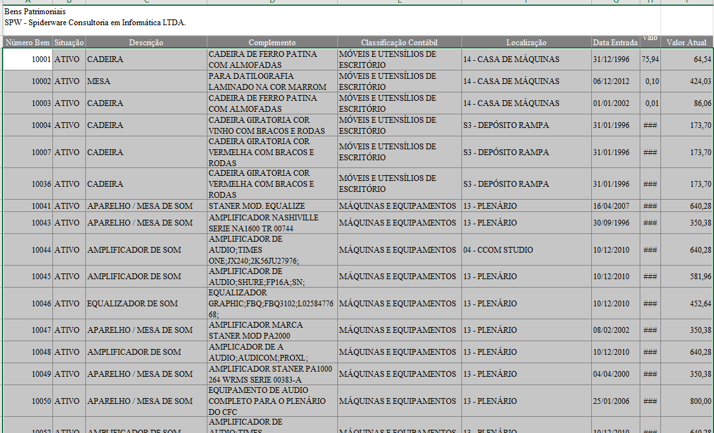
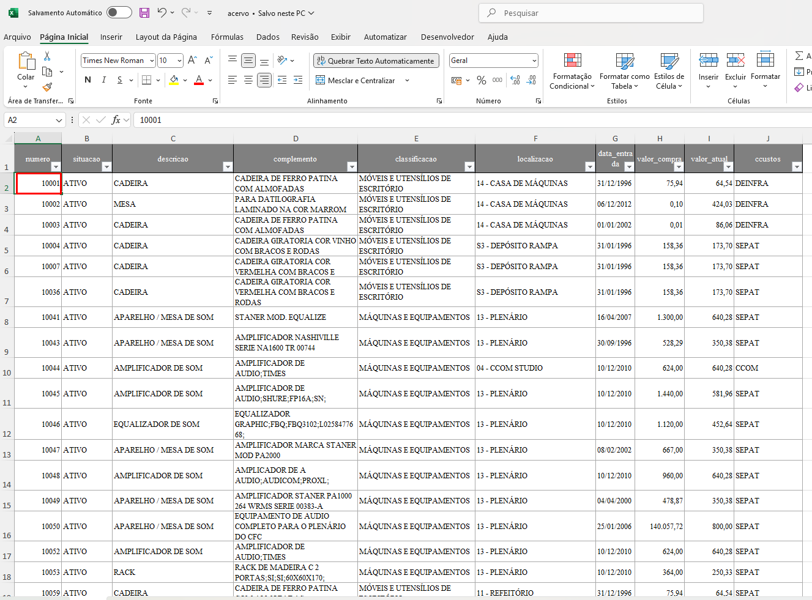
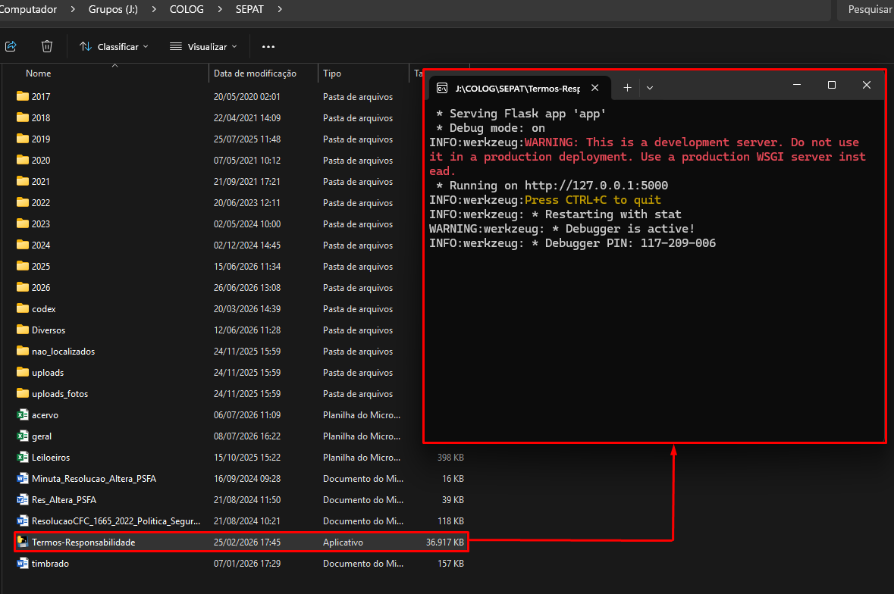
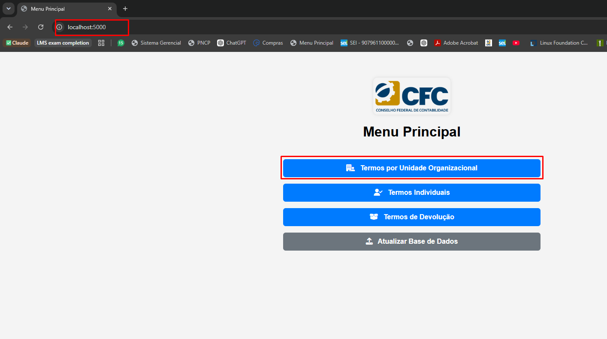
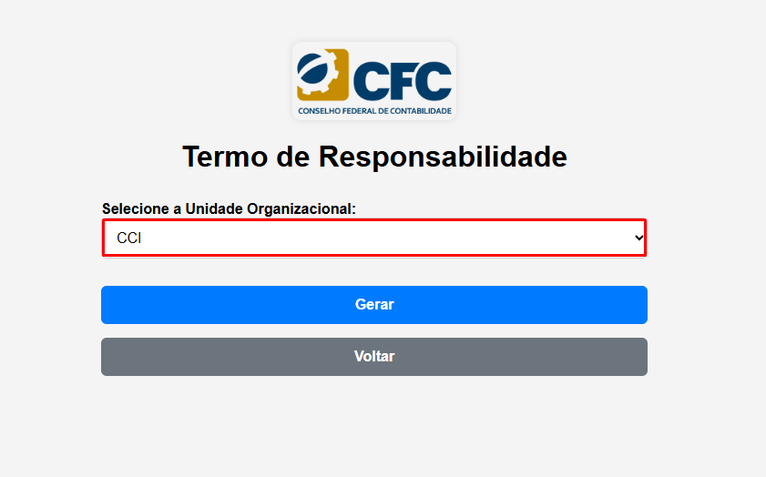
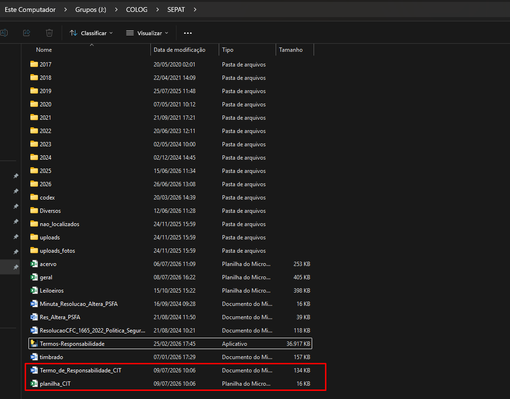

# Emissão de termo de responsabilidade

!!! info "Informações do procedimento"

    **Status editorial:** Em revisão · **Última revisão:** 08/07/2026 · **Sistemas envolvidos:** SBP, Termos-Responsabilidade

<button type="button" class="md-button checklist-print-button" aria-label="Imprimir ou salvar este procedimento como PDF">Imprimir</button>
<button type="button" class="md-button checklist-clear-button" aria-label="Limpar progresso do checklist deste procedimento">Limpar checklist</button>

Marcações salvas só neste navegador. Elas não constituem registro oficial nem histórico auditável.

## Objetivo

Atualizar a planilha de acervo a partir do relatório gerencial do SBP e emitir os termos de responsabilidade por unidade organizacional, garantindo que os dados impressos reflitam a situação atual dos bens ativos.

## Pré-requisitos

Antes de iniciar, verifique se você possui:

- [ ] Acesso ao link gerencial do SBP com perfil que permita gerar relatórios do módulo financeiro.
- [ ] Acesso de rede à pasta `J:\colog\sepat`.
- [ ] Microsoft Excel instalado.
- [ ] Navegador padrão disponível para acessar `localhost:5000`.

!!! warning "Cuidado"

    Não altere a estrutura de colunas da planilha `acervo.xlsx`. Qualquer mudança de layout quebrará a leitura pelo sistema emissor dos termos.

## Passos

1. **Acesse o relatório de bens patrimoniais no gerencial**

    Abra o <a href="https://www3.cfc.org.br/spw/sistemasgerenciaispadronizado/chamador/login.aspx" target="_blank" rel="noopener noreferrer"> Sistema Gerencial </a> , acesse o **módulo financeiro** e, em seguida, o submódulo **bens patrimoniais**.

    

2. **Filtre pelos bens ativos**

    No relatório, no campo **Situação**, digite `ativo` para filtrar apenas os bens ativos.

    

3. **Exporte o relatório para Excel**

    Clique em **Exportar**, selecione **Arquivo Excel** e marque a opção **check (em V)**. Baixe o arquivo gerado.

    

4. **Ajuste a planilha exportada**

    Abra a planilha baixada e **apague a coluna I**.

    !!! note "Nota"

        A remoção da coluna I é obrigatória para manter o padrão da planilha de destino, de onde o sistema emissor dos termos de responsabilidade lerá os dados.

    

5. **Selecione e copie o intervalo de dados**

    Clique na célula **A4** e execute, em sequência:

    - `Ctrl + Shift + →` (seleciona até a última coluna preenchida à direita)
    - `Ctrl + Shift + ↓` (estende a seleção até a última linha preenchida)
    - `Ctrl + C` (copia o intervalo)

    

6. **Cole os dados em `acervo.xlsx`**

    Acesse `J:\colog\sepat` e abra a planilha destino **`acervo.xlsx`**. Selecione a célula **A2** e cole (`Ctrl + V`) o conteúdo da área de transferência.

    !!! tip "Dica"

        Após colar, os dados atualizados do SBP passam a alimentar a fonte de dados usada pelo emissor de termos de responsabilidade.

    

7. **Inicie o sistema emissor de termos**

    Dê **duplo clique** em `J:\colog\sepat\Termos-Responsabilidade.exe` e aguarde o carregamento da aplicação. Abrirá um terminal (tela preta), não feche essa janela, até finalizar os passos.

    !!! note "Nota"

        A aplicação é um sistema Web local. O acesso é feito pelo navegador. Futuramente a TI poderá disponibilizá-lo online ou pela intranet.

    

8. **Acesse a aplicação no navegador**

    Abra o navegador e digite `localhost:5000` na barra de endereços.

    

9. **Gere o termo por unidade organizacional**

    Acesse **Termos por Unidade Organizacional**, selecione o termo que será impresso e gere o arquivo.

    

10. **Recupere o arquivo emitido**

    O termo será emitido em `J:\colog\sepat\`, juntamente com a planilha Excel correspondente.

    

## Resultado esperado

Ao concluir este procedimento você terá:

- Planilha `acervo.xlsx` atualizada com os bens ativos extraídos do SBP.
- Termo de responsabilidade da unidade organizacional emitido em `J:\colog\sepat\`, acompanhado da planilha Excel correspondente.

**Como confirmar:** Abra o arquivo gerado em `J:\colog\sepat\` e verifique se o termo contém os bens da unidade selecionada, com dados consistentes com a situação atual do SBP.

## Referências

- Manual de Gestão Patrimonial do CFC — disponível no portal do CFC.
- Lei n.º 4.320/1964, arts. 94 a 96 — disposições gerais sobre controle patrimonial.
- Lei n.º 14.133/2021 — Nova Lei de Licitações e Contratos, no que se refere à gestão patrimonial.
